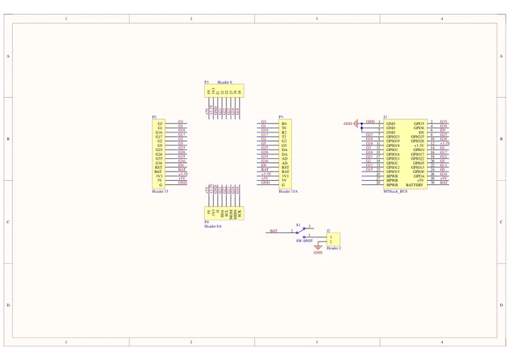
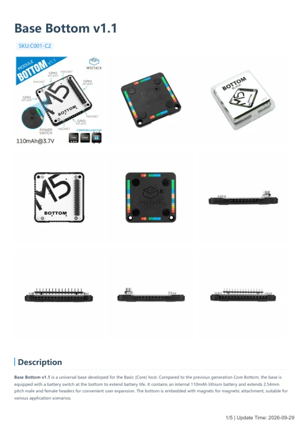

# Base Bottom v1.1

**M5Stack** · Source collection

Revision: Unverified source identity

Coverage: Manufacturer references available; physical pinout and complete connector review are tracked separately

[Browse all manufacturers](../../../../BROWSE.md) · [Devices & IoT](../../../../DEVICES.md) · [Open in the browser guide](https://valleytech-black-wire-guide.pages.dev/?board=source-board-05fc81318ac639cb54)

## Datasheets and original documentation

Board datasheet: **not yet recorded**. Visual reference: **available**.

[Manufacturer model documentation](https://docs.m5stack.com/en/base/BLACK-BOTTOM_V1.1)

- **schematic / board**: [Base Bottom v1.1 Schematics PDF — schematic](https://m5stack-doc.oss-cn-shenzhen.aliyuncs.com/530/Sch_BOTTOM_v1.1.pdf) · [saved document](../../../../library/media/bde7eef0b118e2ec166f0d2c8f5c33e321fdd233e9445d5d97e3b72fc88ed39a.pdf)
- **hardware-guide / board**: [Base Bottom v1.1 — manufacturer hardware guide](https://m5stack.oss-cn-shenzhen.aliyuncs.com/resource/docs/static/pdf/static/en/base/Base_Bottom_v1.1.pdf) · [saved document](../../../../library/media/7bc264cecdd25f33b78d0e61bd04fe03ff6ee7d86ffe46fd2a2aff8555a32648.pdf)

A chip datasheet, schematic and board datasheet have different scopes. Match the exact hardware revision.

[Documentation coverage and remaining gaps](../../../../DOCUMENTATION.md)

## Dimensions

**source reference** · Unreviewed source · JPG

[Open original reference](../../../../library/media/b7dba99e8d3cfc31842bf4693ed10747e56abae9ba5318bb58e61940e3a025f9.jpg)

**Credit and rights:** Source rights not yet established. Source/manufacturer: M5Stack.

[Source 1](https://static-cdn.m5stack.com/resource/docs/products/module/BLACK-BOTTOM_V1.1/img-2764b984-8228-4cf3-9121-1f7f322a27ac.jpg) · [Source 2](https://docs.m5stack.com/en/base/BLACK-BOTTOM_V1.1)

Original source index: Dimensions. This file is searchable but has not been promoted to a reviewed physical board pinout.

Image revision: Not identified

SHA-256: `b7dba99e8d3cfc31842bf4693ed10747e56abae9ba5318bb58e61940e3a025f9`

## Base Bottom v1.1 Schematics PDF — schematic

**reference PDF** · Source model/link and PDF signature/title checked; individual pin assignments and electrical validation pending · PDF

[Open original reference](../../../../library/media/bde7eef0b118e2ec166f0d2c8f5c33e321fdd233e9445d5d97e3b72fc88ed39a.pdf)

**Credit and rights:** Original publisher/manufacturer artwork; redistribution and print rights not established. Attribution is not a license grant.. Source/manufacturer: M5Stack.

[Source 1](https://m5stack-doc.oss-cn-shenzhen.aliyuncs.com/530/Sch_BOTTOM_v1.1.pdf) · [Source 2](https://docs.m5stack.com/en/base/BLACK-BOTTOM_V1.1)

Original document linked from this model’s manufacturer page. Preserve the document’s exact revision and named subassembly scope; a linked accessory schematic is not a whole-device pinout. This is a circuit schematic, not a physical board pinout.

Image revision: Use the revision printed in the original document; do not assume all hardware revisions are interchangeable

SHA-256: `bde7eef0b118e2ec166f0d2c8f5c33e321fdd233e9445d5d97e3b72fc88ed39a`

## Base Bottom v1.1 — manufacturer hardware guide

**reference PDF** · Source model/link and PDF signature/title checked; individual pin assignments and electrical validation pending · PDF

[Open original reference](../../../../library/media/7bc264cecdd25f33b78d0e61bd04fe03ff6ee7d86ffe46fd2a2aff8555a32648.pdf)

**Credit and rights:** Original publisher/manufacturer artwork; redistribution and print rights not established. Attribution is not a license grant.. Source/manufacturer: M5Stack.

[Source 1](https://m5stack.oss-cn-shenzhen.aliyuncs.com/resource/docs/static/pdf/static/en/base/Base_Bottom_v1.1.pdf) · [Source 2](https://docs.m5stack.com/en/base/BLACK-BOTTOM_V1.1)

Original document linked from this model’s manufacturer page. Preserve the document’s exact revision and named subassembly scope; a linked accessory schematic is not a whole-device pinout. This is a hardware manual, not a separately classified board datasheet.

Image revision: Use the revision printed in the original document; do not assume all hardware revisions are interchangeable

SHA-256: `7bc264cecdd25f33b78d0e61bd04fe03ff6ee7d86ffe46fd2a2aff8555a32648`

Pin assignments have not been independently electrically verified. Check board revision before wiring.
