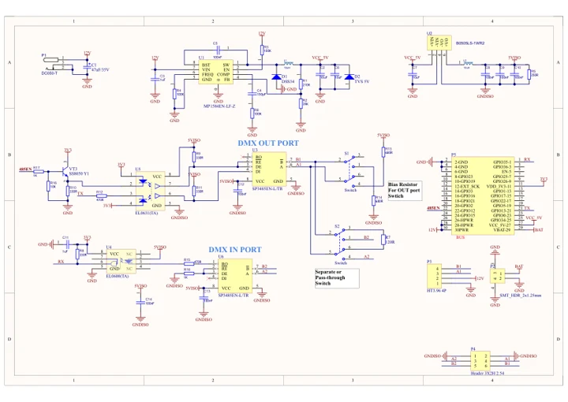
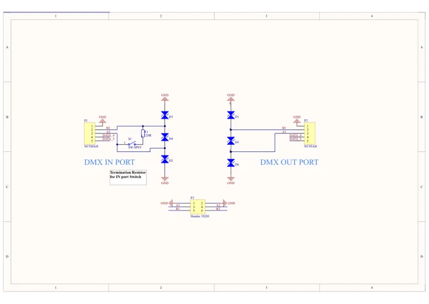
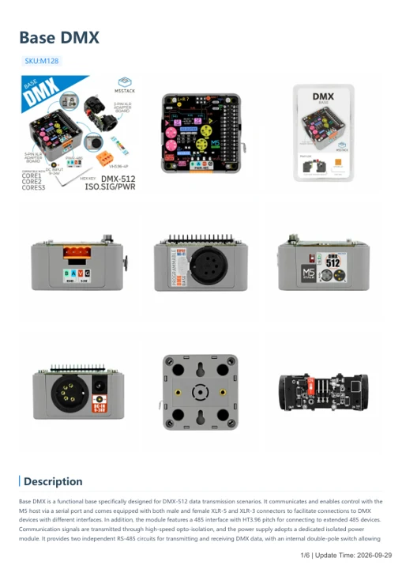

# Base DMX

**M5Stack** · Source collection

Revision: Unverified source identity

Coverage: Manufacturer references available; physical pinout and complete connector review are tracked separately

[Browse all manufacturers](../../../../BROWSE.md) · [Devices & IoT](../../../../DEVICES.md) · [Open in the browser guide](https://valleytech-black-wire-guide.pages.dev/?board=source-board-e3736b3da12836828d)

## Datasheets and original documentation

Board datasheet: **not yet recorded**. Visual reference: **available**.

[Manufacturer model documentation](https://docs.m5stack.com/en/base/DMX_Base)

- **schematic / board**: [Base DMX Schematics PDF — schematic](https://m5stack-doc.oss-cn-shenzhen.aliyuncs.com/555/SCH_DMX_Base_V1.0.pdf) · [saved document](../../../../library/media/3acb83d0b70fba16dadcd4c854cbeccd207550273db0a1bab31158ab32251ecc.pdf)
- **schematic / board**: [Base DMX Sub Schematics PDF — schematic](https://m5stack-doc.oss-cn-shenzhen.aliyuncs.com/555/Sch_DMX-sub_V1.0.pdf) · [saved document](../../../../library/media/1db620830fd4a9bfb3128358f49196ae886008a8d7fc1deedc3761c855204aba.pdf)
- **hardware-guide / board**: [Base DMX — manufacturer hardware guide](https://m5stack.oss-cn-shenzhen.aliyuncs.com/resource/docs/static/pdf/static/en/base/Base_DMX.pdf) · [saved document](../../../../library/media/a2c196bfc073fc902c0dfa1572f916ae6da6b1000b832464fbfa94bddc34990c.pdf)

A chip datasheet, schematic and board datasheet have different scopes. Match the exact hardware revision.

[Documentation coverage and remaining gaps](../../../../DOCUMENTATION.md)

## Dimensions

**source reference** · Unreviewed source · PNG

[Open original reference](../../../../library/media/97b495be41d98d56c9a6333ab0a9938498d767a10521182ba90ea4208b989253.png)

**Credit and rights:** Source rights not yet established. Source/manufacturer: M5Stack.

[Source 1](https://m5stack-doc.oss-cn-shenzhen.aliyuncs.com/1017/M128-BASE-DMX_page_01.png) · [Source 2](https://docs.m5stack.com/en/base/DMX_Base)

Original source index: Dimensions. This file is searchable but has not been promoted to a reviewed physical board pinout.

Image revision: Not identified

SHA-256: `97b495be41d98d56c9a6333ab0a9938498d767a10521182ba90ea4208b989253`

## Base DMX Schematics PDF — schematic

**reference PDF** · Source model/link and PDF signature/title checked; individual pin assignments and electrical validation pending · PDF

[Open original reference](../../../../library/media/3acb83d0b70fba16dadcd4c854cbeccd207550273db0a1bab31158ab32251ecc.pdf)

**Credit and rights:** Original publisher/manufacturer artwork; redistribution and print rights not established. Attribution is not a license grant.. Source/manufacturer: M5Stack.

[Source 1](https://m5stack-doc.oss-cn-shenzhen.aliyuncs.com/555/SCH_DMX_Base_V1.0.pdf) · [Source 2](https://docs.m5stack.com/en/base/DMX_Base)

Original document linked from this model’s manufacturer page. Preserve the document’s exact revision and named subassembly scope; a linked accessory schematic is not a whole-device pinout. This is a circuit schematic, not a physical board pinout.

Image revision: Use the revision printed in the original document; do not assume all hardware revisions are interchangeable

SHA-256: `3acb83d0b70fba16dadcd4c854cbeccd207550273db0a1bab31158ab32251ecc`

## Base DMX Sub Schematics PDF — schematic

**reference PDF** · Source model/link and PDF signature/title checked; individual pin assignments and electrical validation pending · PDF

[Open original reference](../../../../library/media/1db620830fd4a9bfb3128358f49196ae886008a8d7fc1deedc3761c855204aba.pdf)

**Credit and rights:** Original publisher/manufacturer artwork; redistribution and print rights not established. Attribution is not a license grant.. Source/manufacturer: M5Stack.

[Source 1](https://m5stack-doc.oss-cn-shenzhen.aliyuncs.com/555/Sch_DMX-sub_V1.0.pdf) · [Source 2](https://docs.m5stack.com/en/base/DMX_Base)

Original document linked from this model’s manufacturer page. Preserve the document’s exact revision and named subassembly scope; a linked accessory schematic is not a whole-device pinout. This is a circuit schematic, not a physical board pinout.

Image revision: Use the revision printed in the original document; do not assume all hardware revisions are interchangeable

SHA-256: `1db620830fd4a9bfb3128358f49196ae886008a8d7fc1deedc3761c855204aba`

## Base DMX — manufacturer hardware guide

**reference PDF** · Source model/link and PDF signature/title checked; individual pin assignments and electrical validation pending · PDF

[Open original reference](../../../../library/media/a2c196bfc073fc902c0dfa1572f916ae6da6b1000b832464fbfa94bddc34990c.pdf)

**Credit and rights:** Original publisher/manufacturer artwork; redistribution and print rights not established. Attribution is not a license grant.. Source/manufacturer: M5Stack.

[Source 1](https://m5stack.oss-cn-shenzhen.aliyuncs.com/resource/docs/static/pdf/static/en/base/Base_DMX.pdf) · [Source 2](https://docs.m5stack.com/en/base/DMX_Base)

Original document linked from this model’s manufacturer page. Preserve the document’s exact revision and named subassembly scope; a linked accessory schematic is not a whole-device pinout. This is a hardware manual, not a separately classified board datasheet.

Image revision: Use the revision printed in the original document; do not assume all hardware revisions are interchangeable

SHA-256: `a2c196bfc073fc902c0dfa1572f916ae6da6b1000b832464fbfa94bddc34990c`

Pin assignments have not been independently electrically verified. Check board revision before wiring.
