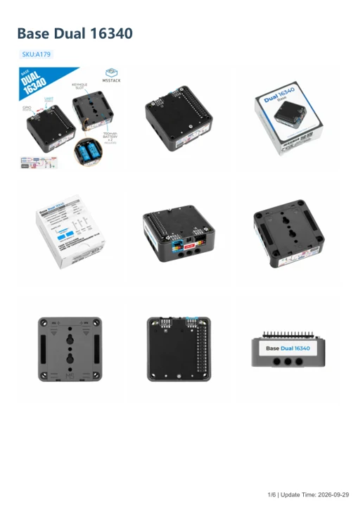

# Base Dual 16340

**M5Stack** · Source collection

Revision: Unverified source identity

Coverage: Manufacturer references available; physical pinout and complete connector review are tracked separately

[Browse all manufacturers](../../../../BROWSE.md) · [Devices & IoT](../../../../DEVICES.md) · [Open in the browser guide](https://valleytech-black-wire-guide.pages.dev/?board=source-board-b06551639f7a523f9f)

## Datasheets and original documentation

Board datasheet: **not yet recorded**. Visual reference: **available**.

[Manufacturer model documentation](https://docs.m5stack.com/en/base/Base_Dual_16340)

- **schematic / board**: [Base Dual 16340 Schematic PDF](https://m5stack-doc.oss-cn-shenzhen.aliyuncs.com/1251/SCH_Base_Dual_16340_v0.2_2025_11_17_11_56_09.pdf) · [saved document](../../../../library/media/664890a509ac3303383cd074bace46a8637fbdef270a3f06b7564ae5f48c1354.pdf)
- **hardware-guide / board**: [Manufacturer pin and hardware documentation](https://docs.m5stack.com/en/base/Base_Dual_16340) · online
- **hardware-guide / board**: [Base Dual 16340 — manufacturer hardware guide](https://m5stack.oss-cn-shenzhen.aliyuncs.com/resource/docs/static/pdf/static/en/base/Base_Dual_16340.pdf) · [saved document](../../../../library/media/fd542e271c73538a92c01e20f265436db01a9e6d46ba5e23e6a34a2008f4700a.pdf)

A chip datasheet, schematic and board datasheet have different scopes. Match the exact hardware revision.

[Documentation coverage and remaining gaps](../../../../DOCUMENTATION.md)

## Dimensions

**source reference** · Unreviewed source · PNG

[Open original reference](../../../../library/media/23a9a0a6c07790dd859f7a3f1eebf5a53364fb2406b875f4b29b4e7538ac1d41.png)

**Credit and rights:** Source rights not yet established. Source/manufacturer: M5Stack.

[Source 1](https://m5stack-doc.oss-cn-shenzhen.aliyuncs.com/1251/A179_Base_Dual_16340_model_size_page_01.png) · [Source 2](https://docs.m5stack.com/en/base/Base_Dual_16340)

Original source index: Dimensions. This file is searchable but has not been promoted to a reviewed physical board pinout.

Image revision: Not identified

SHA-256: `23a9a0a6c07790dd859f7a3f1eebf5a53364fb2406b875f4b29b4e7538ac1d41`

## Base Dual 16340 Schematic PDF

**original reference PDF** · Manufacturer source and first-page preview inspected; electrical correctness and all-connector completeness not independently approved. · PDF

[Open original reference](../../../../library/media/664890a509ac3303383cd074bace46a8637fbdef270a3f06b7564ae5f48c1354.pdf)

**Credit and rights:** Manufacturer artwork; reuse and print rights not established. Inclusion does not relicense the original.. Source/manufacturer: M5Stack.

[Source 1](https://m5stack-doc.oss-cn-shenzhen.aliyuncs.com/1251/SCH_Base_Dual_16340_v0.2_2025_11_17_11_56_09.pdf) · [Source 2](https://docs.m5stack.com/en/base/Base_Dual_16340)

Manufacturer source retained unchanged. Manufacturer source and first-page preview inspected; electrical correctness and all-connector completeness not independently approved.

Image revision: As supplied in the original; match exact board revision

SHA-256: `664890a509ac3303383cd074bace46a8637fbdef270a3f06b7564ae5f48c1354`

## Base Dual 16340 — manufacturer hardware guide

**reference PDF** · Source model/link and PDF signature/title checked; individual pin assignments and electrical validation pending · PDF

[Open original reference](../../../../library/media/fd542e271c73538a92c01e20f265436db01a9e6d46ba5e23e6a34a2008f4700a.pdf)

**Credit and rights:** Original publisher/manufacturer artwork; redistribution and print rights not established. Attribution is not a license grant.. Source/manufacturer: M5Stack.

[Source 1](https://m5stack.oss-cn-shenzhen.aliyuncs.com/resource/docs/static/pdf/static/en/base/Base_Dual_16340.pdf) · [Source 2](https://docs.m5stack.com/en/base/Base_Dual_16340)

Original document linked from this model’s manufacturer page. Preserve the document’s exact revision and named subassembly scope; a linked accessory schematic is not a whole-device pinout. This is a hardware manual, not a separately classified board datasheet.

Image revision: Use the revision printed in the original document; do not assume all hardware revisions are interchangeable

SHA-256: `fd542e271c73538a92c01e20f265436db01a9e6d46ba5e23e6a34a2008f4700a`

Pin assignments have not been independently electrically verified. Check board revision before wiring.
