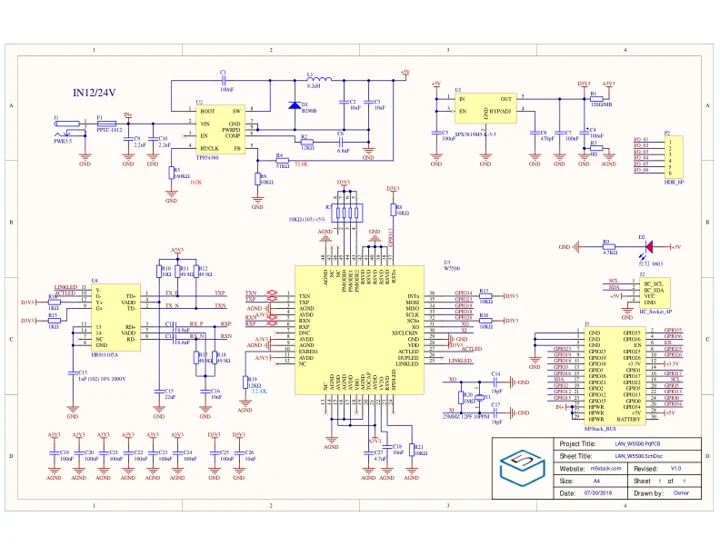
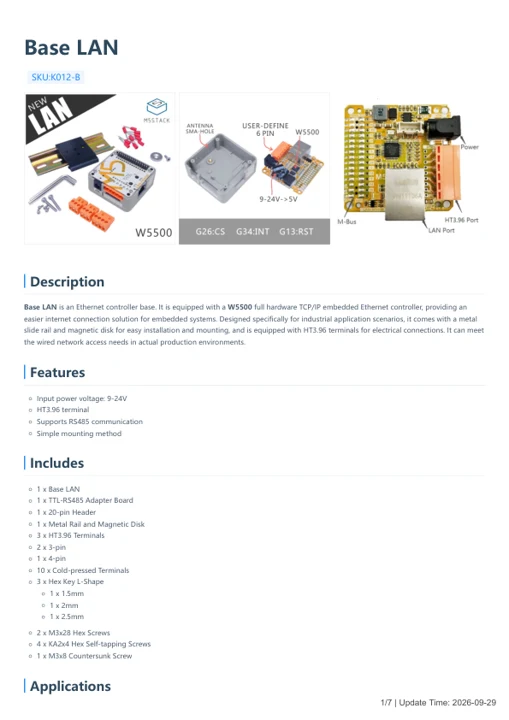

# Base LAN

**M5Stack** · Source collection

Revision: Unverified source identity

Coverage: Manufacturer references available; physical pinout and complete connector review are tracked separately

[Browse all manufacturers](../../../../BROWSE.md) · [Devices & IoT](../../../../DEVICES.md) · [Open in the browser guide](https://valleytech-black-wire-guide.pages.dev/?board=source-board-1765fafdbeffdee8ac)

## Datasheets and original documentation

Board datasheet: **not yet recorded**. Visual reference: **available**.

[Manufacturer model documentation](https://docs.m5stack.com/en/base/lan_base)

- **schematic / board**: [Base LAN Schematics PDF — schematic](https://m5stack.oss-cn-shenzhen.aliyuncs.com/resource/docs/schematic/Bases/lan_base.pdf) · [saved document](../../../../library/media/5d7a7a40af248fcc123f90c97a82512f99bdb6cbb23ff9585d48242c5a2cfacc.pdf)
- **hardware-guide / board**: [Base LAN — manufacturer hardware guide](https://m5stack.oss-cn-shenzhen.aliyuncs.com/resource/docs/static/pdf/static/en/base/Base_LAN.pdf) · [saved document](../../../../library/media/8aa84a4fb58e4ed35636c01568b1f8c0eb8e28db2197c5981cf9db33536a7d10.pdf)

A chip datasheet, schematic and board datasheet have different scopes. Match the exact hardware revision.

[Documentation coverage and remaining gaps](../../../../DOCUMENTATION.md)

## Dimensions

**source reference** · Unreviewed source · PNG

[Open original reference](../../../../library/media/d57606956e436d98026bfaf64b53796a184da14240ff4f441c7a3cffb119fd9c.png)

**Credit and rights:** Source rights not yet established. Source/manufacturer: M5Stack.

[Source 1](https://m5stack-doc.oss-cn-shenzhen.aliyuncs.com/996/K012-C-K012-B-BASE-LAN_page_01.png) · [Source 2](https://docs.m5stack.com/en/base/lan_base)

Original source index: Dimensions. This file is searchable but has not been promoted to a reviewed physical board pinout.

Image revision: Not identified

SHA-256: `d57606956e436d98026bfaf64b53796a184da14240ff4f441c7a3cffb119fd9c`

## Base LAN Schematics PDF — schematic

**reference PDF** · Source model/link and PDF signature/title checked; individual pin assignments and electrical validation pending · PDF

[Open original reference](../../../../library/media/5d7a7a40af248fcc123f90c97a82512f99bdb6cbb23ff9585d48242c5a2cfacc.pdf)

**Credit and rights:** Original publisher/manufacturer artwork; redistribution and print rights not established. Attribution is not a license grant.. Source/manufacturer: M5Stack.

[Source 1](https://m5stack.oss-cn-shenzhen.aliyuncs.com/resource/docs/schematic/Bases/lan_base.pdf) · [Source 2](https://docs.m5stack.com/en/base/lan_base)

Original document linked from this model’s manufacturer page. Preserve the document’s exact revision and named subassembly scope; a linked accessory schematic is not a whole-device pinout. This is a circuit schematic, not a physical board pinout.

Image revision: Use the revision printed in the original document; do not assume all hardware revisions are interchangeable

SHA-256: `5d7a7a40af248fcc123f90c97a82512f99bdb6cbb23ff9585d48242c5a2cfacc`

## Base LAN — manufacturer hardware guide

**reference PDF** · Source model/link and PDF signature/title checked; individual pin assignments and electrical validation pending · PDF

[Open original reference](../../../../library/media/8aa84a4fb58e4ed35636c01568b1f8c0eb8e28db2197c5981cf9db33536a7d10.pdf)

**Credit and rights:** Original publisher/manufacturer artwork; redistribution and print rights not established. Attribution is not a license grant.. Source/manufacturer: M5Stack.

[Source 1](https://m5stack.oss-cn-shenzhen.aliyuncs.com/resource/docs/static/pdf/static/en/base/Base_LAN.pdf) · [Source 2](https://docs.m5stack.com/en/base/lan_base)

Original document linked from this model’s manufacturer page. Preserve the document’s exact revision and named subassembly scope; a linked accessory schematic is not a whole-device pinout. This is a hardware manual, not a separately classified board datasheet.

Image revision: Use the revision printed in the original document; do not assume all hardware revisions are interchangeable

SHA-256: `8aa84a4fb58e4ed35636c01568b1f8c0eb8e28db2197c5981cf9db33536a7d10`

Pin assignments have not been independently electrically verified. Check board revision before wiring.
