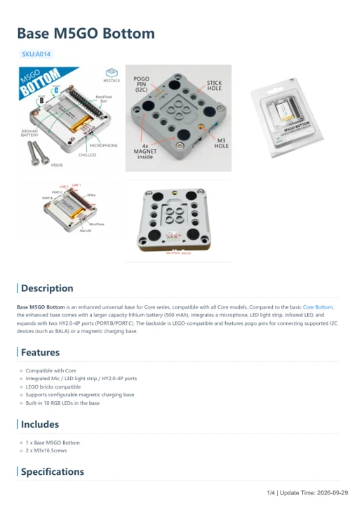
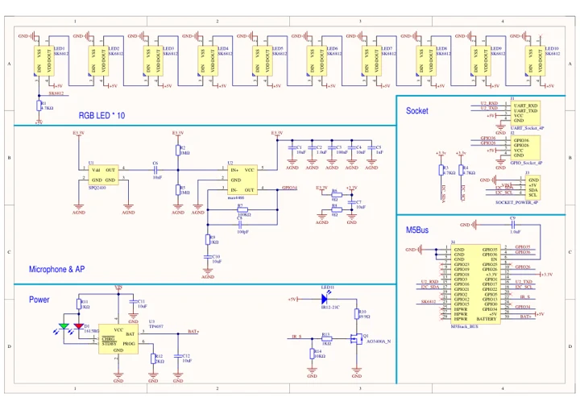

# Base M5GO Bottom

**M5Stack** · Source collection

Revision: Unverified source identity

Coverage: Manufacturer references available; physical pinout and complete connector review are tracked separately

[Browse all manufacturers](../../../../BROWSE.md) · [Devices & IoT](../../../../DEVICES.md) · [Open in the browser guide](https://valleytech-black-wire-guide.pages.dev/?board=source-board-8db6b3a7d82af5e109)

## Datasheets and original documentation

Board datasheet: **not yet recorded**. Visual reference: **available**.

[Manufacturer model documentation](https://docs.m5stack.com/en/base/m5go_bottom)

- **hardware-guide / board**: [Base M5GO Bottom — manufacturer hardware guide](https://m5stack.oss-cn-shenzhen.aliyuncs.com/resource/docs/static/pdf/static/en/base/Base_M5GO_Bottom.pdf) · [saved document](../../../../library/media/d400e16db5cb6b6d26a503429fdbda6a9746cb91389728db0380a5b15f6a503d.pdf)
- **schematic / board**: [Base M5GO Bottom Schematics PDF — schematic](https://m5stack-doc.oss-cn-shenzhen.aliyuncs.com/1006/A014_Sch_M5GO.pdf) · [saved document](../../../../library/media/9cec0cb8913cda3220218626895e5a587e2ba55a8d16be14b17a597f72e42908.pdf)

A chip datasheet, schematic and board datasheet have different scopes. Match the exact hardware revision.

[Documentation coverage and remaining gaps](../../../../DOCUMENTATION.md)

## Dimensions

**source reference** · Unreviewed source · JPG

[Open original reference](../../../../library/media/c12431ceb5ae401eec1cfa53803fbf1e0489291e6c3eb03aa2026ead63bc64b6.jpg)

**Credit and rights:** Source rights not yet established. Source/manufacturer: M5Stack.

[Source 1](https://static-cdn.m5stack.com/resource/docs/products/module/M5GO3 Bottom/img-c2558938-5e94-482b-9c59-02df14bb3088.jpg) · [Source 2](https://docs.m5stack.com/en/base/m5go_bottom)

Original source index: Dimensions. This file is searchable but has not been promoted to a reviewed physical board pinout.

Image revision: Not identified

SHA-256: `c12431ceb5ae401eec1cfa53803fbf1e0489291e6c3eb03aa2026ead63bc64b6`

## Base M5GO Bottom — manufacturer hardware guide

**reference PDF** · Source model/link and PDF signature/title checked; individual pin assignments and electrical validation pending · PDF

[Open original reference](../../../../library/media/d400e16db5cb6b6d26a503429fdbda6a9746cb91389728db0380a5b15f6a503d.pdf)

**Credit and rights:** Original publisher/manufacturer artwork; redistribution and print rights not established. Attribution is not a license grant.. Source/manufacturer: M5Stack.

[Source 1](https://m5stack.oss-cn-shenzhen.aliyuncs.com/resource/docs/static/pdf/static/en/base/Base_M5GO_Bottom.pdf) · [Source 2](https://docs.m5stack.com/en/base/m5go_bottom)

Original document linked from this model’s manufacturer page. Preserve the document’s exact revision and named subassembly scope; a linked accessory schematic is not a whole-device pinout. This is a hardware manual, not a separately classified board datasheet.

Image revision: Use the revision printed in the original document; do not assume all hardware revisions are interchangeable

SHA-256: `d400e16db5cb6b6d26a503429fdbda6a9746cb91389728db0380a5b15f6a503d`

## Base M5GO Bottom Schematics PDF — schematic

**reference PDF** · Source model/link and PDF signature/title checked; individual pin assignments and electrical validation pending · PDF

[Open original reference](../../../../library/media/9cec0cb8913cda3220218626895e5a587e2ba55a8d16be14b17a597f72e42908.pdf)

**Credit and rights:** Original publisher/manufacturer artwork; redistribution and print rights not established. Attribution is not a license grant.. Source/manufacturer: M5Stack.

[Source 1](https://m5stack-doc.oss-cn-shenzhen.aliyuncs.com/1006/A014_Sch_M5GO.pdf) · [Source 2](https://docs.m5stack.com/en/base/m5go_bottom)

Original document linked from this model’s manufacturer page. Preserve the document’s exact revision and named subassembly scope; a linked accessory schematic is not a whole-device pinout. This is a circuit schematic, not a physical board pinout.

Image revision: Use the revision printed in the original document; do not assume all hardware revisions are interchangeable

SHA-256: `9cec0cb8913cda3220218626895e5a587e2ba55a8d16be14b17a597f72e42908`

Pin assignments have not been independently electrically verified. Check board revision before wiring.
