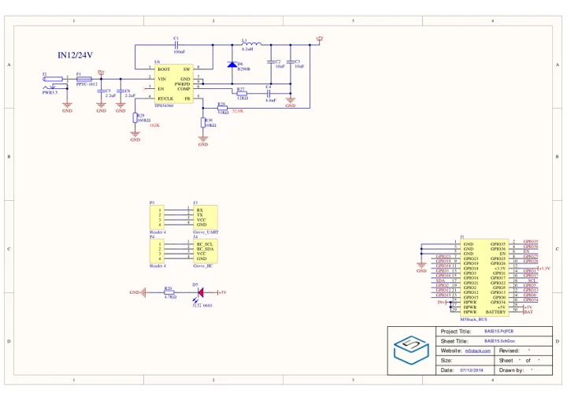
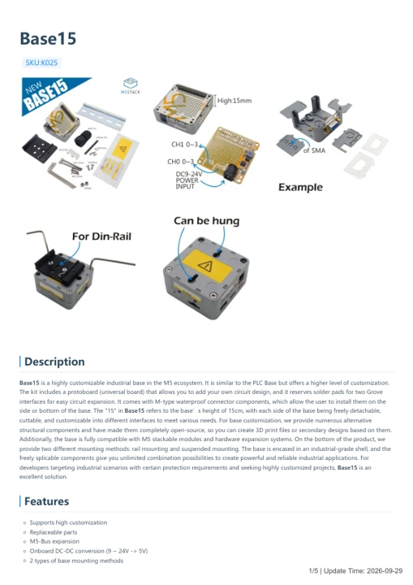

# Base15

**M5Stack** · Source collection

Revision: Unverified source identity

Coverage: Manufacturer references available; physical pinout and complete connector review are tracked separately

[Browse all manufacturers](../../../../BROWSE.md) · [Devices & IoT](../../../../DEVICES.md) · [Open in the browser guide](https://valleytech-black-wire-guide.pages.dev/?board=source-board-b3ff3fa15c5e1dc487)

## Datasheets and original documentation

Board datasheet: **not yet recorded**. Visual reference: **available**.

[Manufacturer model documentation](https://docs.m5stack.com/en/base/base15)

- **schematic / board**: [Base15 Schematics PDF — schematic](https://m5stack.oss-cn-shenzhen.aliyuncs.com/resource/docs/schematic/Bases/BASE15.pdf) · [saved document](../../../../library/media/3ce037c29f98e1c79ec8b4c8608711dff53626f130f32471cbebe9afee3300db.pdf)
- **hardware-guide / board**: [Base15 — manufacturer hardware guide](https://m5stack.oss-cn-shenzhen.aliyuncs.com/resource/docs/static/pdf/static/en/base/Base15.pdf) · [saved document](../../../../library/media/4797eaad9f136edd5c5b0b4f6d18324dddc48e4bcf484e16b9425db3695f4a9a.pdf)

A chip datasheet, schematic and board datasheet have different scopes. Match the exact hardware revision.

[Documentation coverage and remaining gaps](../../../../DOCUMENTATION.md)

## Dimensions

**source reference** · Unreviewed source · PNG

[Open original reference](../../../../library/media/cbe250bbf8d438e2a57b2cde5327c41c77b13925beb168fb77fb4a524e144e04.png)

**Credit and rights:** Source rights not yet established. Source/manufacturer: M5Stack.

[Source 1](https://m5stack-doc.oss-cn-shenzhen.aliyuncs.com/1002/K025-model-base15_page_01.png) · [Source 2](https://docs.m5stack.com/en/base/base15)

Original source index: Dimensions. This file is searchable but has not been promoted to a reviewed physical board pinout.

Image revision: Not identified

SHA-256: `cbe250bbf8d438e2a57b2cde5327c41c77b13925beb168fb77fb4a524e144e04`

## Base15 Schematics PDF — schematic

**reference PDF** · Source model/link and PDF signature/title checked; individual pin assignments and electrical validation pending · PDF

[Open original reference](../../../../library/media/3ce037c29f98e1c79ec8b4c8608711dff53626f130f32471cbebe9afee3300db.pdf)

**Credit and rights:** Original publisher/manufacturer artwork; redistribution and print rights not established. Attribution is not a license grant.. Source/manufacturer: M5Stack.

[Source 1](https://m5stack.oss-cn-shenzhen.aliyuncs.com/resource/docs/schematic/Bases/BASE15.pdf) · [Source 2](https://docs.m5stack.com/en/base/base15)

Original document linked from this model’s manufacturer page. Preserve the document’s exact revision and named subassembly scope; a linked accessory schematic is not a whole-device pinout. This is a circuit schematic, not a physical board pinout.

Image revision: Use the revision printed in the original document; do not assume all hardware revisions are interchangeable

SHA-256: `3ce037c29f98e1c79ec8b4c8608711dff53626f130f32471cbebe9afee3300db`

## Base15 — manufacturer hardware guide

**reference PDF** · Source model/link and PDF signature/title checked; individual pin assignments and electrical validation pending · PDF

[Open original reference](../../../../library/media/4797eaad9f136edd5c5b0b4f6d18324dddc48e4bcf484e16b9425db3695f4a9a.pdf)

**Credit and rights:** Original publisher/manufacturer artwork; redistribution and print rights not established. Attribution is not a license grant.. Source/manufacturer: M5Stack.

[Source 1](https://m5stack.oss-cn-shenzhen.aliyuncs.com/resource/docs/static/pdf/static/en/base/Base15.pdf) · [Source 2](https://docs.m5stack.com/en/base/base15)

Original document linked from this model’s manufacturer page. Preserve the document’s exact revision and named subassembly scope; a linked accessory schematic is not a whole-device pinout. This is a hardware manual, not a separately classified board datasheet.

Image revision: Use the revision printed in the original document; do not assume all hardware revisions are interchangeable

SHA-256: `4797eaad9f136edd5c5b0b4f6d18324dddc48e4bcf484e16b9425db3695f4a9a`

Pin assignments have not been independently electrically verified. Check board revision before wiring.
