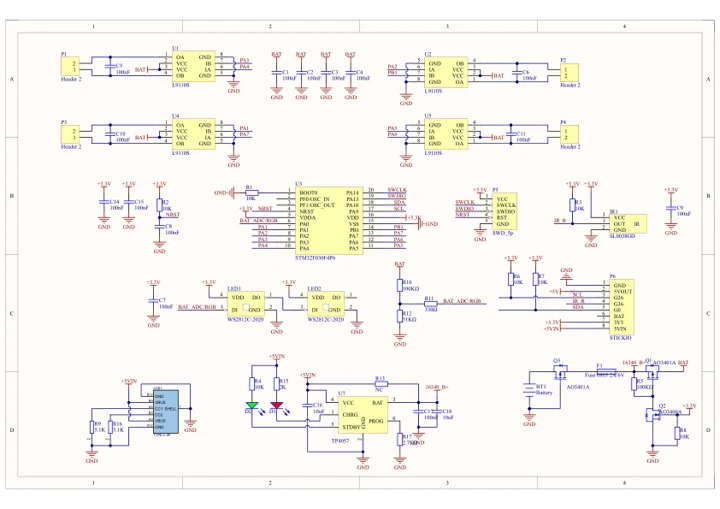
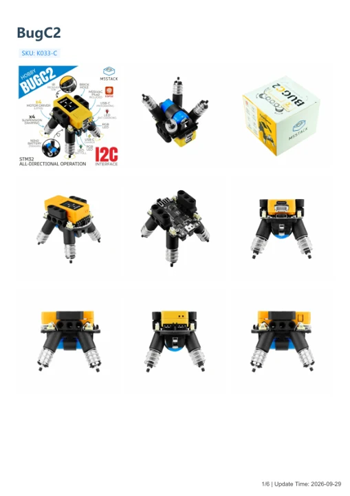

# BugC2

**M5Stack** · Source collection

Revision: Unverified source identity

Coverage: Manufacturer references available; physical pinout and complete connector review are tracked separately

[Browse all manufacturers](../../../../BROWSE.md) · [Devices & IoT](../../../../DEVICES.md) · [Open in the browser guide](https://valleytech-black-wire-guide.pages.dev/?board=source-board-226e53b100adda2b6a)

## Datasheets and original documentation

Board datasheet: **not yet recorded**. Visual reference: **available**.

[Manufacturer model documentation](https://docs.m5stack.com/en/app/BUGC2)

- **schematic / board**: [BugC2 Schematics PDF — schematic](https://m5stack-doc.oss-cn-shenzhen.aliyuncs.com/541/SCH_BugC2_V1.0.pdf) · [saved document](../../../../library/media/a69f80c54465fd31d853f291acfe2eaa82a4b186eea8e49c9c1c6826a19c04af.pdf)
- **hardware-guide / board**: [BugC2 — manufacturer hardware guide](https://m5stack.oss-cn-shenzhen.aliyuncs.com/resource/docs/static/pdf/static/en/app/BugC2.pdf) · [saved document](../../../../library/media/408021cf6e06441c01155c618effea3dc0143640447e6a009560afc047f85280.pdf)

A chip datasheet, schematic and board datasheet have different scopes. Match the exact hardware revision.

[Documentation coverage and remaining gaps](../../../../DOCUMENTATION.md)

## Dimensions

**source reference** · Unreviewed source · PNG

[Open original reference](../../../../library/media/543e1ff29a0a1aeca5c4bbd522cccbf19d3d53a00565f9cda463424c6b924a33.png)

**Credit and rights:** Source rights not yet established. Source/manufacturer: M5Stack.

[Source 1](https://m5stack-doc.oss-cn-shenzhen.aliyuncs.com/541/K033-C-bugc2_1__page_01.png) · [Source 2](https://docs.m5stack.com/en/app/BUGC2)

Original source index: Dimensions. This file is searchable but has not been promoted to a reviewed physical board pinout.

Image revision: Not identified

SHA-256: `543e1ff29a0a1aeca5c4bbd522cccbf19d3d53a00565f9cda463424c6b924a33`

## BugC2 Schematics PDF — schematic

**reference PDF** · Source model/link and PDF signature/title checked; individual pin assignments and electrical validation pending · PDF

[Open original reference](../../../../library/media/a69f80c54465fd31d853f291acfe2eaa82a4b186eea8e49c9c1c6826a19c04af.pdf)

**Credit and rights:** Original publisher/manufacturer artwork; redistribution and print rights not established. Attribution is not a license grant.. Source/manufacturer: M5Stack.

[Source 1](https://m5stack-doc.oss-cn-shenzhen.aliyuncs.com/541/SCH_BugC2_V1.0.pdf) · [Source 2](https://docs.m5stack.com/en/app/BUGC2)

Original document linked from this model’s manufacturer page. Preserve the document’s exact revision and named subassembly scope; a linked accessory schematic is not a whole-device pinout. This is a circuit schematic, not a physical board pinout.

Image revision: Use the revision printed in the original document; do not assume all hardware revisions are interchangeable

SHA-256: `a69f80c54465fd31d853f291acfe2eaa82a4b186eea8e49c9c1c6826a19c04af`

## BugC2 — manufacturer hardware guide

**reference PDF** · Source model/link and PDF signature/title checked; individual pin assignments and electrical validation pending · PDF

[Open original reference](../../../../library/media/408021cf6e06441c01155c618effea3dc0143640447e6a009560afc047f85280.pdf)

**Credit and rights:** Original publisher/manufacturer artwork; redistribution and print rights not established. Attribution is not a license grant.. Source/manufacturer: M5Stack.

[Source 1](https://m5stack.oss-cn-shenzhen.aliyuncs.com/resource/docs/static/pdf/static/en/app/BugC2.pdf) · [Source 2](https://docs.m5stack.com/en/app/BUGC2)

Original document linked from this model’s manufacturer page. Preserve the document’s exact revision and named subassembly scope; a linked accessory schematic is not a whole-device pinout. This is a hardware manual, not a separately classified board datasheet.

Image revision: Use the revision printed in the original document; do not assume all hardware revisions are interchangeable

SHA-256: `408021cf6e06441c01155c618effea3dc0143640447e6a009560afc047f85280`

Pin assignments have not been independently electrically verified. Check board revision before wiring.
