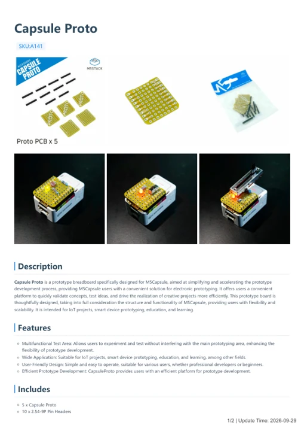

# Capsule Proto

**M5Stack** · Source collection

Revision: Unverified source identity

Coverage: Manufacturer references available; physical pinout and complete connector review are tracked separately

[Browse all manufacturers](../../../../BROWSE.md) · [Devices & IoT](../../../../DEVICES.md) · [Open in the browser guide](https://valleytech-black-wire-guide.pages.dev/?board=source-board-42bedf822aedda5aac)

Device category: **Wearables**

## Datasheets and original documentation

Board datasheet: **not yet recorded**. Visual reference: **available**.

[Manufacturer model documentation](https://docs.m5stack.com/en/accessory/Capsule-proto)

- **hardware-guide / board**: [Capsule Proto — manufacturer hardware guide](https://m5stack.oss-cn-shenzhen.aliyuncs.com/resource/docs/static/pdf/static/en/accessory/Capsule_Proto.pdf) · [saved document](../../../../library/media/23e421f424b81f3809d3f0b874a95cd3e7de1fff7d6096b5c5ce78efd1f41496.pdf)

A chip datasheet, schematic and board datasheet have different scopes. Match the exact hardware revision.

[Documentation coverage and remaining gaps](../../../../DOCUMENTATION.md)

## Dimensions

**source reference** · Unreviewed source · JPG

[Open original reference](../../../../library/media/be9b9b11008e613c9b1ad6e2eba5248d0e44fc68e51c9ad64fc3fc783d22c806.jpg)

**Credit and rights:** Source rights not yet established. Source/manufacturer: M5Stack.

[Source 1](https://static-cdn.m5stack.com/resource/docs/products/accessory/Capsule-proto/img-6b60e6bb-b5d5-414e-9ec1-ef6751648a01.jpg) · [Source 2](https://docs.m5stack.com/en/accessory/Capsule-proto)

Original source index: Dimensions. This file is searchable but has not been promoted to a reviewed physical board pinout.

Image revision: Not identified

SHA-256: `be9b9b11008e613c9b1ad6e2eba5248d0e44fc68e51c9ad64fc3fc783d22c806`

## Capsule Proto — manufacturer hardware guide

**reference PDF** · Source model/link and PDF signature/title checked; individual pin assignments and electrical validation pending · PDF

[Open original reference](../../../../library/media/23e421f424b81f3809d3f0b874a95cd3e7de1fff7d6096b5c5ce78efd1f41496.pdf)

**Credit and rights:** Original publisher/manufacturer artwork; redistribution and print rights not established. Attribution is not a license grant.. Source/manufacturer: M5Stack.

[Source 1](https://m5stack.oss-cn-shenzhen.aliyuncs.com/resource/docs/static/pdf/static/en/accessory/Capsule_Proto.pdf) · [Source 2](https://docs.m5stack.com/en/accessory/Capsule-proto)

Original document linked from this model’s manufacturer page. Preserve the document’s exact revision and named subassembly scope; a linked accessory schematic is not a whole-device pinout. This is a hardware manual, not a separately classified board datasheet.

Image revision: Use the revision printed in the original document; do not assume all hardware revisions are interchangeable

SHA-256: `23e421f424b81f3809d3f0b874a95cd3e7de1fff7d6096b5c5ce78efd1f41496`

Pin assignments have not been independently electrically verified. Check board revision before wiring.
