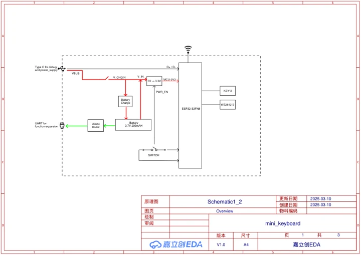
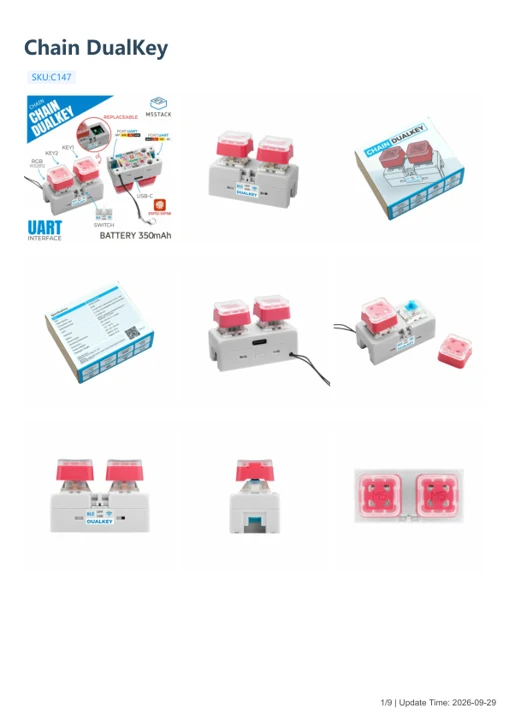

# Chain DualKey

**M5Stack** · Source collection

Revision: Unverified source identity

Coverage: Manufacturer references available; physical pinout and complete connector review are tracked separately

[Browse all manufacturers](../../../../BROWSE.md) · [Devices & IoT](../../../../DEVICES.md) · [Open in the browser guide](https://valleytech-black-wire-guide.pages.dev/?board=source-board-60579f1faed5fea3f0)

## Datasheets and original documentation

Board datasheet: **not yet recorded**. Visual reference: **available**.

[Manufacturer model documentation](https://docs.m5stack.com/en/chain/Chain_DualKey)

- **schematic / board**: [Chain DualKey Schematics PDF — schematic](https://m5stack-doc.oss-cn-shenzhen.aliyuncs.com/1176/Chain_DualKey_SCH_V1.5_20250725_2025_07_25_16_06_51.pdf) · [saved document](../../../../library/media/e405d192c70ff7b8c58674b42fb69feb893a76f5842db7b101eedff4cca755e1.pdf)
- **hardware-guide / board**: [Chain DualKey — manufacturer hardware guide](https://m5stack.oss-cn-shenzhen.aliyuncs.com/resource/docs/static/pdf/static/en/chain/Chain_DualKey.pdf) · [saved document](../../../../library/media/81cd0602974ed5afcf24c5e67b14bd882ca587485577395bb8eed7f8ee90001b.pdf)

A chip datasheet, schematic and board datasheet have different scopes. Match the exact hardware revision.

[Documentation coverage and remaining gaps](../../../../DOCUMENTATION.md)

## Dimensions

**source reference** · Unreviewed source · PNG

[Open original reference](../../../../library/media/b359ce282d91065644e5d9a4b94ff946344e7b8711a860d47d3f82143ec047ff.png)

**Credit and rights:** Source rights not yet established. Source/manufacturer: M5Stack.

[Source 1](https://m5stack-doc.oss-cn-shenzhen.aliyuncs.com/1176/C147-chain-dualkey-model-size_page_01.png) · [Source 2](https://docs.m5stack.com/en/chain/Chain_DualKey)

Original source index: Dimensions. This file is searchable but has not been promoted to a reviewed physical board pinout.

Image revision: Not identified

SHA-256: `b359ce282d91065644e5d9a4b94ff946344e7b8711a860d47d3f82143ec047ff`

## Chain DualKey Schematics PDF — schematic

**reference PDF** · Source model/link and PDF signature/title checked; individual pin assignments and electrical validation pending · PDF

[Open original reference](../../../../library/media/e405d192c70ff7b8c58674b42fb69feb893a76f5842db7b101eedff4cca755e1.pdf)

**Credit and rights:** Original publisher/manufacturer artwork; redistribution and print rights not established. Attribution is not a license grant.. Source/manufacturer: M5Stack.

[Source 1](https://m5stack-doc.oss-cn-shenzhen.aliyuncs.com/1176/Chain_DualKey_SCH_V1.5_20250725_2025_07_25_16_06_51.pdf) · [Source 2](https://docs.m5stack.com/en/chain/Chain_DualKey)

Original document linked from this model’s manufacturer page. Preserve the document’s exact revision and named subassembly scope; a linked accessory schematic is not a whole-device pinout. This is a circuit schematic, not a physical board pinout.

Image revision: Use the revision printed in the original document; do not assume all hardware revisions are interchangeable

SHA-256: `e405d192c70ff7b8c58674b42fb69feb893a76f5842db7b101eedff4cca755e1`

## Chain DualKey — manufacturer hardware guide

**reference PDF** · Source model/link and PDF signature/title checked; individual pin assignments and electrical validation pending · PDF

[Open original reference](../../../../library/media/81cd0602974ed5afcf24c5e67b14bd882ca587485577395bb8eed7f8ee90001b.pdf)

**Credit and rights:** Original publisher/manufacturer artwork; redistribution and print rights not established. Attribution is not a license grant.. Source/manufacturer: M5Stack.

[Source 1](https://m5stack.oss-cn-shenzhen.aliyuncs.com/resource/docs/static/pdf/static/en/chain/Chain_DualKey.pdf) · [Source 2](https://docs.m5stack.com/en/chain/Chain_DualKey)

Original document linked from this model’s manufacturer page. Preserve the document’s exact revision and named subassembly scope; a linked accessory schematic is not a whole-device pinout. This is a hardware manual, not a separately classified board datasheet.

Image revision: Use the revision printed in the original document; do not assume all hardware revisions are interchangeable

SHA-256: `81cd0602974ed5afcf24c5e67b14bd882ca587485577395bb8eed7f8ee90001b`

Pin assignments have not been independently electrically verified. Check board revision before wiring.
