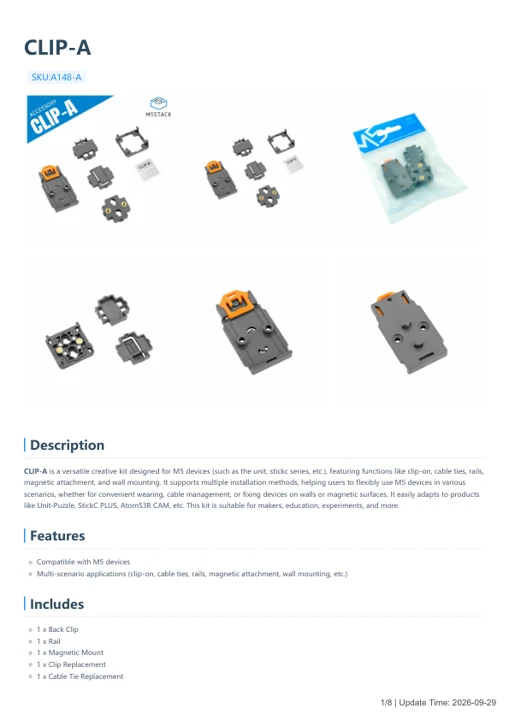

# CLIP-A

**M5Stack** · Source collection

Revision: Unverified source identity

Coverage: Manufacturer references available; physical pinout and complete connector review are tracked separately

[Browse all manufacturers](../../../../BROWSE.md) · [Devices & IoT](../../../../DEVICES.md) · [Open in the browser guide](https://valleytech-black-wire-guide.pages.dev/?board=source-board-60237e7bb4061c03d2)

## Datasheets and original documentation

Board datasheet: **not yet recorded**. Visual reference: **available**.

[Manufacturer model documentation](https://docs.m5stack.com/en/accessory/CLIP-A)

- **hardware-guide / board**: [CLIP-A — manufacturer hardware guide](https://m5stack.oss-cn-shenzhen.aliyuncs.com/resource/docs/static/pdf/static/en/accessory/CLIP-A.pdf) · [saved document](../../../../library/media/e6a80c20f998ac0be1b4d36e8b67625f74d577135ac99f47c00381dd29acf96a.pdf)

A chip datasheet, schematic and board datasheet have different scopes. Match the exact hardware revision.

[Documentation coverage and remaining gaps](../../../../DOCUMENTATION.md)

## Dimensions

**source reference** · Unreviewed source · PNG

[Open original reference](../../../../library/media/bc137a766a1af04c54c96cfa695456a0877c59355be1ec53c97084087875c5c2.png)

**Credit and rights:** Source rights not yet established. Source/manufacturer: M5Stack.

[Source 1](https://m5stack.oss-cn-shenzhen.aliyuncs.com/resource/docs/products/accessory/CLIP-A/Module%20Size2.png) · [Source 2](https://docs.m5stack.com/en/accessory/CLIP-A)

Original source index: Dimensions. This file is searchable but has not been promoted to a reviewed physical board pinout.

Image revision: Not identified

SHA-256: `bc137a766a1af04c54c96cfa695456a0877c59355be1ec53c97084087875c5c2`

## Dimensions

**source reference** · Unreviewed source · PNG

[Open original reference](../../../../library/media/2049c5da38b1478ad765784bfb9cd09abdc9ea618ae92746b2870607fda7fef7.png)

**Credit and rights:** Source rights not yet established. Source/manufacturer: M5Stack.

[Source 1](https://m5stack.oss-cn-shenzhen.aliyuncs.com/resource/docs/products/accessory/CLIP-A/Module%20Size3.png) · [Source 2](https://docs.m5stack.com/en/accessory/CLIP-A)

Original source index: Dimensions. This file is searchable but has not been promoted to a reviewed physical board pinout.

Image revision: Not identified

SHA-256: `2049c5da38b1478ad765784bfb9cd09abdc9ea618ae92746b2870607fda7fef7`

## Dimensions

**source reference** · Unreviewed source · PNG

[Open original reference](../../../../library/media/e1fc7af8423eb01703b49bf9622d8110d7a9a78e64e8908dbefaaa4ef2722bde.png)

**Credit and rights:** Source rights not yet established. Source/manufacturer: M5Stack.

[Source 1](https://m5stack.oss-cn-shenzhen.aliyuncs.com/resource/docs/products/accessory/CLIP-A/Module%20Size7.png) · [Source 2](https://docs.m5stack.com/en/accessory/CLIP-A)

Original source index: Dimensions. This file is searchable but has not been promoted to a reviewed physical board pinout.

Image revision: Not identified

SHA-256: `e1fc7af8423eb01703b49bf9622d8110d7a9a78e64e8908dbefaaa4ef2722bde`

## Dimensions

**source reference** · Unreviewed source · PNG

[Open original reference](../../../../library/media/ffbbe460370c47a23627c0745d2fb1748f812b6ed54bf65ddd510a50b4e57e2b.png)

**Credit and rights:** Source rights not yet established. Source/manufacturer: M5Stack.

[Source 1](https://m5stack.oss-cn-shenzhen.aliyuncs.com/resource/docs/products/accessory/CLIP-A/Module%20Size1.png) · [Source 2](https://docs.m5stack.com/en/accessory/CLIP-A)

Original source index: Dimensions. This file is searchable but has not been promoted to a reviewed physical board pinout.

Image revision: Not identified

SHA-256: `ffbbe460370c47a23627c0745d2fb1748f812b6ed54bf65ddd510a50b4e57e2b`

## CLIP-A — manufacturer hardware guide

**reference PDF** · Source model/link and PDF signature/title checked; individual pin assignments and electrical validation pending · PDF

[Open original reference](../../../../library/media/e6a80c20f998ac0be1b4d36e8b67625f74d577135ac99f47c00381dd29acf96a.pdf)

**Credit and rights:** Original publisher/manufacturer artwork; redistribution and print rights not established. Attribution is not a license grant.. Source/manufacturer: M5Stack.

[Source 1](https://m5stack.oss-cn-shenzhen.aliyuncs.com/resource/docs/static/pdf/static/en/accessory/CLIP-A.pdf) · [Source 2](https://docs.m5stack.com/en/accessory/CLIP-A)

Original document linked from this model’s manufacturer page. Preserve the document’s exact revision and named subassembly scope; a linked accessory schematic is not a whole-device pinout. This is a hardware manual, not a separately classified board datasheet.

Image revision: Use the revision printed in the original document; do not assume all hardware revisions are interchangeable

SHA-256: `e6a80c20f998ac0be1b4d36e8b67625f74d577135ac99f47c00381dd29acf96a`

Pin assignments have not been independently electrically verified. Check board revision before wiring.
