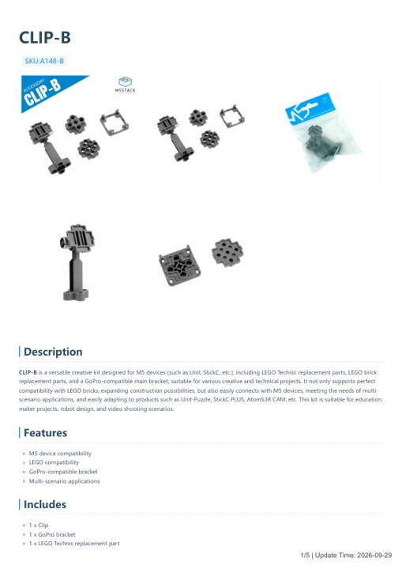

# CLIP-B

**M5Stack** · Source collection

Revision: Unverified source identity

Coverage: Manufacturer references available; physical pinout and complete connector review are tracked separately

[Browse all manufacturers](../../../../BROWSE.md) · [Devices & IoT](../../../../DEVICES.md) · [Open in the browser guide](https://valleytech-black-wire-guide.pages.dev/?board=source-board-a193e8448eda7a6fb6)

## Datasheets and original documentation

Board datasheet: **not yet recorded**. Visual reference: **available**.

[Manufacturer model documentation](https://docs.m5stack.com/en/accessory/CLIP-B)

- **hardware-guide / board**: [CLIP-B — manufacturer hardware guide](https://m5stack.oss-cn-shenzhen.aliyuncs.com/resource/docs/static/pdf/static/en/accessory/CLIP-B.pdf) · [saved document](../../../../library/media/ae77dce2e186f248c5300e7304f97336a2e4a375770a17cc6669f5f1bb35cd69.pdf)

A chip datasheet, schematic and board datasheet have different scopes. Match the exact hardware revision.

[Documentation coverage and remaining gaps](../../../../DOCUMENTATION.md)

## Dimensions

**source reference** · Unreviewed source · PNG

[Open original reference](../../../../library/media/7fae96013c1e7c1c54186867547e8cfaa0f5d8723e4531da1823015fec795747.png)

**Credit and rights:** Source rights not yet established. Source/manufacturer: M5Stack.

[Source 1](https://m5stack.oss-cn-shenzhen.aliyuncs.com/resource/docs/products/accessory/CLIP-B/Module%20Size5.png) · [Source 2](https://docs.m5stack.com/en/accessory/CLIP-B)

Original source index: Dimensions. This file is searchable but has not been promoted to a reviewed physical board pinout.

Image revision: Not identified

SHA-256: `7fae96013c1e7c1c54186867547e8cfaa0f5d8723e4531da1823015fec795747`

## Dimensions

**source reference** · Unreviewed source · PNG

[Open original reference](../../../../library/media/c96f313dccb045662a5bcd80d2e71fbb2cc4d967c54fe8c300cdb5db83bc9792.png)

**Credit and rights:** Source rights not yet established. Source/manufacturer: M5Stack.

[Source 1](https://m5stack.oss-cn-shenzhen.aliyuncs.com/resource/docs/products/accessory/CLIP-B/Module%20Size6.png) · [Source 2](https://docs.m5stack.com/en/accessory/CLIP-B)

Original source index: Dimensions. This file is searchable but has not been promoted to a reviewed physical board pinout.

Image revision: Not identified

SHA-256: `c96f313dccb045662a5bcd80d2e71fbb2cc4d967c54fe8c300cdb5db83bc9792`

## Dimensions

**source reference** · Unreviewed source · PNG

[Open original reference](../../../../library/media/3c37a1474b6dc3ec1d4bb515d5706002f788837a8ce4bdadfd93742a57f1aeb0.png)

**Credit and rights:** Source rights not yet established. Source/manufacturer: M5Stack.

[Source 1](https://m5stack.oss-cn-shenzhen.aliyuncs.com/resource/docs/products/accessory/CLIP-B/Module%20Size4.png) · [Source 2](https://docs.m5stack.com/en/accessory/CLIP-B)

Original source index: Dimensions. This file is searchable but has not been promoted to a reviewed physical board pinout.

Image revision: Not identified

SHA-256: `3c37a1474b6dc3ec1d4bb515d5706002f788837a8ce4bdadfd93742a57f1aeb0`

## CLIP-B — manufacturer hardware guide

**reference PDF** · Source model/link and PDF signature/title checked; individual pin assignments and electrical validation pending · PDF

[Open original reference](../../../../library/media/ae77dce2e186f248c5300e7304f97336a2e4a375770a17cc6669f5f1bb35cd69.pdf)

**Credit and rights:** Original publisher/manufacturer artwork; redistribution and print rights not established. Attribution is not a license grant.. Source/manufacturer: M5Stack.

[Source 1](https://m5stack.oss-cn-shenzhen.aliyuncs.com/resource/docs/static/pdf/static/en/accessory/CLIP-B.pdf) · [Source 2](https://docs.m5stack.com/en/accessory/CLIP-B)

Original document linked from this model’s manufacturer page. Preserve the document’s exact revision and named subassembly scope; a linked accessory schematic is not a whole-device pinout. This is a hardware manual, not a separately classified board datasheet.

Image revision: Use the revision printed in the original document; do not assume all hardware revisions are interchangeable

SHA-256: `ae77dce2e186f248c5300e7304f97336a2e4a375770a17cc6669f5f1bb35cd69`

Pin assignments have not been independently electrically verified. Check board revision before wiring.
