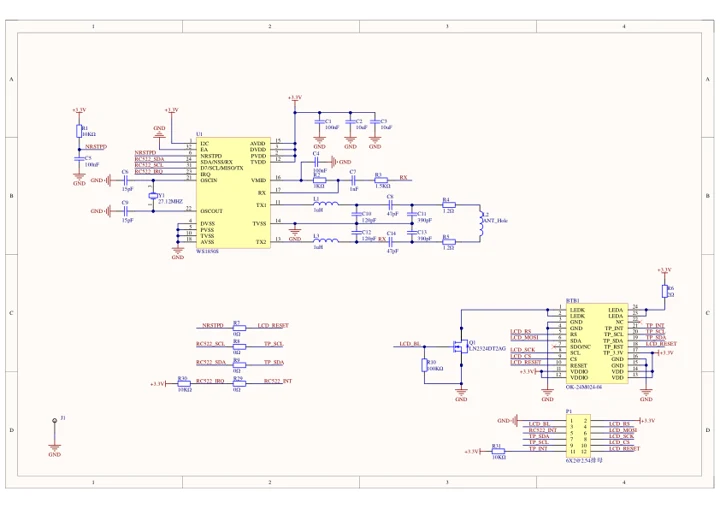
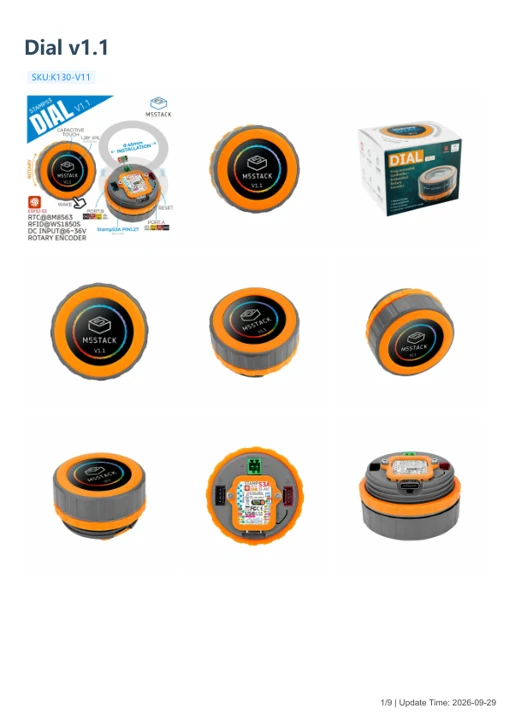

# Dial v1.1

**M5Stack** · Source collection

Revision: Unverified source identity

Coverage: Manufacturer references available; physical pinout and complete connector review are tracked separately

[Browse all manufacturers](../../../../BROWSE.md) · [Devices & IoT](../../../../DEVICES.md) · [Open in the browser guide](https://valleytech-black-wire-guide.pages.dev/?board=source-board-2e468ee183dfdf8945)

Device category: **Controllers & instruments**

## Datasheets and original documentation

Board datasheet: **not yet recorded**. Visual reference: **available**.

[Manufacturer model documentation](https://docs.m5stack.com/en/core/M5Dial%20V1.1)

- **schematic / board**: [Dial Schematics PDF — schematic](https://m5stack-doc.oss-cn-shenzhen.aliyuncs.com/499/Sch_M5Dial.pdf) · [saved document](../../../../library/media/66be81ef2255363bbac105bffb959c33daad6239a0caa6e17f68660d1f6cd99d.pdf)
- **hardware-guide / board**: [Dial v1.1 — manufacturer hardware guide](https://m5stack.oss-cn-shenzhen.aliyuncs.com/resource/docs/static/pdf/static/en/core/Dial_v1.1.pdf) · [saved document](../../../../library/media/fd632251396b25a52527e8d21bc5d1a270f5a49a3663c06f087d7a35f3482f2b.pdf)

A chip datasheet, schematic and board datasheet have different scopes. Match the exact hardware revision.

[Documentation coverage and remaining gaps](../../../../DOCUMENTATION.md)

## Dimensions

**source reference** · Unreviewed source · PNG

[Open original reference](../../../../library/media/48cb120283c1f06b557707674d76274614ceee86bb3de0d10fbb2d8b112a53c6.png)

**Credit and rights:** Source rights not yet established. Source/manufacturer: M5Stack.

[Source 1](https://static-cdn.m5stack.com/resource/docs/products/core/M5Dial/img-4739e0cc-227a-4f6b-9956-48915212e9c8.png) · [Source 2](https://docs.m5stack.com/en/core/M5Dial%20V1.1)

Original source index: Dimensions. This file is searchable but has not been promoted to a reviewed physical board pinout.

Image revision: Not identified

SHA-256: `48cb120283c1f06b557707674d76274614ceee86bb3de0d10fbb2d8b112a53c6`

## Dial Schematics PDF — schematic

**reference PDF** · Source model/link and PDF signature/title checked; individual pin assignments and electrical validation pending · PDF

[Open original reference](../../../../library/media/66be81ef2255363bbac105bffb959c33daad6239a0caa6e17f68660d1f6cd99d.pdf)

**Credit and rights:** Original publisher/manufacturer artwork; redistribution and print rights not established. Attribution is not a license grant.. Source/manufacturer: M5Stack.

[Source 1](https://m5stack-doc.oss-cn-shenzhen.aliyuncs.com/499/Sch_M5Dial.pdf) · [Source 2](https://docs.m5stack.com/en/core/M5Dial)

Original document linked from this model’s manufacturer page. Preserve the document’s exact revision and named subassembly scope; a linked accessory schematic is not a whole-device pinout. This is a circuit schematic, not a physical board pinout.

Image revision: Use the revision printed in the original document; do not assume all hardware revisions are interchangeable

SHA-256: `66be81ef2255363bbac105bffb959c33daad6239a0caa6e17f68660d1f6cd99d`

## Dial v1.1 — manufacturer hardware guide

**reference PDF** · Source model/link and PDF signature/title checked; individual pin assignments and electrical validation pending · PDF

[Open original reference](../../../../library/media/fd632251396b25a52527e8d21bc5d1a270f5a49a3663c06f087d7a35f3482f2b.pdf)

**Credit and rights:** Original publisher/manufacturer artwork; redistribution and print rights not established. Attribution is not a license grant.. Source/manufacturer: M5Stack.

[Source 1](https://m5stack.oss-cn-shenzhen.aliyuncs.com/resource/docs/static/pdf/static/en/core/Dial_v1.1.pdf) · [Source 2](https://docs.m5stack.com/en/core/M5Dial%20V1.1)

Original document linked from this model’s manufacturer page. Preserve the document’s exact revision and named subassembly scope; a linked accessory schematic is not a whole-device pinout. This is a hardware manual, not a separately classified board datasheet.

Image revision: Use the revision printed in the original document; do not assume all hardware revisions are interchangeable

SHA-256: `fd632251396b25a52527e8d21bc5d1a270f5a49a3663c06f087d7a35f3482f2b`

Pin assignments have not been independently electrically verified. Check board revision before wiring.
