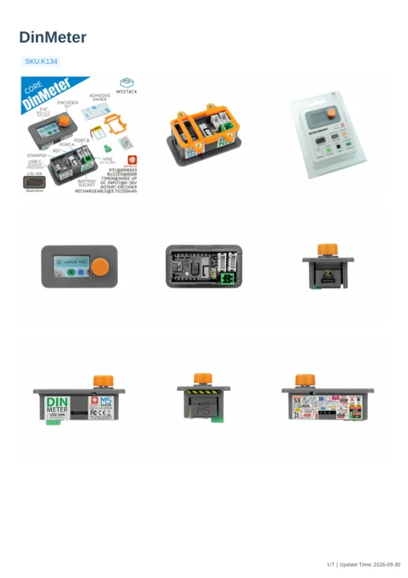

# DinMeter

**M5Stack** · Source collection

Revision: Unverified source identity

Coverage: Manufacturer references available; physical pinout and complete connector review are tracked separately

[Browse all manufacturers](../../../../BROWSE.md) · [Devices & IoT](../../../../DEVICES.md) · [Open in the browser guide](https://valleytech-black-wire-guide.pages.dev/?board=source-board-78312b711a6be4a8c3)

## Datasheets and original documentation

Board datasheet: **not yet recorded**. Visual reference: **available**.

[Manufacturer model documentation](https://docs.m5stack.com/en/core/M5DinMeter)

- **schematic / board**: [DinMeter Schematics PDF — schematic](https://m5stack-doc.oss-cn-shenzhen.aliyuncs.com/500/DIN_Meter_v1.0.pdf) · [saved document](../../../../library/media/03ec335396e4f527119f89f697fca9887505dc1b28077871b2fb361ba6e4c070.pdf)
- **hardware-guide / board**: [DinMeter — manufacturer hardware guide](https://m5stack.oss-cn-shenzhen.aliyuncs.com/resource/docs/static/pdf/static/en/core/DinMeter.pdf) · [saved document](../../../../library/media/57d9667d5be19534ef492062f6dfa2c49a89dc6222645239b79503536e3e70bf.pdf)

A chip datasheet, schematic and board datasheet have different scopes. Match the exact hardware revision.

[Documentation coverage and remaining gaps](../../../../DOCUMENTATION.md)

## Dimensions

**source reference** · Unreviewed source · PNG

[Open original reference](../../../../library/media/7b1cfa0fbbb034e8e062cb2667348b03a2032ae8dac1e7fa5294c8b52e10e0af.png)

**Credit and rights:** Source rights not yet established. Source/manufacturer: M5Stack.

[Source 1](https://m5stack-doc.oss-cn-shenzhen.aliyuncs.com/1211/K134-din_meter_asm_v1_page_01.png) · [Source 2](https://docs.m5stack.com/en/core/M5DinMeter)

Original source index: Dimensions. This file is searchable but has not been promoted to a reviewed physical board pinout.

Image revision: Not identified

SHA-256: `7b1cfa0fbbb034e8e062cb2667348b03a2032ae8dac1e7fa5294c8b52e10e0af`

## DinMeter Schematics PDF — schematic

**reference PDF** · Source model/link and PDF signature/title checked; individual pin assignments and electrical validation pending · PDF

[Open original reference](../../../../library/media/03ec335396e4f527119f89f697fca9887505dc1b28077871b2fb361ba6e4c070.pdf)

**Credit and rights:** Original publisher/manufacturer artwork; redistribution and print rights not established. Attribution is not a license grant.. Source/manufacturer: M5Stack.

[Source 1](https://m5stack-doc.oss-cn-shenzhen.aliyuncs.com/500/DIN_Meter_v1.0.pdf) · [Source 2](https://docs.m5stack.com/en/core/M5DinMeter)

Original document linked from this model’s manufacturer page. Preserve the document’s exact revision and named subassembly scope; a linked accessory schematic is not a whole-device pinout. This is a circuit schematic, not a physical board pinout.

Image revision: Use the revision printed in the original document; do not assume all hardware revisions are interchangeable

SHA-256: `03ec335396e4f527119f89f697fca9887505dc1b28077871b2fb361ba6e4c070`

## DinMeter — manufacturer hardware guide

**reference PDF** · Source model/link and PDF signature/title checked; individual pin assignments and electrical validation pending · PDF

[Open original reference](../../../../library/media/57d9667d5be19534ef492062f6dfa2c49a89dc6222645239b79503536e3e70bf.pdf)

**Credit and rights:** Original publisher/manufacturer artwork; redistribution and print rights not established. Attribution is not a license grant.. Source/manufacturer: M5Stack.

[Source 1](https://m5stack.oss-cn-shenzhen.aliyuncs.com/resource/docs/static/pdf/static/en/core/DinMeter.pdf) · [Source 2](https://docs.m5stack.com/en/core/M5DinMeter)

Original document linked from this model’s manufacturer page. Preserve the document’s exact revision and named subassembly scope; a linked accessory schematic is not a whole-device pinout. This is a hardware manual, not a separately classified board datasheet.

Image revision: Use the revision printed in the original document; do not assume all hardware revisions are interchangeable

SHA-256: `57d9667d5be19534ef492062f6dfa2c49a89dc6222645239b79503536e3e70bf`

Pin assignments have not been independently electrically verified. Check board revision before wiring.
