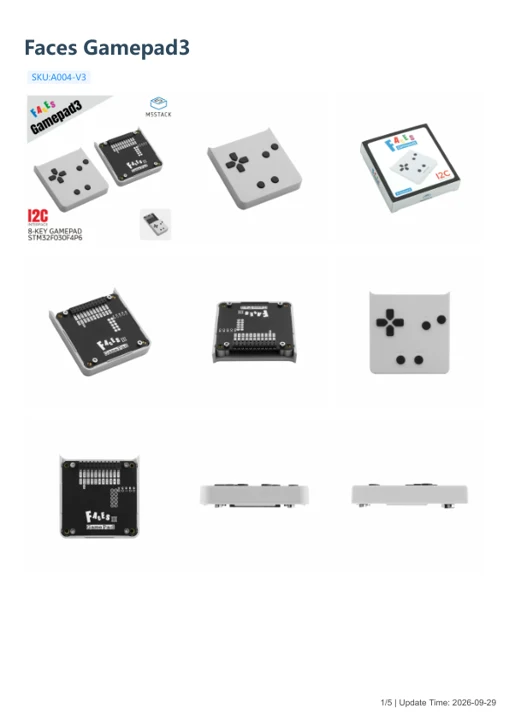

# Faces Gamepad3

**M5Stack** · Source collection

Revision: Unverified source identity

Coverage: Manufacturer references available; physical pinout and complete connector review are tracked separately

[Browse all manufacturers](../../../../BROWSE.md) · [Devices & IoT](../../../../DEVICES.md) · [Open in the browser guide](https://valleytech-black-wire-guide.pages.dev/?board=source-board-84312f51f4f10bbd1a)

## Datasheets and original documentation

Board datasheet: **not yet recorded**. Visual reference: **available**.

[Manufacturer model documentation](https://docs.m5stack.com/en/faces/Faces_Gamepad3)

- **schematic / board**: [Faces Gamepad3 Schematics PDF](https://m5stack-doc.oss-cn-shenzhen.aliyuncs.com/1271/A004-V3_Faces_Gamepad3_Sche.pdf) · [saved document](../../../../library/media/847c842586ee0d44a74bc7475c0812946f0fc2002b43cd18c1cc079af9dc06e5.pdf)
- **hardware-guide / board**: [Manufacturer pin and hardware documentation](https://docs.m5stack.com/en/faces/Faces_Gamepad3) · online
- **hardware-guide / board**: [Faces Gamepad3 — manufacturer hardware guide](https://m5stack.oss-cn-shenzhen.aliyuncs.com/resource/docs/static/pdf/static/en/faces/Faces_Gamepad3.pdf) · [saved document](../../../../library/media/d1138c8b0895e59d3d30d21358f0b1e0891f4101bbcc820d34a200eb10c5b61c.pdf)

A chip datasheet, schematic and board datasheet have different scopes. Match the exact hardware revision.

[Documentation coverage and remaining gaps](../../../../DOCUMENTATION.md)

## Dimensions

**source reference** · Unreviewed source · PNG

[Open original reference](../../../../library/media/842bef9bfe55d329b2e22c258b69c081e86417f89c6f96940d7c34bd9a88c5f5.png)

**Credit and rights:** Source rights not yet established. Source/manufacturer: M5Stack.

[Source 1](https://m5stack-doc.oss-cn-shenzhen.aliyuncs.com/1271/A004-V3_Faces_Gamepad3_model_size_page_01.png) · [Source 2](https://docs.m5stack.com/en/faces/Faces_Gamepad3)

Original source index: Dimensions. This file is searchable but has not been promoted to a reviewed physical board pinout.

Image revision: Not identified

SHA-256: `842bef9bfe55d329b2e22c258b69c081e86417f89c6f96940d7c34bd9a88c5f5`

## Faces Gamepad3 Schematics PDF

**original reference PDF** · Manufacturer source and first-page preview inspected; independent electrical and all-connector completeness review pending. · PDF

[Open original reference](../../../../library/media/847c842586ee0d44a74bc7475c0812946f0fc2002b43cd18c1cc079af9dc06e5.pdf)

**Credit and rights:** Manufacturer artwork; reuse and print rights not established. Inclusion does not relicense the original.. Source/manufacturer: M5Stack.

[Source 1](https://m5stack-doc.oss-cn-shenzhen.aliyuncs.com/1271/A004-V3_Faces_Gamepad3_Sche.pdf) · [Source 2](https://docs.m5stack.com/en/faces/Faces_Gamepad3)

Manufacturer source retained unchanged. Manufacturer source and first-page preview inspected; independent electrical and all-connector completeness review pending.

Image revision: As supplied in the original; match exact board revision

SHA-256: `847c842586ee0d44a74bc7475c0812946f0fc2002b43cd18c1cc079af9dc06e5`

## Faces Gamepad3 — manufacturer hardware guide

**reference PDF** · Source model/link and PDF signature/title checked; individual pin assignments and electrical validation pending · PDF

[Open original reference](../../../../library/media/d1138c8b0895e59d3d30d21358f0b1e0891f4101bbcc820d34a200eb10c5b61c.pdf)

**Credit and rights:** Original publisher/manufacturer artwork; redistribution and print rights not established. Attribution is not a license grant.. Source/manufacturer: M5Stack.

[Source 1](https://m5stack.oss-cn-shenzhen.aliyuncs.com/resource/docs/static/pdf/static/en/faces/Faces_Gamepad3.pdf) · [Source 2](https://docs.m5stack.com/en/faces/Faces_Gamepad3)

Original document linked from this model’s manufacturer page. Preserve the document’s exact revision and named subassembly scope; a linked accessory schematic is not a whole-device pinout. This is a hardware manual, not a separately classified board datasheet.

Image revision: Use the revision printed in the original document; do not assume all hardware revisions are interchangeable

SHA-256: `d1138c8b0895e59d3d30d21358f0b1e0891f4101bbcc820d34a200eb10c5b61c`

Pin assignments have not been independently electrically verified. Check board revision before wiring.
