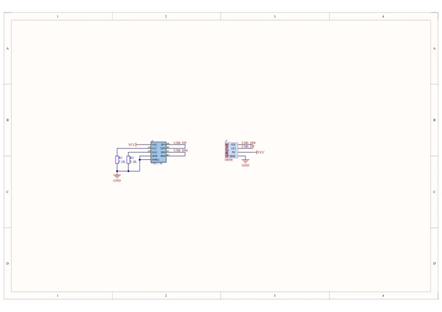
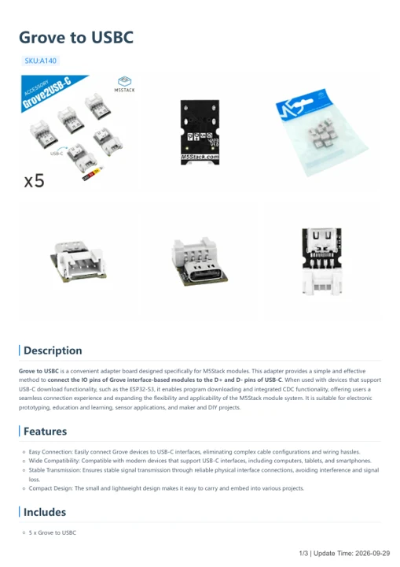

# Grove to USBC

**M5Stack** · Source collection

Revision: Unverified source identity

Coverage: Manufacturer references available; physical pinout and complete connector review are tracked separately

[Browse all manufacturers](../../../../BROWSE.md) · [Devices & IoT](../../../../DEVICES.md) · [Open in the browser guide](https://valleytech-black-wire-guide.pages.dev/?board=source-board-1a18c2638cb34d6a64)

## Datasheets and original documentation

Board datasheet: **not yet recorded**. Visual reference: **available**.

[Manufacturer model documentation](https://docs.m5stack.com/en/accessory/Grove2USB-C)

- **schematic / board**: [Grove to USBC Schematics PDF — schematic](https://m5stack-doc.oss-cn-shenzhen.aliyuncs.com/537/SCH_Grove2USB-C_V1.0.pdf) · [saved document](../../../../library/media/fcc616f6cc2a491986cfbb19041bc01a1f30121533e1e6f07d69131f8ae362a6.pdf)
- **hardware-guide / board**: [Grove to USBC — manufacturer hardware guide](https://m5stack.oss-cn-shenzhen.aliyuncs.com/resource/docs/static/pdf/static/en/accessory/Grove_to_USBC.pdf) · [saved document](../../../../library/media/869fc6fc4ca96fe09e463b97b30c6533e32d28d40e05fcc34c1a66ecfabcc39c.pdf)

A chip datasheet, schematic and board datasheet have different scopes. Match the exact hardware revision.

[Documentation coverage and remaining gaps](../../../../DOCUMENTATION.md)

## Dimensions

**source reference** · Unreviewed source · JPG

[Open original reference](../../../../library/media/ca3419df82ce723f6976979ac971e045955af898c4cd7fe2533bc8cdd35cae40.jpg)

**Credit and rights:** Source rights not yet established. Source/manufacturer: M5Stack.

[Source 1](https://static-cdn.m5stack.com/resource/docs/products/accessory/Grove2USB-C/img-03ae74c6-0243-435d-aed9-6ac1d5a93e2a.jpg) · [Source 2](https://docs.m5stack.com/en/accessory/Grove2USB-C)

Original source index: Dimensions. This file is searchable but has not been promoted to a reviewed physical board pinout.

Image revision: Not identified

SHA-256: `ca3419df82ce723f6976979ac971e045955af898c4cd7fe2533bc8cdd35cae40`

## Grove to USBC Schematics PDF — schematic

**reference PDF** · Source model/link and PDF signature/title checked; individual pin assignments and electrical validation pending · PDF

[Open original reference](../../../../library/media/fcc616f6cc2a491986cfbb19041bc01a1f30121533e1e6f07d69131f8ae362a6.pdf)

**Credit and rights:** Original publisher/manufacturer artwork; redistribution and print rights not established. Attribution is not a license grant.. Source/manufacturer: M5Stack.

[Source 1](https://m5stack-doc.oss-cn-shenzhen.aliyuncs.com/537/SCH_Grove2USB-C_V1.0.pdf) · [Source 2](https://docs.m5stack.com/en/accessory/Grove2USB-C)

Original document linked from this model’s manufacturer page. Preserve the document’s exact revision and named subassembly scope; a linked accessory schematic is not a whole-device pinout. This is a circuit schematic, not a physical board pinout.

Image revision: Use the revision printed in the original document; do not assume all hardware revisions are interchangeable

SHA-256: `fcc616f6cc2a491986cfbb19041bc01a1f30121533e1e6f07d69131f8ae362a6`

## Grove to USBC — manufacturer hardware guide

**reference PDF** · Source model/link and PDF signature/title checked; individual pin assignments and electrical validation pending · PDF

[Open original reference](../../../../library/media/869fc6fc4ca96fe09e463b97b30c6533e32d28d40e05fcc34c1a66ecfabcc39c.pdf)

**Credit and rights:** Original publisher/manufacturer artwork; redistribution and print rights not established. Attribution is not a license grant.. Source/manufacturer: M5Stack.

[Source 1](https://m5stack.oss-cn-shenzhen.aliyuncs.com/resource/docs/static/pdf/static/en/accessory/Grove_to_USBC.pdf) · [Source 2](https://docs.m5stack.com/en/accessory/Grove2USB-C)

Original document linked from this model’s manufacturer page. Preserve the document’s exact revision and named subassembly scope; a linked accessory schematic is not a whole-device pinout. This is a hardware manual, not a separately classified board datasheet.

Image revision: Use the revision printed in the original document; do not assume all hardware revisions are interchangeable

SHA-256: `869fc6fc4ca96fe09e463b97b30c6533e32d28d40e05fcc34c1a66ecfabcc39c`

Pin assignments have not been independently electrically verified. Check board revision before wiring.
