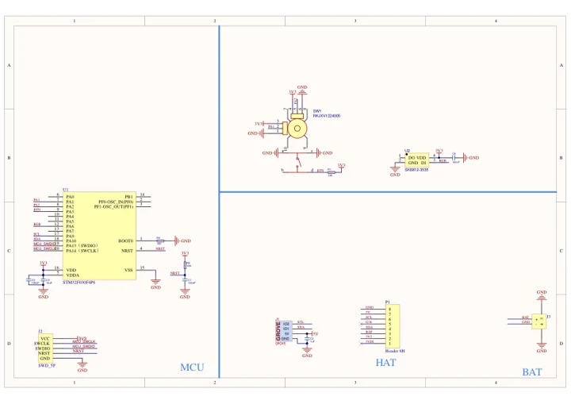

# Hat Mini JoyC

**M5Stack** · Source collection

Revision: Unverified source identity

Coverage: Manufacturer references available; physical pinout and complete connector review are tracked separately

[Browse all manufacturers](../../../../BROWSE.md) · [Devices & IoT](../../../../DEVICES.md) · [Open in the browser guide](https://valleytech-black-wire-guide.pages.dev/?board=source-board-dc2d1e6efbc6a3aec1)

## Datasheets and original documentation

Board datasheet: **not yet recorded**. Visual reference: **available**.

[Manufacturer model documentation](https://docs.m5stack.com/en/hat/MiniJoyC)

- **schematic / board**: [Hat Mini JoyC Schematics PDF — schematic](https://m5stack-doc.oss-cn-shenzhen.aliyuncs.com/610/SCH_HAT_MiniJoyC_V1.0.pdf) · [saved document](../../../../library/media/5f339e4dc80492e341e171529b9ca7b831b9ad37fa9c7b51666f4bce77c230df.pdf)

A chip datasheet, schematic and board datasheet have different scopes. Match the exact hardware revision.

[Documentation coverage and remaining gaps](../../../../DOCUMENTATION.md)

## Dimensions

**source reference** · Unreviewed source · PNG

[Open original reference](../../../../library/media/e682a9b5fc1cf40a48d0fa9e726e65c08efe594a0f8ef8cec557c26adb84da67.png)

**Credit and rights:** Source rights not yet established. Source/manufacturer: M5Stack.

[Source 1](https://static-cdn.m5stack.com/resource/docs/products/hat/MiniJoyC/img-14cbb54f-a375-4e6d-b73f-0d6bf0f53130.png) · [Source 2](https://docs.m5stack.com/en/hat/MiniJoyC)

Original source index: Dimensions. This file is searchable but has not been promoted to a reviewed physical board pinout.

Image revision: Not identified

SHA-256: `e682a9b5fc1cf40a48d0fa9e726e65c08efe594a0f8ef8cec557c26adb84da67`

## Hat Mini JoyC Schematics PDF — schematic

**reference PDF** · Source model/link and PDF signature/title checked; individual pin assignments and electrical validation pending · PDF

[Open original reference](../../../../library/media/5f339e4dc80492e341e171529b9ca7b831b9ad37fa9c7b51666f4bce77c230df.pdf)

**Credit and rights:** Original publisher/manufacturer artwork; redistribution and print rights not established. Attribution is not a license grant.. Source/manufacturer: M5Stack.

[Source 1](https://m5stack-doc.oss-cn-shenzhen.aliyuncs.com/610/SCH_HAT_MiniJoyC_V1.0.pdf) · [Source 2](https://docs.m5stack.com/en/hat/MiniJoyC)

Original document linked from this model’s manufacturer page. Preserve the document’s exact revision and named subassembly scope; a linked accessory schematic is not a whole-device pinout. This is a circuit schematic, not a physical board pinout.

Image revision: Use the revision printed in the original document; do not assume all hardware revisions are interchangeable

SHA-256: `5f339e4dc80492e341e171529b9ca7b831b9ad37fa9c7b51666f4bce77c230df`

Pin assignments have not been independently electrically verified. Check board revision before wiring.
