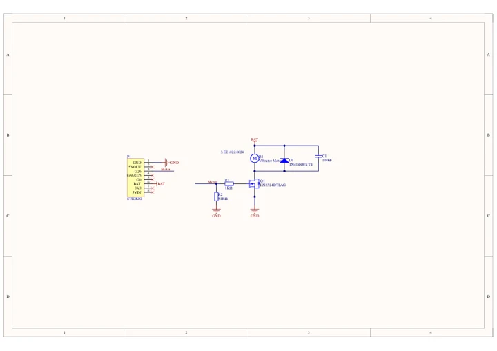
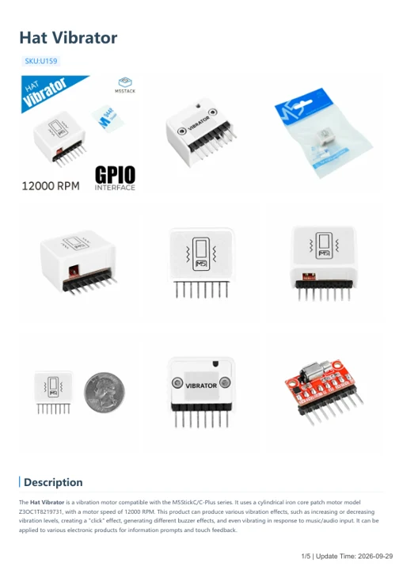

# Hat Vibrator

**M5Stack** · Source collection

Revision: Unverified source identity

Coverage: Manufacturer references available; physical pinout and complete connector review are tracked separately

[Browse all manufacturers](../../../../BROWSE.md) · [Devices & IoT](../../../../DEVICES.md) · [Open in the browser guide](https://valleytech-black-wire-guide.pages.dev/?board=source-board-dd1dfe21c8f7ff15bc)

## Datasheets and original documentation

Board datasheet: **not yet recorded**. Visual reference: **available**.

[Manufacturer model documentation](https://docs.m5stack.com/en/hat/HAT-Vibrator)

- **schematic / board**: [Hat Vibrator Schematics PDF — schematic](https://m5stack-doc.oss-cn-shenzhen.aliyuncs.com/614/Sch_HAT-Vibrator.pdf) · [saved document](../../../../library/media/6d1d6d49c88fb5da9cc0e4d604f0a5cb1604efce6686b0a43644bbd48a7e7107.pdf)
- **hardware-guide / board**: [Hat Vibrator — manufacturer hardware guide](https://m5stack.oss-cn-shenzhen.aliyuncs.com/resource/docs/static/pdf/static/en/hat/Hat_Vibrator.pdf) · [saved document](../../../../library/media/86b6568cd6a0f385c2a74196b5bde2fc8ad875237bc784b5487058464808ca63.pdf)

A chip datasheet, schematic and board datasheet have different scopes. Match the exact hardware revision.

[Documentation coverage and remaining gaps](../../../../DOCUMENTATION.md)

## Dimensions

**source reference** · Unreviewed source · PNG

[Open original reference](../../../../library/media/c4f8b1d94bf9f528c4e1815bf76bbbf8b466d88d7687408e6e86adbd629677e2.png)

**Credit and rights:** Source rights not yet established. Source/manufacturer: M5Stack.

[Source 1](https://static-cdn.m5stack.com/resource/docs/products/hat/HAT-Vibrator/img-f907f409-6f6f-48ec-837d-bd0728b14c52.png) · [Source 2](https://docs.m5stack.com/en/hat/HAT-Vibrator)

Original source index: Dimensions. This file is searchable but has not been promoted to a reviewed physical board pinout.

Image revision: Not identified

SHA-256: `c4f8b1d94bf9f528c4e1815bf76bbbf8b466d88d7687408e6e86adbd629677e2`

## Hat Vibrator Schematics PDF — schematic

**reference PDF** · Source model/link and PDF signature/title checked; individual pin assignments and electrical validation pending · PDF

[Open original reference](../../../../library/media/6d1d6d49c88fb5da9cc0e4d604f0a5cb1604efce6686b0a43644bbd48a7e7107.pdf)

**Credit and rights:** Original publisher/manufacturer artwork; redistribution and print rights not established. Attribution is not a license grant.. Source/manufacturer: M5Stack.

[Source 1](https://m5stack-doc.oss-cn-shenzhen.aliyuncs.com/614/Sch_HAT-Vibrator.pdf) · [Source 2](https://docs.m5stack.com/en/hat/HAT-Vibrator)

Original document linked from this model’s manufacturer page. Preserve the document’s exact revision and named subassembly scope; a linked accessory schematic is not a whole-device pinout. This is a circuit schematic, not a physical board pinout.

Image revision: Use the revision printed in the original document; do not assume all hardware revisions are interchangeable

SHA-256: `6d1d6d49c88fb5da9cc0e4d604f0a5cb1604efce6686b0a43644bbd48a7e7107`

## Hat Vibrator — manufacturer hardware guide

**reference PDF** · Source model/link and PDF signature/title checked; individual pin assignments and electrical validation pending · PDF

[Open original reference](../../../../library/media/86b6568cd6a0f385c2a74196b5bde2fc8ad875237bc784b5487058464808ca63.pdf)

**Credit and rights:** Original publisher/manufacturer artwork; redistribution and print rights not established. Attribution is not a license grant.. Source/manufacturer: M5Stack.

[Source 1](https://m5stack.oss-cn-shenzhen.aliyuncs.com/resource/docs/static/pdf/static/en/hat/Hat_Vibrator.pdf) · [Source 2](https://docs.m5stack.com/en/hat/HAT-Vibrator)

Original document linked from this model’s manufacturer page. Preserve the document’s exact revision and named subassembly scope; a linked accessory schematic is not a whole-device pinout. This is a hardware manual, not a separately classified board datasheet.

Image revision: Use the revision printed in the original document; do not assume all hardware revisions are interchangeable

SHA-256: `86b6568cd6a0f385c2a74196b5bde2fc8ad875237bc784b5487058464808ca63`

Pin assignments have not been independently electrically verified. Check board revision before wiring.
