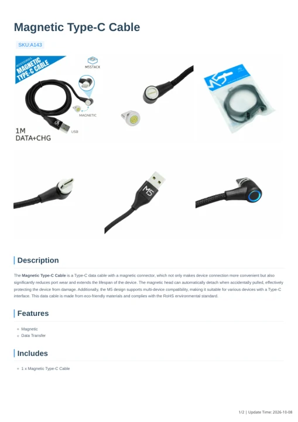

# Magnetic Type-C Cable

**M5Stack** · Source collection

Revision: Unverified source identity

Coverage: Manufacturer references available; physical pinout and complete connector review are tracked separately

[Browse all manufacturers](../../../../BROWSE.md) · [Devices & IoT](../../../../DEVICES.md) · [Open in the browser guide](https://valleytech-black-wire-guide.pages.dev/?board=source-board-e6d5bcae9df6feb312)

## Datasheets and original documentation

Board datasheet: **not yet recorded**. Visual reference: **available**.

[Manufacturer model documentation](https://docs.m5stack.com/en/accessory/M5%20Magnetic%20Type-C%20Cable)

- **hardware-guide / board**: [Magnetic Type-C Cable — manufacturer hardware guide](https://m5stack.oss-cn-shenzhen.aliyuncs.com/resource/docs/static/pdf/static/en/accessory/Magnetic_Type-C_Cable.pdf) · [saved document](../../../../library/media/1a3179605856e50128e0b7eed05d825e6324a2bdfd9d8e24c28d581b4dd92f69.pdf)

A chip datasheet, schematic and board datasheet have different scopes. Match the exact hardware revision.

[Documentation coverage and remaining gaps](../../../../DOCUMENTATION.md)

## Dimensions

**source reference** · Unreviewed source · PNG

[Open original reference](../../../../library/media/d329b2b07bc1c10952718e4b51db5ce6e104b3cd46ce5374b2ee9a2288a0e3dc.png)

**Credit and rights:** Source rights not yet established. Source/manufacturer: M5Stack.

[Source 1](https://static-cdn.m5stack.com/resource/docs/products/accessory/M5 Magnetic Type-C Cable/img-33c9a8c4-18d0-4968-912c-7edd6e79a341.png) · [Source 2](https://docs.m5stack.com/en/accessory/M5%20Magnetic%20Type-C%20Cable)

Original source index: Dimensions. This file is searchable but has not been promoted to a reviewed physical board pinout.

Image revision: Not identified

SHA-256: `d329b2b07bc1c10952718e4b51db5ce6e104b3cd46ce5374b2ee9a2288a0e3dc`

## Magnetic Type-C Cable — manufacturer hardware guide

**reference PDF** · Source model/link and PDF signature/title checked; individual pin assignments and electrical validation pending · PDF

[Open original reference](../../../../library/media/1a3179605856e50128e0b7eed05d825e6324a2bdfd9d8e24c28d581b4dd92f69.pdf)

**Credit and rights:** Original publisher/manufacturer artwork; redistribution and print rights not established. Attribution is not a license grant.. Source/manufacturer: M5Stack.

[Source 1](https://m5stack.oss-cn-shenzhen.aliyuncs.com/resource/docs/static/pdf/static/en/accessory/Magnetic_Type-C_Cable.pdf) · [Source 2](https://docs.m5stack.com/en/accessory/M5%20Magnetic%20Type-C%20Cable)

Original document linked from this model’s manufacturer page. Preserve the document’s exact revision and named subassembly scope; a linked accessory schematic is not a whole-device pinout. This is a hardware manual, not a separately classified board datasheet.

Image revision: Use the revision printed in the original document; do not assume all hardware revisions are interchangeable

SHA-256: `1a3179605856e50128e0b7eed05d825e6324a2bdfd9d8e24c28d581b4dd92f69`

Pin assignments have not been independently electrically verified. Check board revision before wiring.
