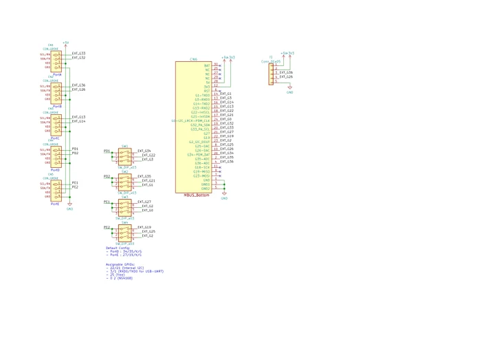
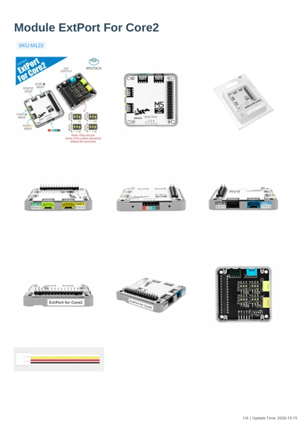

# Module ExtPort For Core2

**M5Stack** · Source collection

Revision: Unverified source identity

Coverage: Manufacturer references available; physical pinout and complete connector review are tracked separately

[Browse all manufacturers](../../../../BROWSE.md) · [Devices & IoT](../../../../DEVICES.md) · [Open in the browser guide](https://valleytech-black-wire-guide.pages.dev/?board=source-board-c560ffe2964a48351a)

## Datasheets and original documentation

Board datasheet: **not yet recorded**. Visual reference: **available**.

[Manufacturer model documentation](https://docs.m5stack.com/en/module/extport_for_core2)

- **schematic / board**: [Module ExtPort For Core2 Schematics PDF — schematic](https://m5stack-doc.oss-cn-shenzhen.aliyuncs.com/550/module_ext_port_for_core2_sch.pdf) · [saved document](../../../../library/media/e8105f9bfa2b4b4281cd1622e423a79bc50d8055127eff9af7bad2846d6dd93d.pdf)
- **hardware-guide / board**: [Module ExtPort For Core2 — manufacturer hardware guide](https://m5stack.oss-cn-shenzhen.aliyuncs.com/resource/docs/static/pdf/static/en/module/Module_ExtPort_For_Core2.pdf) · [saved document](../../../../library/media/7abc1a3221bf1b861d9ec4fec46d81ffe7c75141cda539781b7273a2c7c9c8dd.pdf)

A chip datasheet, schematic and board datasheet have different scopes. Match the exact hardware revision.

[Documentation coverage and remaining gaps](../../../../DOCUMENTATION.md)

## Dimensions

**source reference** · Unreviewed source · PNG

[Open original reference](../../../../library/media/2000b89ef22490cd65ad9d50a87c9c6b36b78c7f25b741aefa63c48d986cb38d.png)

**Credit and rights:** Source rights not yet established. Source/manufacturer: M5Stack.

[Source 1](https://m5stack-doc.oss-cn-shenzhen.aliyuncs.com/976/extportforcore2_page_01.png) · [Source 2](https://docs.m5stack.com/en/module/extport_for_core2)

Original source index: Dimensions. This file is searchable but has not been promoted to a reviewed physical board pinout.

Image revision: Not identified

SHA-256: `2000b89ef22490cd65ad9d50a87c9c6b36b78c7f25b741aefa63c48d986cb38d`

## Pinout

**source reference** · Unreviewed source · PNG

[Open original reference](../../../../library/media/8280de26a1e2e8f2dbb2bb43dee45a3dc5d2f80d6c122a5ca6fa71fe15121385.png)

**Credit and rights:** Source rights not yet established. Source/manufacturer: M5Stack.

[Source 1](https://static-cdn.m5stack.com/resource/docs/products/module/extport_for_core2/extport_for_core2_grove_01.webp) · [Source 2](https://docs.m5stack.com/en/module/extport_for_core2)

Original source index: Pinout. This file is searchable but has not been promoted to a reviewed physical board pinout.

Image revision: Not identified

SHA-256: `8280de26a1e2e8f2dbb2bb43dee45a3dc5d2f80d6c122a5ca6fa71fe15121385`

## Module ExtPort For Core2 Schematics PDF — schematic

**reference PDF** · Source model/link and PDF signature/title checked; individual pin assignments and electrical validation pending · PDF

[Open original reference](../../../../library/media/e8105f9bfa2b4b4281cd1622e423a79bc50d8055127eff9af7bad2846d6dd93d.pdf)

**Credit and rights:** Original publisher/manufacturer artwork; redistribution and print rights not established. Attribution is not a license grant.. Source/manufacturer: M5Stack.

[Source 1](https://m5stack-doc.oss-cn-shenzhen.aliyuncs.com/550/module_ext_port_for_core2_sch.pdf) · [Source 2](https://docs.m5stack.com/en/module/extport_for_core2)

Original document linked from this model’s manufacturer page. Preserve the document’s exact revision and named subassembly scope; a linked accessory schematic is not a whole-device pinout. This is a circuit schematic, not a physical board pinout.

Image revision: Use the revision printed in the original document; do not assume all hardware revisions are interchangeable

SHA-256: `e8105f9bfa2b4b4281cd1622e423a79bc50d8055127eff9af7bad2846d6dd93d`

## Module ExtPort For Core2 — manufacturer hardware guide

**reference PDF** · Source model/link and PDF signature/title checked; individual pin assignments and electrical validation pending · PDF

[Open original reference](../../../../library/media/7abc1a3221bf1b861d9ec4fec46d81ffe7c75141cda539781b7273a2c7c9c8dd.pdf)

**Credit and rights:** Original publisher/manufacturer artwork; redistribution and print rights not established. Attribution is not a license grant.. Source/manufacturer: M5Stack.

[Source 1](https://m5stack.oss-cn-shenzhen.aliyuncs.com/resource/docs/static/pdf/static/en/module/Module_ExtPort_For_Core2.pdf) · [Source 2](https://docs.m5stack.com/en/module/extport_for_core2)

Original document linked from this model’s manufacturer page. Preserve the document’s exact revision and named subassembly scope; a linked accessory schematic is not a whole-device pinout. This is a hardware manual, not a separately classified board datasheet.

Image revision: Use the revision printed in the original document; do not assume all hardware revisions are interchangeable

SHA-256: `7abc1a3221bf1b861d9ec4fec46d81ffe7c75141cda539781b7273a2c7c9c8dd`

Pin assignments have not been independently electrically verified. Check board revision before wiring.
