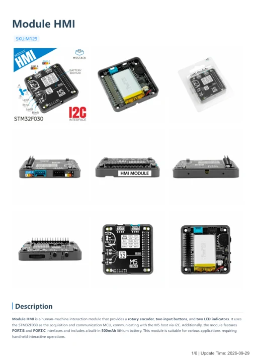

# Module HMI

**M5Stack** · Source collection

Revision: Unverified source identity

Coverage: Manufacturer references available; physical pinout and complete connector review are tracked separately

[Browse all manufacturers](../../../../BROWSE.md) · [Devices & IoT](../../../../DEVICES.md) · [Open in the browser guide](https://valleytech-black-wire-guide.pages.dev/?board=source-board-05507662d78ca9da33)

## Datasheets and original documentation

Board datasheet: **not yet recorded**. Visual reference: **available**.

[Manufacturer model documentation](https://docs.m5stack.com/en/module/HMI%20Module)

- **hardware-guide / board**: [Module HMI — manufacturer hardware guide](https://m5stack.oss-cn-shenzhen.aliyuncs.com/resource/docs/static/pdf/static/en/module/Module_HMI.pdf) · [saved document](../../../../library/media/00d62ceb806c09a07cd2149a076358a46830c705593acb65f9b278f821d14d7b.pdf)

A chip datasheet, schematic and board datasheet have different scopes. Match the exact hardware revision.

[Documentation coverage and remaining gaps](../../../../DOCUMENTATION.md)

## Dimensions

**source reference** · Unreviewed source · PNG

[Open original reference](../../../../library/media/76a23afe4edd1c00de7f038a33815b391fef63142115a35ed1b15b58bfcc09e0.png)

**Credit and rights:** Source rights not yet established. Source/manufacturer: M5Stack.

[Source 1](https://m5stack-doc.oss-cn-shenzhen.aliyuncs.com/989/hmi_page_01.png) · [Source 2](https://docs.m5stack.com/en/module/HMI%20Module)

Original source index: Dimensions. This file is searchable but has not been promoted to a reviewed physical board pinout.

Image revision: Not identified

SHA-256: `76a23afe4edd1c00de7f038a33815b391fef63142115a35ed1b15b58bfcc09e0`

## Module HMI — manufacturer hardware guide

**reference PDF** · Source model/link and PDF signature/title checked; individual pin assignments and electrical validation pending · PDF

[Open original reference](../../../../library/media/00d62ceb806c09a07cd2149a076358a46830c705593acb65f9b278f821d14d7b.pdf)

**Credit and rights:** Original publisher/manufacturer artwork; redistribution and print rights not established. Attribution is not a license grant.. Source/manufacturer: M5Stack.

[Source 1](https://m5stack.oss-cn-shenzhen.aliyuncs.com/resource/docs/static/pdf/static/en/module/Module_HMI.pdf) · [Source 2](https://docs.m5stack.com/en/module/HMI%20Module)

Original document linked from this model’s manufacturer page. Preserve the document’s exact revision and named subassembly scope; a linked accessory schematic is not a whole-device pinout. This is a hardware manual, not a separately classified board datasheet.

Image revision: Use the revision printed in the original document; do not assume all hardware revisions are interchangeable

SHA-256: `00d62ceb806c09a07cd2149a076358a46830c705593acb65f9b278f821d14d7b`

Pin assignments have not been independently electrically verified. Check board revision before wiring.
