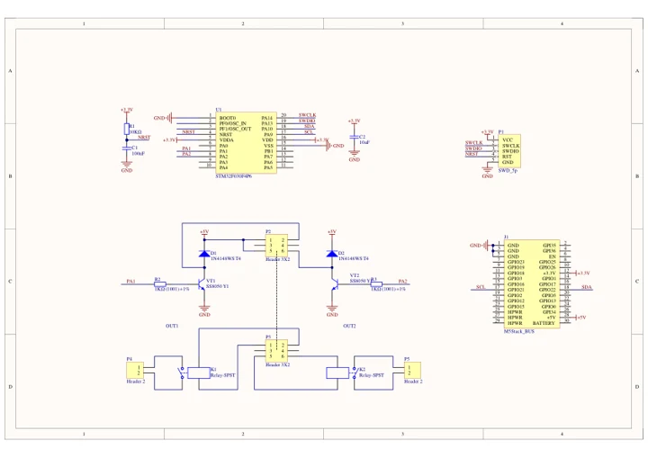
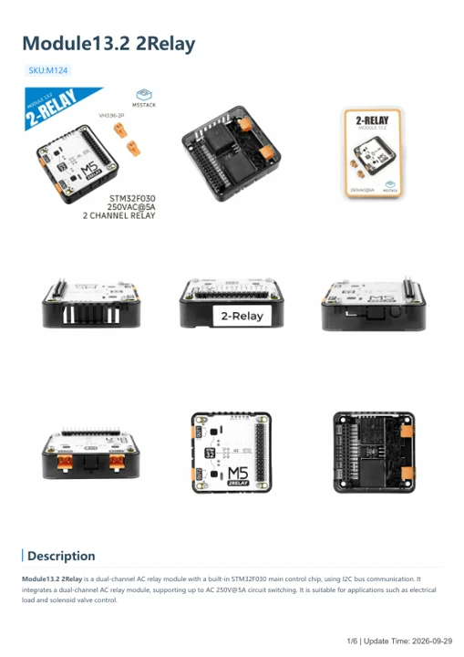

# Module13.2 2Relay

**M5Stack** · Source collection

Revision: Unverified source identity

Coverage: Manufacturer references available; physical pinout and complete connector review are tracked separately

[Browse all manufacturers](../../../../BROWSE.md) · [Devices & IoT](../../../../DEVICES.md) · [Open in the browser guide](https://valleytech-black-wire-guide.pages.dev/?board=source-board-ca5ac5069f3672db8c)

## Datasheets and original documentation

Board datasheet: **not yet recorded**. Visual reference: **available**.

[Manufacturer model documentation](https://docs.m5stack.com/en/module/2Relay)

- **schematic / board**: [Module13.2 2Relay Schematics PDF — schematic](https://m5stack-doc.oss-cn-shenzhen.aliyuncs.com/551/Sch_Module13.2_2Relay.pdf) · [saved document](../../../../library/media/2f31f0ad5890acd1bd5dc1790c2a84600f52aee1e8b821aea9c8ff3970e5e034.pdf)
- **hardware-guide / board**: [Module13.2 2Relay — manufacturer hardware guide](https://m5stack.oss-cn-shenzhen.aliyuncs.com/resource/docs/static/pdf/static/en/module/Module13.2_2Relay.pdf) · [saved document](../../../../library/media/17400b758265e6ea7a2acb842400e39cdfa7e1d34b7d64e2f3f8b30b8b9ada4e.pdf)

A chip datasheet, schematic and board datasheet have different scopes. Match the exact hardware revision.

[Documentation coverage and remaining gaps](../../../../DOCUMENTATION.md)

## Dimensions

**source reference** · Unreviewed source · PNG

[Open original reference](../../../../library/media/9c1f9da63cd75d390cc834ff384f8d7125bf6dce52c8309a723a96abafaaff87.png)

**Credit and rights:** Source rights not yet established. Source/manufacturer: M5Stack.

[Source 1](https://static-cdn.m5stack.com/resource/docs/products/module/2Relay/img-f508ceef-20b6-4400-a00c-3d452707197a.png) · [Source 2](https://docs.m5stack.com/en/module/2Relay)

Original source index: Dimensions. This file is searchable but has not been promoted to a reviewed physical board pinout.

Image revision: Not identified

SHA-256: `9c1f9da63cd75d390cc834ff384f8d7125bf6dce52c8309a723a96abafaaff87`

## Module13.2 2Relay Schematics PDF — schematic

**reference PDF** · Source model/link and PDF signature/title checked; individual pin assignments and electrical validation pending · PDF

[Open original reference](../../../../library/media/2f31f0ad5890acd1bd5dc1790c2a84600f52aee1e8b821aea9c8ff3970e5e034.pdf)

**Credit and rights:** Original publisher/manufacturer artwork; redistribution and print rights not established. Attribution is not a license grant.. Source/manufacturer: M5Stack.

[Source 1](https://m5stack-doc.oss-cn-shenzhen.aliyuncs.com/551/Sch_Module13.2_2Relay.pdf) · [Source 2](https://docs.m5stack.com/en/module/2Relay)

Original document linked from this model’s manufacturer page. Preserve the document’s exact revision and named subassembly scope; a linked accessory schematic is not a whole-device pinout. This is a circuit schematic, not a physical board pinout.

Image revision: Use the revision printed in the original document; do not assume all hardware revisions are interchangeable

SHA-256: `2f31f0ad5890acd1bd5dc1790c2a84600f52aee1e8b821aea9c8ff3970e5e034`

## Module13.2 2Relay — manufacturer hardware guide

**reference PDF** · Source model/link and PDF signature/title checked; individual pin assignments and electrical validation pending · PDF

[Open original reference](../../../../library/media/17400b758265e6ea7a2acb842400e39cdfa7e1d34b7d64e2f3f8b30b8b9ada4e.pdf)

**Credit and rights:** Original publisher/manufacturer artwork; redistribution and print rights not established. Attribution is not a license grant.. Source/manufacturer: M5Stack.

[Source 1](https://m5stack.oss-cn-shenzhen.aliyuncs.com/resource/docs/static/pdf/static/en/module/Module13.2_2Relay.pdf) · [Source 2](https://docs.m5stack.com/en/module/2Relay)

Original document linked from this model’s manufacturer page. Preserve the document’s exact revision and named subassembly scope; a linked accessory schematic is not a whole-device pinout. This is a hardware manual, not a separately classified board datasheet.

Image revision: Use the revision printed in the original document; do not assume all hardware revisions are interchangeable

SHA-256: `17400b758265e6ea7a2acb842400e39cdfa7e1d34b7d64e2f3f8b30b8b9ada4e`

Pin assignments have not been independently electrically verified. Check board revision before wiring.
