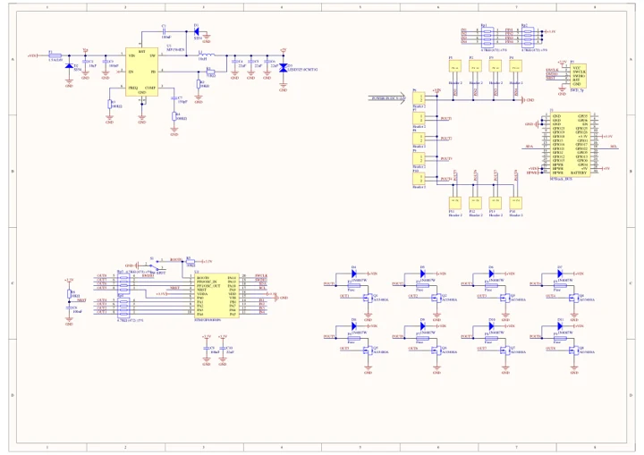
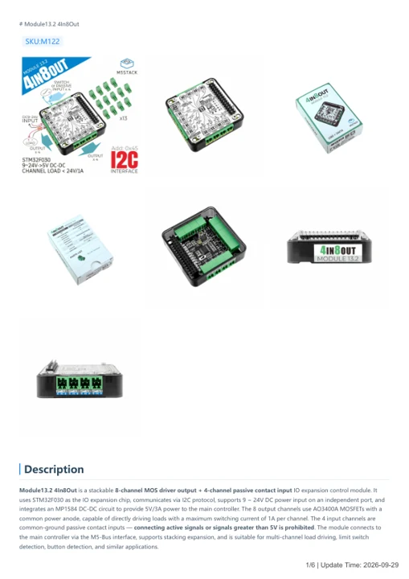

# Module13.2 4In8Out

**M5Stack** · Source collection

Revision: Unverified source identity

Coverage: Manufacturer references available; physical pinout and complete connector review are tracked separately

[Browse all manufacturers](../../../../BROWSE.md) · [Devices & IoT](../../../../DEVICES.md) · [Open in the browser guide](https://valleytech-black-wire-guide.pages.dev/?board=source-board-9180b6a15972b74fad)

## Datasheets and original documentation

Board datasheet: **not yet recorded**. Visual reference: **available**.

[Manufacturer model documentation](https://docs.m5stack.com/en/module/4in8out)

- **schematic / board**: [Module13.2 4In8Out Schematics PDF — schematic](https://m5stack-doc.oss-cn-shenzhen.aliyuncs.com/549/Sch_4IN8OUT.pdf) · [saved document](../../../../library/media/a607ab67874a3ce6b876821a10e8de21827f31fd7c0cbcca3dae46386e80d8fe.pdf)
- **hardware-guide / board**: [Module13.2 4In8Out — manufacturer hardware guide](https://m5stack.oss-cn-shenzhen.aliyuncs.com/resource/docs/static/pdf/static/en/module/Module13.2_4In8Out.pdf) · [saved document](../../../../library/media/a0ebbdbf1cc089d390b3e357e4687931be9895ff7fe48513b8d1d22e28b4a2f3.pdf)

A chip datasheet, schematic and board datasheet have different scopes. Match the exact hardware revision.

[Documentation coverage and remaining gaps](../../../../DOCUMENTATION.md)

## Dimensions

**source reference** · Unreviewed source · PNG

[Open original reference](../../../../library/media/8508b9b3c6d3b3c5f30ca57b9d51a59431d4aa31898dff838808477b6db7bd8d.png)

**Credit and rights:** Source rights not yet established. Source/manufacturer: M5Stack.

[Source 1](https://m5stack-doc.oss-cn-shenzhen.aliyuncs.com/969/4in8out_page_01.png) · [Source 2](https://docs.m5stack.com/en/module/4in8out)

Original source index: Dimensions. This file is searchable but has not been promoted to a reviewed physical board pinout.

Image revision: Not identified

SHA-256: `8508b9b3c6d3b3c5f30ca57b9d51a59431d4aa31898dff838808477b6db7bd8d`

## Module13.2 4In8Out Schematics PDF — schematic

**reference PDF** · Source model/link and PDF signature/title checked; individual pin assignments and electrical validation pending · PDF

[Open original reference](../../../../library/media/a607ab67874a3ce6b876821a10e8de21827f31fd7c0cbcca3dae46386e80d8fe.pdf)

**Credit and rights:** Original publisher/manufacturer artwork; redistribution and print rights not established. Attribution is not a license grant.. Source/manufacturer: M5Stack.

[Source 1](https://m5stack-doc.oss-cn-shenzhen.aliyuncs.com/549/Sch_4IN8OUT.pdf) · [Source 2](https://docs.m5stack.com/en/module/4in8out)

Original document linked from this model’s manufacturer page. Preserve the document’s exact revision and named subassembly scope; a linked accessory schematic is not a whole-device pinout. This is a circuit schematic, not a physical board pinout.

Image revision: Use the revision printed in the original document; do not assume all hardware revisions are interchangeable

SHA-256: `a607ab67874a3ce6b876821a10e8de21827f31fd7c0cbcca3dae46386e80d8fe`

## Module13.2 4In8Out — manufacturer hardware guide

**reference PDF** · Source model/link and PDF signature/title checked; individual pin assignments and electrical validation pending · PDF

[Open original reference](../../../../library/media/a0ebbdbf1cc089d390b3e357e4687931be9895ff7fe48513b8d1d22e28b4a2f3.pdf)

**Credit and rights:** Original publisher/manufacturer artwork; redistribution and print rights not established. Attribution is not a license grant.. Source/manufacturer: M5Stack.

[Source 1](https://m5stack.oss-cn-shenzhen.aliyuncs.com/resource/docs/static/pdf/static/en/module/Module13.2_4In8Out.pdf) · [Source 2](https://docs.m5stack.com/en/module/4in8out)

Original document linked from this model’s manufacturer page. Preserve the document’s exact revision and named subassembly scope; a linked accessory schematic is not a whole-device pinout. This is a hardware manual, not a separately classified board datasheet.

Image revision: Use the revision printed in the original document; do not assume all hardware revisions are interchangeable

SHA-256: `a0ebbdbf1cc089d390b3e357e4687931be9895ff7fe48513b8d1d22e28b4a2f3`

Pin assignments have not been independently electrically verified. Check board revision before wiring.
