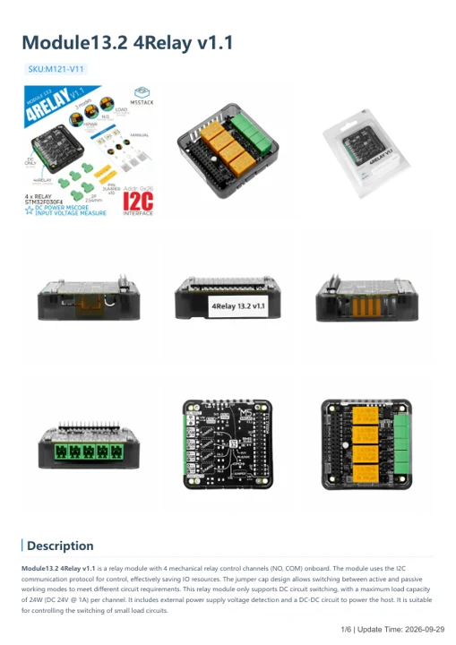
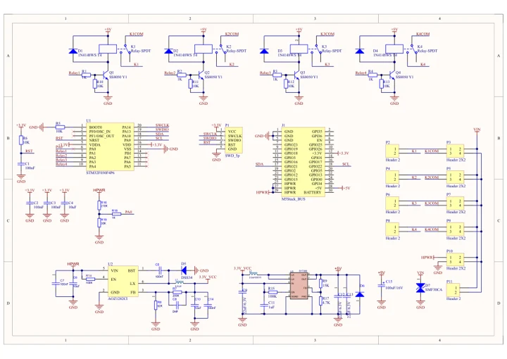

# Module13.2 4Relay v1.1

**M5Stack** · Source collection

Revision: Unverified source identity

Coverage: Manufacturer references available; physical pinout and complete connector review are tracked separately

[Browse all manufacturers](../../../../BROWSE.md) · [Devices & IoT](../../../../DEVICES.md) · [Open in the browser guide](https://valleytech-black-wire-guide.pages.dev/?board=source-board-de2383c9a997eba58a)

## Datasheets and original documentation

Board datasheet: **not yet recorded**. Visual reference: **available**.

[Manufacturer model documentation](https://docs.m5stack.com/en/module/4Relay%20Module%2013.2_V1.1)

- **hardware-guide / board**: [Module13.2 4Relay v1.1 — manufacturer hardware guide](https://m5stack.oss-cn-shenzhen.aliyuncs.com/resource/docs/static/pdf/static/en/module/Module13.2_4Relay_v1.1.pdf) · [saved document](../../../../library/media/ba28d62ec37a15c1268c42efaf14eee12f61be14ff8afaf9b08c2037b02afab7.pdf)
- **schematic / board**: [Module13.2 4Relay v1.1 Schematics PDF — schematic](https://m5stack-doc.oss-cn-shenzhen.aliyuncs.com/548/Sch_4Relay_13.2_Module_V1.1.pdf) · [saved document](../../../../library/media/099f018ef7e238303371076bc335803d3ab24821cd2c5bc9625d4eef7b6b974a.pdf)

A chip datasheet, schematic and board datasheet have different scopes. Match the exact hardware revision.

[Documentation coverage and remaining gaps](../../../../DOCUMENTATION.md)

## Dimensions

**source reference** · Unreviewed source · JPG

[Open original reference](../../../../library/media/85d6d0d055d6141a2a6dcdf5923899e398e0f01155ff6e1f48508ad10543bfd6.jpg)

**Credit and rights:** Source rights not yet established. Source/manufacturer: M5Stack.

[Source 1](https://static-cdn.m5stack.com/resource/docs/products/module/4Relay Module 13.2_V1.1/img-d370e126-9eef-432f-a08b-de8ae6a6222a.jpg) · [Source 2](https://docs.m5stack.com/en/module/4Relay%20Module%2013.2_V1.1)

Original source index: Dimensions. This file is searchable but has not been promoted to a reviewed physical board pinout.

Image revision: Not identified

SHA-256: `85d6d0d055d6141a2a6dcdf5923899e398e0f01155ff6e1f48508ad10543bfd6`

## Module13.2 4Relay v1.1 — manufacturer hardware guide

**reference PDF** · Source model/link and PDF signature/title checked; individual pin assignments and electrical validation pending · PDF

[Open original reference](../../../../library/media/ba28d62ec37a15c1268c42efaf14eee12f61be14ff8afaf9b08c2037b02afab7.pdf)

**Credit and rights:** Original publisher/manufacturer artwork; redistribution and print rights not established. Attribution is not a license grant.. Source/manufacturer: M5Stack.

[Source 1](https://m5stack.oss-cn-shenzhen.aliyuncs.com/resource/docs/static/pdf/static/en/module/Module13.2_4Relay_v1.1.pdf) · [Source 2](https://docs.m5stack.com/en/module/4Relay%20Module%2013.2_V1.1)

Original document linked from this model’s manufacturer page. Preserve the document’s exact revision and named subassembly scope; a linked accessory schematic is not a whole-device pinout. This is a hardware manual, not a separately classified board datasheet.

Image revision: Use the revision printed in the original document; do not assume all hardware revisions are interchangeable

SHA-256: `ba28d62ec37a15c1268c42efaf14eee12f61be14ff8afaf9b08c2037b02afab7`

## Module13.2 4Relay v1.1 Schematics PDF — schematic

**reference PDF** · Source model/link and PDF signature/title checked; individual pin assignments and electrical validation pending · PDF

[Open original reference](../../../../library/media/099f018ef7e238303371076bc335803d3ab24821cd2c5bc9625d4eef7b6b974a.pdf)

**Credit and rights:** Original publisher/manufacturer artwork; redistribution and print rights not established. Attribution is not a license grant.. Source/manufacturer: M5Stack.

[Source 1](https://m5stack-doc.oss-cn-shenzhen.aliyuncs.com/548/Sch_4Relay_13.2_Module_V1.1.pdf) · [Source 2](https://docs.m5stack.com/en/module/4Relay%20Module%2013.2_V1.1)

Original document linked from this model’s manufacturer page. Preserve the document’s exact revision and named subassembly scope; a linked accessory schematic is not a whole-device pinout. This is a circuit schematic, not a physical board pinout.

Image revision: Use the revision printed in the original document; do not assume all hardware revisions are interchangeable

SHA-256: `099f018ef7e238303371076bc335803d3ab24821cd2c5bc9625d4eef7b6b974a`

Pin assignments have not been independently electrically verified. Check board revision before wiring.
