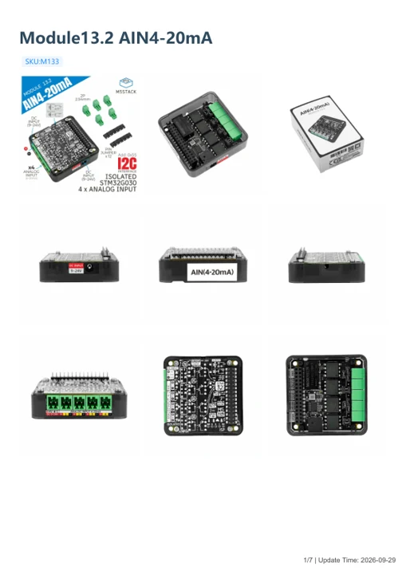
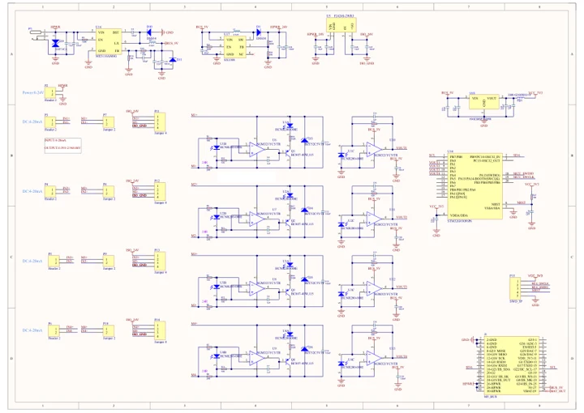

# Module13.2 AIN4-20mA

**M5Stack** · Source collection

Revision: Unverified source identity

Coverage: Manufacturer references available; physical pinout and complete connector review are tracked separately

[Browse all manufacturers](../../../../BROWSE.md) · [Devices & IoT](../../../../DEVICES.md) · [Open in the browser guide](https://valleytech-black-wire-guide.pages.dev/?board=source-board-0b4a243a3290908eda)

## Datasheets and original documentation

Board datasheet: **not yet recorded**. Visual reference: **available**.

[Manufacturer model documentation](https://docs.m5stack.com/en/module/AIN4-20mA%20Module%2013.2)

- **hardware-guide / board**: [Module13.2 AIN4-20mA — manufacturer hardware guide](https://m5stack.oss-cn-shenzhen.aliyuncs.com/resource/docs/static/pdf/static/en/module/Module13.2_AIN4-20mA.pdf) · [saved document](../../../../library/media/2cfc7be57b0199d9c3e72d00f97ecc81b0d18827ce71a03b4ba717c8d43ba015.pdf)
- **schematic / board**: [Module13.2 AIN4-20mA Schematics PDF — schematic](https://m5stack-doc.oss-cn-shenzhen.aliyuncs.com/560/SCH_Module13.2_AIN4-20mA_V1.0.pdf) · [saved document](../../../../library/media/9d6f89325bb0e4b2994597c02492edcd5f0984885623da9ced873eb404e0a25e.pdf)

A chip datasheet, schematic and board datasheet have different scopes. Match the exact hardware revision.

[Documentation coverage and remaining gaps](../../../../DOCUMENTATION.md)

## Dimensions

**source reference** · Unreviewed source · PNG

[Open original reference](../../../../library/media/e78240b8b0a4c53fcf049847ec27f180039efda2233f7b8bf8c39ce4d89edf0e.png)

**Credit and rights:** Source rights not yet established. Source/manufacturer: M5Stack.

[Source 1](https://m5stack-doc.oss-cn-shenzhen.aliyuncs.com/1029/M133-al4-20ma_page_01.png) · [Source 2](https://docs.m5stack.com/en/module/AIN4-20mA%20Module%2013.2)

Original source index: Dimensions. This file is searchable but has not been promoted to a reviewed physical board pinout.

Image revision: Not identified

SHA-256: `e78240b8b0a4c53fcf049847ec27f180039efda2233f7b8bf8c39ce4d89edf0e`

## Module13.2 AIN4-20mA — manufacturer hardware guide

**reference PDF** · Source model/link and PDF signature/title checked; individual pin assignments and electrical validation pending · PDF

[Open original reference](../../../../library/media/2cfc7be57b0199d9c3e72d00f97ecc81b0d18827ce71a03b4ba717c8d43ba015.pdf)

**Credit and rights:** Original publisher/manufacturer artwork; redistribution and print rights not established. Attribution is not a license grant.. Source/manufacturer: M5Stack.

[Source 1](https://m5stack.oss-cn-shenzhen.aliyuncs.com/resource/docs/static/pdf/static/en/module/Module13.2_AIN4-20mA.pdf) · [Source 2](https://docs.m5stack.com/en/module/AIN4-20mA%20Module%2013.2)

Original document linked from this model’s manufacturer page. Preserve the document’s exact revision and named subassembly scope; a linked accessory schematic is not a whole-device pinout. This is a hardware manual, not a separately classified board datasheet.

Image revision: Use the revision printed in the original document; do not assume all hardware revisions are interchangeable

SHA-256: `2cfc7be57b0199d9c3e72d00f97ecc81b0d18827ce71a03b4ba717c8d43ba015`

## Module13.2 AIN4-20mA Schematics PDF — schematic

**reference PDF** · Source model/link and PDF signature/title checked; individual pin assignments and electrical validation pending · PDF

[Open original reference](../../../../library/media/9d6f89325bb0e4b2994597c02492edcd5f0984885623da9ced873eb404e0a25e.pdf)

**Credit and rights:** Original publisher/manufacturer artwork; redistribution and print rights not established. Attribution is not a license grant.. Source/manufacturer: M5Stack.

[Source 1](https://m5stack-doc.oss-cn-shenzhen.aliyuncs.com/560/SCH_Module13.2_AIN4-20mA_V1.0.pdf) · [Source 2](https://docs.m5stack.com/en/module/AIN4-20mA%20Module%2013.2)

Original document linked from this model’s manufacturer page. Preserve the document’s exact revision and named subassembly scope; a linked accessory schematic is not a whole-device pinout. This is a circuit schematic, not a physical board pinout.

Image revision: Use the revision printed in the original document; do not assume all hardware revisions are interchangeable

SHA-256: `9d6f89325bb0e4b2994597c02492edcd5f0984885623da9ced873eb404e0a25e`

Pin assignments have not been independently electrically verified. Check board revision before wiring.
