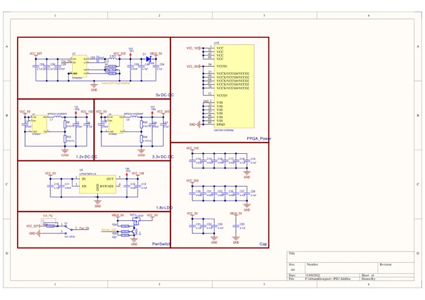
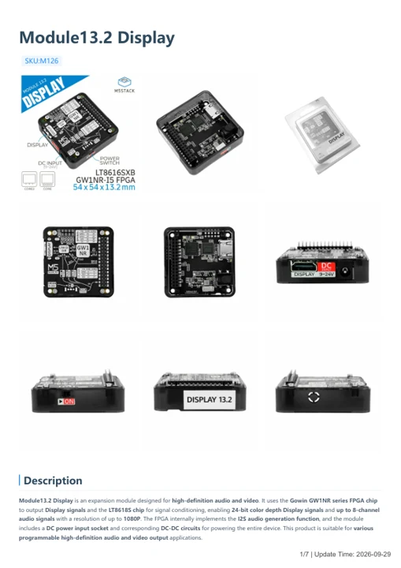

# Module13.2 Display

**M5Stack** · Source collection

Revision: Unverified source identity

Coverage: Manufacturer references available; physical pinout and complete connector review are tracked separately

[Browse all manufacturers](../../../../BROWSE.md) · [Devices & IoT](../../../../DEVICES.md) · [Open in the browser guide](https://valleytech-black-wire-guide.pages.dev/?board=source-board-8e3d770acbcff70eaa)

## Datasheets and original documentation

Board datasheet: **not yet recorded**. Visual reference: **available**.

[Manufacturer model documentation](https://docs.m5stack.com/en/module/Display%20Module%2013.2)

- **schematic / board**: [Module13.2 Display Schematics PDF — schematic](https://m5stack-doc.oss-cn-shenzhen.aliyuncs.com/553/Display_Module_13.2.pdf) · [saved document](../../../../library/media/2d8266ffa7cd6f33f508a03e7265c19653dcdf0ec94c482151bb6c52bbac6ae3.pdf)
- **hardware-guide / board**: [Module13.2 Display — manufacturer hardware guide](https://m5stack.oss-cn-shenzhen.aliyuncs.com/resource/docs/static/pdf/static/en/module/Module13.2_Display.pdf) · [saved document](../../../../library/media/ef7425deca69172f66ebebc61df73ad52af2ad9ad7697ec287352697fe1aa805.pdf)

A chip datasheet, schematic and board datasheet have different scopes. Match the exact hardware revision.

[Documentation coverage and remaining gaps](../../../../DOCUMENTATION.md)

## Dimensions

**source reference** · Unreviewed source · PNG

[Open original reference](../../../../library/media/8a34199de1915f7ab16527a2bc105ed197ee20a662777e25397c5d4282cd66e1.png)

**Credit and rights:** Source rights not yet established. Source/manufacturer: M5Stack.

[Source 1](https://m5stack-doc.oss-cn-shenzhen.aliyuncs.com/986/M126-displaymoudle_page_01.png) · [Source 2](https://docs.m5stack.com/en/module/Display%20Module%2013.2)

Original source index: Dimensions. This file is searchable but has not been promoted to a reviewed physical board pinout.

Image revision: Not identified

SHA-256: `8a34199de1915f7ab16527a2bc105ed197ee20a662777e25397c5d4282cd66e1`

## Module13.2 Display Schematics PDF — schematic

**reference PDF** · Source model/link and PDF signature/title checked; individual pin assignments and electrical validation pending · PDF

[Open original reference](../../../../library/media/2d8266ffa7cd6f33f508a03e7265c19653dcdf0ec94c482151bb6c52bbac6ae3.pdf)

**Credit and rights:** Original publisher/manufacturer artwork; redistribution and print rights not established. Attribution is not a license grant.. Source/manufacturer: M5Stack.

[Source 1](https://m5stack-doc.oss-cn-shenzhen.aliyuncs.com/553/Display_Module_13.2.pdf) · [Source 2](https://docs.m5stack.com/en/module/Display%20Module%2013.2)

Original document linked from this model’s manufacturer page. Preserve the document’s exact revision and named subassembly scope; a linked accessory schematic is not a whole-device pinout. This is a circuit schematic, not a physical board pinout.

Image revision: Use the revision printed in the original document; do not assume all hardware revisions are interchangeable

SHA-256: `2d8266ffa7cd6f33f508a03e7265c19653dcdf0ec94c482151bb6c52bbac6ae3`

## Module13.2 Display — manufacturer hardware guide

**reference PDF** · Source model/link and PDF signature/title checked; individual pin assignments and electrical validation pending · PDF

[Open original reference](../../../../library/media/ef7425deca69172f66ebebc61df73ad52af2ad9ad7697ec287352697fe1aa805.pdf)

**Credit and rights:** Original publisher/manufacturer artwork; redistribution and print rights not established. Attribution is not a license grant.. Source/manufacturer: M5Stack.

[Source 1](https://m5stack.oss-cn-shenzhen.aliyuncs.com/resource/docs/static/pdf/static/en/module/Module13.2_Display.pdf) · [Source 2](https://docs.m5stack.com/en/module/Display%20Module%2013.2)

Original document linked from this model’s manufacturer page. Preserve the document’s exact revision and named subassembly scope; a linked accessory schematic is not a whole-device pinout. This is a hardware manual, not a separately classified board datasheet.

Image revision: Use the revision printed in the original document; do not assume all hardware revisions are interchangeable

SHA-256: `ef7425deca69172f66ebebc61df73ad52af2ad9ad7697ec287352697fe1aa805`

Pin assignments have not been independently electrically verified. Check board revision before wiring.
