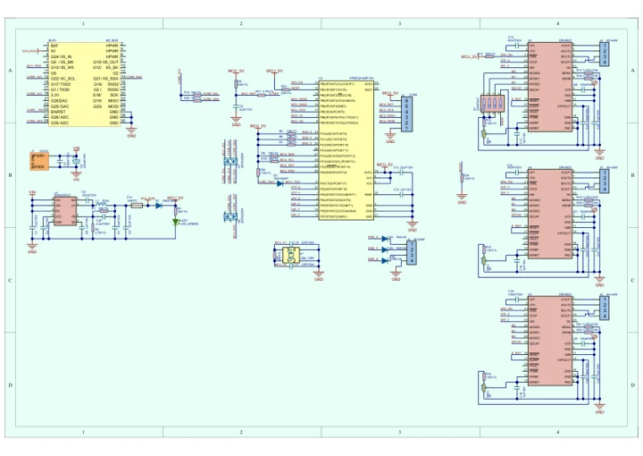
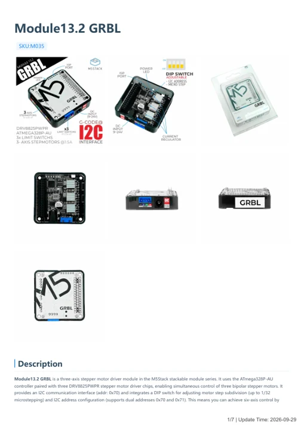

# Module13.2 GRBL

**M5Stack** · Source collection

Revision: Unverified source identity

Coverage: Manufacturer references available; physical pinout and complete connector review are tracked separately

[Browse all manufacturers](../../../../BROWSE.md) · [Devices & IoT](../../../../DEVICES.md) · [Open in the browser guide](https://valleytech-black-wire-guide.pages.dev/?board=source-board-84d351cb075336ebda)

## Datasheets and original documentation

Board datasheet: **not yet recorded**. Visual reference: **available**.

[Manufacturer model documentation](https://docs.m5stack.com/en/module/grbl13.2)

- **schematic / board**: [Module13.2 GRBL Schematics PDF — schematic](https://m5stack-doc.oss-cn-shenzhen.aliyuncs.com/546/Sch_M5GRBL_V1.1.pdf) · [saved document](../../../../library/media/ed7545b94b333f318ae98cfc9a846af97add65f47a03c6eb44e1f07d64ee9d90.pdf)
- **hardware-guide / board**: [Module13.2 GRBL — manufacturer hardware guide](https://m5stack.oss-cn-shenzhen.aliyuncs.com/resource/docs/static/pdf/static/en/module/Module13.2_GRBL.pdf) · [saved document](../../../../library/media/1f4f0afe26d7ee0c61d0534472b0cfdcc5a15d8432d0b5264aaa954c844da506.pdf)

A chip datasheet, schematic and board datasheet have different scopes. Match the exact hardware revision.

[Documentation coverage and remaining gaps](../../../../DOCUMENTATION.md)

## Dimensions

**source reference** · Unreviewed source · PNG

[Open original reference](../../../../library/media/5d80cc602bc242c9d41291b4cf90df1a78888db67db0627d27c6b8b9b608e423.png)

**Credit and rights:** Source rights not yet established. Source/manufacturer: M5Stack.

[Source 1](https://m5stack-doc.oss-cn-shenzhen.aliyuncs.com/546/Module-GRBL_page_01.png) · [Source 2](https://docs.m5stack.com/en/module/grbl13.2)

Original source index: Dimensions. This file is searchable but has not been promoted to a reviewed physical board pinout.

Image revision: Not identified

SHA-256: `5d80cc602bc242c9d41291b4cf90df1a78888db67db0627d27c6b8b9b608e423`

## Module13.2 GRBL Schematics PDF — schematic

**reference PDF** · Source model/link and PDF signature/title checked; individual pin assignments and electrical validation pending · PDF

[Open original reference](../../../../library/media/ed7545b94b333f318ae98cfc9a846af97add65f47a03c6eb44e1f07d64ee9d90.pdf)

**Credit and rights:** Original publisher/manufacturer artwork; redistribution and print rights not established. Attribution is not a license grant.. Source/manufacturer: M5Stack.

[Source 1](https://m5stack-doc.oss-cn-shenzhen.aliyuncs.com/546/Sch_M5GRBL_V1.1.pdf) · [Source 2](https://docs.m5stack.com/en/module/grbl13.2)

Original document linked from this model’s manufacturer page. Preserve the document’s exact revision and named subassembly scope; a linked accessory schematic is not a whole-device pinout. This is a circuit schematic, not a physical board pinout.

Image revision: Use the revision printed in the original document; do not assume all hardware revisions are interchangeable

SHA-256: `ed7545b94b333f318ae98cfc9a846af97add65f47a03c6eb44e1f07d64ee9d90`

## Module13.2 GRBL — manufacturer hardware guide

**reference PDF** · Source model/link and PDF signature/title checked; individual pin assignments and electrical validation pending · PDF

[Open original reference](../../../../library/media/1f4f0afe26d7ee0c61d0534472b0cfdcc5a15d8432d0b5264aaa954c844da506.pdf)

**Credit and rights:** Original publisher/manufacturer artwork; redistribution and print rights not established. Attribution is not a license grant.. Source/manufacturer: M5Stack.

[Source 1](https://m5stack.oss-cn-shenzhen.aliyuncs.com/resource/docs/static/pdf/static/en/module/Module13.2_GRBL.pdf) · [Source 2](https://docs.m5stack.com/en/module/grbl13.2)

Original document linked from this model’s manufacturer page. Preserve the document’s exact revision and named subassembly scope; a linked accessory schematic is not a whole-device pinout. This is a hardware manual, not a separately classified board datasheet.

Image revision: Use the revision printed in the original document; do not assume all hardware revisions are interchangeable

SHA-256: `1f4f0afe26d7ee0c61d0534472b0cfdcc5a15d8432d0b5264aaa954c844da506`

Pin assignments have not been independently electrically verified. Check board revision before wiring.
