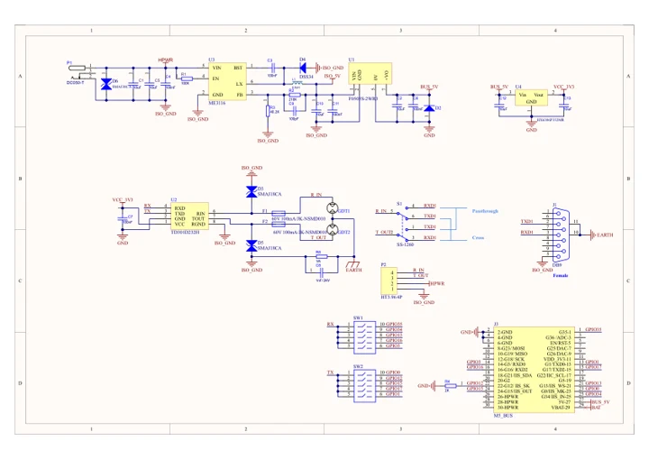
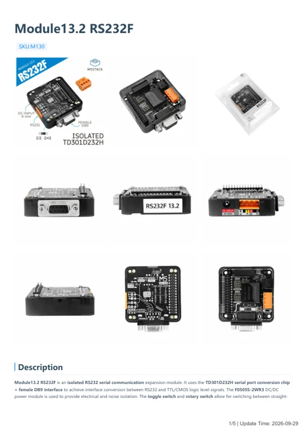

# Module13.2 RS232F

**M5Stack** · Source collection

Revision: Unverified source identity

Coverage: Manufacturer references available; physical pinout and complete connector review are tracked separately

[Browse all manufacturers](../../../../BROWSE.md) · [Devices & IoT](../../../../DEVICES.md) · [Open in the browser guide](https://valleytech-black-wire-guide.pages.dev/?board=source-board-5e56132d0a5c47db56)

## Datasheets and original documentation

Board datasheet: **not yet recorded**. Visual reference: **available**.

[Manufacturer model documentation](https://docs.m5stack.com/en/module/RS232F%20Module%2013.2)

- **schematic / board**: [Module13.2 RS232F Schematics PDF — schematic](https://m5stack-doc.oss-cn-shenzhen.aliyuncs.com/557/SCH_Module_13.2_RS232F_V1.0.pdf) · [saved document](../../../../library/media/6808bbdcb76f03a1c84726afdc6b7c477f253f8b72a53200cac0275d7b3eb1a2.pdf)
- **hardware-guide / board**: [Module13.2 RS232F — manufacturer hardware guide](https://m5stack.oss-cn-shenzhen.aliyuncs.com/resource/docs/static/pdf/static/en/module/Module13.2_RS232F.pdf) · [saved document](../../../../library/media/4050a4545e2e4b36dcef851f3b6750454f6bfa215a1d4f5cd7b1df858bd7a164.pdf)

A chip datasheet, schematic and board datasheet have different scopes. Match the exact hardware revision.

[Documentation coverage and remaining gaps](../../../../DOCUMENTATION.md)

## Dimensions

**source reference** · Unreviewed source · PNG

[Open original reference](../../../../library/media/814ae91ae6aba0c5ae8cd41bf01859669e4ef4e7abb6f32858b3d1b439e50e88.png)

**Credit and rights:** Source rights not yet established. Source/manufacturer: M5Stack.

[Source 1](https://m5stack-doc.oss-cn-shenzhen.aliyuncs.com/987/M130-M131-232moudle_page_01.png) · [Source 2](https://docs.m5stack.com/en/module/RS232F%20Module%2013.2)

Original source index: Dimensions. This file is searchable but has not been promoted to a reviewed physical board pinout.

Image revision: Not identified

SHA-256: `814ae91ae6aba0c5ae8cd41bf01859669e4ef4e7abb6f32858b3d1b439e50e88`

## Module13.2 RS232F Schematics PDF — schematic

**reference PDF** · Source model/link and PDF signature/title checked; individual pin assignments and electrical validation pending · PDF

[Open original reference](../../../../library/media/6808bbdcb76f03a1c84726afdc6b7c477f253f8b72a53200cac0275d7b3eb1a2.pdf)

**Credit and rights:** Original publisher/manufacturer artwork; redistribution and print rights not established. Attribution is not a license grant.. Source/manufacturer: M5Stack.

[Source 1](https://m5stack-doc.oss-cn-shenzhen.aliyuncs.com/557/SCH_Module_13.2_RS232F_V1.0.pdf) · [Source 2](https://docs.m5stack.com/en/module/RS232F%20Module%2013.2)

Original document linked from this model’s manufacturer page. Preserve the document’s exact revision and named subassembly scope; a linked accessory schematic is not a whole-device pinout. This is a circuit schematic, not a physical board pinout.

Image revision: Use the revision printed in the original document; do not assume all hardware revisions are interchangeable

SHA-256: `6808bbdcb76f03a1c84726afdc6b7c477f253f8b72a53200cac0275d7b3eb1a2`

## Module13.2 RS232F — manufacturer hardware guide

**reference PDF** · Source model/link and PDF signature/title checked; individual pin assignments and electrical validation pending · PDF

[Open original reference](../../../../library/media/4050a4545e2e4b36dcef851f3b6750454f6bfa215a1d4f5cd7b1df858bd7a164.pdf)

**Credit and rights:** Original publisher/manufacturer artwork; redistribution and print rights not established. Attribution is not a license grant.. Source/manufacturer: M5Stack.

[Source 1](https://m5stack.oss-cn-shenzhen.aliyuncs.com/resource/docs/static/pdf/static/en/module/Module13.2_RS232F.pdf) · [Source 2](https://docs.m5stack.com/en/module/RS232F%20Module%2013.2)

Original document linked from this model’s manufacturer page. Preserve the document’s exact revision and named subassembly scope; a linked accessory schematic is not a whole-device pinout. This is a hardware manual, not a separately classified board datasheet.

Image revision: Use the revision printed in the original document; do not assume all hardware revisions are interchangeable

SHA-256: `4050a4545e2e4b36dcef851f3b6750454f6bfa215a1d4f5cd7b1df858bd7a164`

Pin assignments have not been independently electrically verified. Check board revision before wiring.
