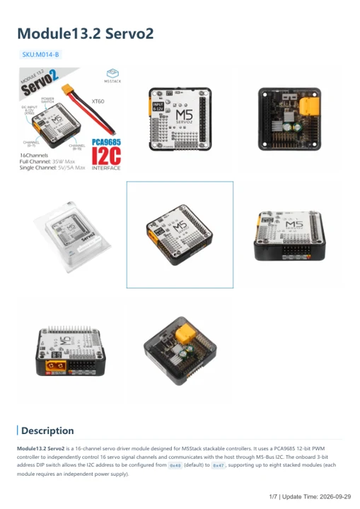
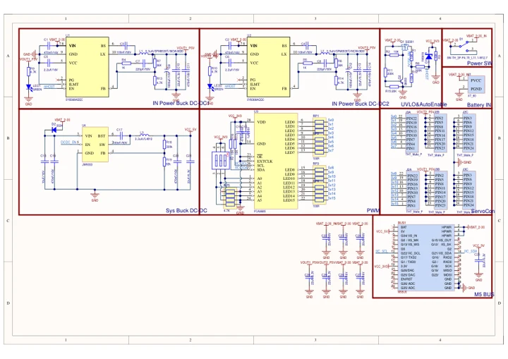

# Module13.2 Servo2

**M5Stack** · Source collection

Revision: Unverified source identity

Coverage: Manufacturer references available; physical pinout and complete connector review are tracked separately

[Browse all manufacturers](../../../../BROWSE.md) · [Devices & IoT](../../../../DEVICES.md) · [Open in the browser guide](https://valleytech-black-wire-guide.pages.dev/?board=source-board-f0d28a23bf4b251145)

## Datasheets and original documentation

Board datasheet: **not yet recorded**. Visual reference: **available**.

[Manufacturer model documentation](https://docs.m5stack.com/en/module/servo2)

- **hardware-guide / board**: [Module13.2 Servo2 — manufacturer hardware guide](https://m5stack.oss-cn-shenzhen.aliyuncs.com/resource/docs/static/pdf/static/en/module/Module13.2_Servo2.pdf) · [saved document](../../../../library/media/8e65f1534a1d9ef50a1e0881a628f393dcba59c2e62c2725b5036820bbb766c1.pdf)
- **schematic / board**: [Module13.2 Servo2 Schematics PDF — schematic](https://m5stack-doc.oss-cn-shenzhen.aliyuncs.com/965/M014-B_Module13.2_Servo2_Sche.pdf) · [saved document](../../../../library/media/f12f45d9b74340270f69f48318ea7f637d94e070b89dc38ce7988ed1f4cec26e.pdf)

A chip datasheet, schematic and board datasheet have different scopes. Match the exact hardware revision.

[Documentation coverage and remaining gaps](../../../../DOCUMENTATION.md)

## Dimensions

**source reference** · Unreviewed source · PNG

[Open original reference](../../../../library/media/7b60f0a6e0eb5983d758d0175ee65a2c52183df2d6b31072412fccdea5867a6b.png)

**Credit and rights:** Source rights not yet established. Source/manufacturer: M5Stack.

[Source 1](https://m5stack-doc.oss-cn-shenzhen.aliyuncs.com/965/servo2_page_01.png) · [Source 2](https://docs.m5stack.com/en/module/servo2)

Original source index: Dimensions. This file is searchable but has not been promoted to a reviewed physical board pinout.

Image revision: Not identified

SHA-256: `7b60f0a6e0eb5983d758d0175ee65a2c52183df2d6b31072412fccdea5867a6b`

## Module13.2 Servo2 — manufacturer hardware guide

**reference PDF** · Source model/link and PDF signature/title checked; individual pin assignments and electrical validation pending · PDF

[Open original reference](../../../../library/media/8e65f1534a1d9ef50a1e0881a628f393dcba59c2e62c2725b5036820bbb766c1.pdf)

**Credit and rights:** Original publisher/manufacturer artwork; redistribution and print rights not established. Attribution is not a license grant.. Source/manufacturer: M5Stack.

[Source 1](https://m5stack.oss-cn-shenzhen.aliyuncs.com/resource/docs/static/pdf/static/en/module/Module13.2_Servo2.pdf) · [Source 2](https://docs.m5stack.com/en/module/servo2)

Original document linked from this model’s manufacturer page. Preserve the document’s exact revision and named subassembly scope; a linked accessory schematic is not a whole-device pinout. This is a hardware manual, not a separately classified board datasheet.

Image revision: Use the revision printed in the original document; do not assume all hardware revisions are interchangeable

SHA-256: `8e65f1534a1d9ef50a1e0881a628f393dcba59c2e62c2725b5036820bbb766c1`

## Module13.2 Servo2 Schematics PDF — schematic

**reference PDF** · Source model/link and PDF signature/title checked; individual pin assignments and electrical validation pending · PDF

[Open original reference](../../../../library/media/f12f45d9b74340270f69f48318ea7f637d94e070b89dc38ce7988ed1f4cec26e.pdf)

**Credit and rights:** Original publisher/manufacturer artwork; redistribution and print rights not established. Attribution is not a license grant.. Source/manufacturer: M5Stack.

[Source 1](https://m5stack-doc.oss-cn-shenzhen.aliyuncs.com/965/M014-B_Module13.2_Servo2_Sche.pdf) · [Source 2](https://docs.m5stack.com/en/module/servo2)

Original document linked from this model’s manufacturer page. Preserve the document’s exact revision and named subassembly scope; a linked accessory schematic is not a whole-device pinout. This is a circuit schematic, not a physical board pinout.

Image revision: Use the revision printed in the original document; do not assume all hardware revisions are interchangeable

SHA-256: `f12f45d9b74340270f69f48318ea7f637d94e070b89dc38ce7988ed1f4cec26e`

Pin assignments have not been independently electrically verified. Check board revision before wiring.
