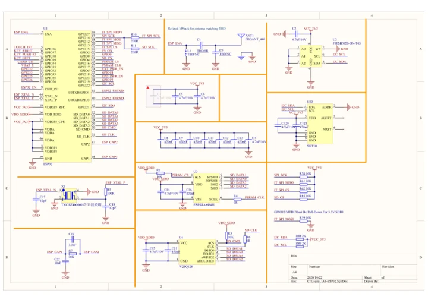

# Paper

**M5Stack** · Source collection

Revision: Unverified source identity

Coverage: Manufacturer references available; physical pinout and complete connector review are tracked separately

[Browse all manufacturers](../../../../BROWSE.md) · [Devices & IoT](../../../../DEVICES.md) · [Open in the browser guide](https://valleytech-black-wire-guide.pages.dev/?board=source-board-5654dd9b9e82931965)

Device category: **Controllers & instruments**

## Datasheets and original documentation

Board datasheet: **not yet recorded**. Visual reference: **available**.

[Manufacturer model documentation](https://docs.m5stack.com/en/core/m5paper)

- **schematic / board**: [Paper Schematics PDF — schematic](https://m5stack.oss-cn-shenzhen.aliyuncs.com/resource/docs/schematic/Core/m5paper/M5_PAPER_SCH.pdf) · [saved document](../../../../library/media/885e5b4aed56b3a429096b20892f50f1679efd772e6d6b1729bfd677db57a8c2.pdf)

A chip datasheet, schematic and board datasheet have different scopes. Match the exact hardware revision.

[Documentation coverage and remaining gaps](../../../../DOCUMENTATION.md)

## Dimensions

**source reference** · Unreviewed source · JPG

[Open original reference](../../../../library/media/4fcf1c96b32a7e67d6f690fc04d8a21cc2ae75fa001e0ae01623b0a05eb23864.jpg)

**Credit and rights:** Source rights not yet established. Source/manufacturer: M5Stack.

[Source 1](https://m5stack.oss-cn-shenzhen.aliyuncs.com/resource/docs/products/core/m5paper/module%20size.jpg) · [Source 2](https://docs.m5stack.com/en/core/m5paper)

Original source index: Dimensions. This file is searchable but has not been promoted to a reviewed physical board pinout.

Image revision: Not identified

SHA-256: `4fcf1c96b32a7e67d6f690fc04d8a21cc2ae75fa001e0ae01623b0a05eb23864`

## Paper Schematics PDF — schematic

**reference PDF** · Source model/link and PDF signature/title checked; individual pin assignments and electrical validation pending · PDF

[Open original reference](../../../../library/media/885e5b4aed56b3a429096b20892f50f1679efd772e6d6b1729bfd677db57a8c2.pdf)

**Credit and rights:** Original publisher/manufacturer artwork; redistribution and print rights not established. Attribution is not a license grant.. Source/manufacturer: M5Stack.

[Source 1](https://m5stack.oss-cn-shenzhen.aliyuncs.com/resource/docs/schematic/Core/m5paper/M5_PAPER_SCH.pdf) · [Source 2](https://docs.m5stack.com/en/core/m5paper)

Original document linked from this model’s manufacturer page. Preserve the document’s exact revision and named subassembly scope; a linked accessory schematic is not a whole-device pinout. This is a circuit schematic, not a physical board pinout.

Image revision: Use the revision printed in the original document; do not assume all hardware revisions are interchangeable

SHA-256: `885e5b4aed56b3a429096b20892f50f1679efd772e6d6b1729bfd677db57a8c2`

Pin assignments have not been independently electrically verified. Check board revision before wiring.
