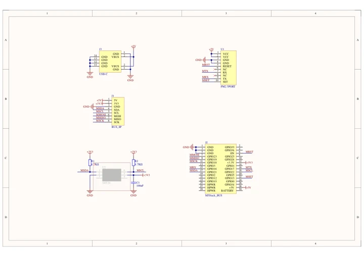
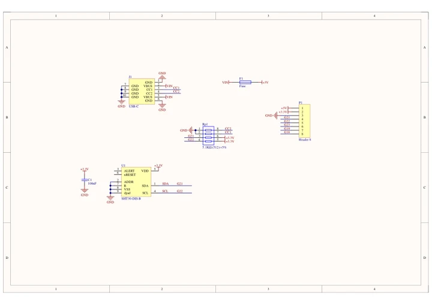
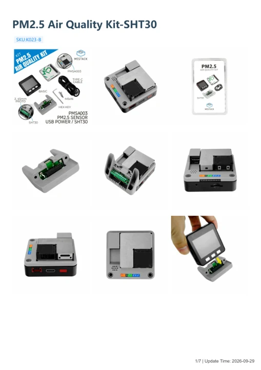

# PM2.5 Air Quality Kit-SHT30

**M5Stack** · Source collection

Revision: Unverified source identity

Coverage: Manufacturer references available; physical pinout and complete connector review are tracked separately

[Browse all manufacturers](../../../../BROWSE.md) · [Devices & IoT](../../../../DEVICES.md) · [Open in the browser guide](https://valleytech-black-wire-guide.pages.dev/?board=source-board-d8775e9e36120c2195)

## Datasheets and original documentation

Board datasheet: **not yet recorded**. Visual reference: **available**.

[Manufacturer model documentation](https://docs.m5stack.com/en/app/PM2.5_Air_Quality_Kit-SHT30)

- **schematic / board**: [Module Air Quality Schematics PDF — schematic](https://m5stack-doc.oss-cn-shenzhen.aliyuncs.com/1067/K023-B-Sch_Air.pdf) · [saved document](../../../../library/media/5ac5ff8c48954f33cd802ec7cb749a2e4c89d755d14fa6a7f0acb604c672f702.pdf)
- **schematic / board**: [Base BTC Schematics PDF — schematic](https://m5stack-doc.oss-cn-shenzhen.aliyuncs.com/1000/A011-Sch_BTC_v2.1.pdf) · [saved document](../../../../library/media/22f8c491c7351db8d4801e5eb40cf628f1d67f51735237b51e21f2a446989781.pdf)
- **hardware-guide / board**: [PM2.5 Air Quality Kit-SHT30 — manufacturer hardware guide](https://m5stack.oss-cn-shenzhen.aliyuncs.com/resource/docs/static/pdf/static/en/app/PM2.5_Air_Quality_Kit-SHT30.pdf) · [saved document](../../../../library/media/87bf5f500b3864562a0f727f4f4a3f7dc567aed362be314a40c29fd831e13093.pdf)

A chip datasheet, schematic and board datasheet have different scopes. Match the exact hardware revision.

[Documentation coverage and remaining gaps](../../../../DOCUMENTATION.md)

## Dimensions

**source reference** · Unreviewed source · PNG

[Open original reference](../../../../library/media/6677fafded7140b4020f988c9bef1a0f252a2312a82b4a10341daed9365457f5.png)

**Credit and rights:** Source rights not yet established. Source/manufacturer: M5Stack.

[Source 1](https://m5stack-doc.oss-cn-shenzhen.aliyuncs.com/1067/K023-B-model-pm2_5_v1_3_page_01.png) · [Source 2](https://docs.m5stack.com/en/app/PM2.5_Air_Quality_Kit-SHT30)

Original source index: Dimensions. This file is searchable but has not been promoted to a reviewed physical board pinout.

Image revision: Not identified

SHA-256: `6677fafded7140b4020f988c9bef1a0f252a2312a82b4a10341daed9365457f5`

## Module Air Quality Schematics PDF — schematic

**reference PDF** · Source model/link and PDF signature/title checked; individual pin assignments and electrical validation pending · PDF

[Open original reference](../../../../library/media/5ac5ff8c48954f33cd802ec7cb749a2e4c89d755d14fa6a7f0acb604c672f702.pdf)

**Credit and rights:** Original publisher/manufacturer artwork; redistribution and print rights not established. Attribution is not a license grant.. Source/manufacturer: M5Stack.

[Source 1](https://m5stack-doc.oss-cn-shenzhen.aliyuncs.com/1067/K023-B-Sch_Air.pdf) · [Source 2](https://docs.m5stack.com/en/app/PM2.5_Air_Quality_Kit-SHT30)

Original document linked from this model’s manufacturer page. Preserve the document’s exact revision and named subassembly scope; a linked accessory schematic is not a whole-device pinout. This is a circuit schematic, not a physical board pinout.

Image revision: Use the revision printed in the original document; do not assume all hardware revisions are interchangeable

SHA-256: `5ac5ff8c48954f33cd802ec7cb749a2e4c89d755d14fa6a7f0acb604c672f702`

## Base BTC Schematics PDF — schematic

**reference PDF** · Source model/link and PDF signature/title checked; individual pin assignments and electrical validation pending · PDF

[Open original reference](../../../../library/media/22f8c491c7351db8d4801e5eb40cf628f1d67f51735237b51e21f2a446989781.pdf)

**Credit and rights:** Original publisher/manufacturer artwork; redistribution and print rights not established. Attribution is not a license grant.. Source/manufacturer: M5Stack.

[Source 1](https://m5stack-doc.oss-cn-shenzhen.aliyuncs.com/1000/A011-Sch_BTC_v2.1.pdf) · [Source 2](https://docs.m5stack.com/en/app/PM2.5_Air_Quality_Kit-SHT30)

Original document linked from this model’s manufacturer page. Preserve the document’s exact revision and named subassembly scope; a linked accessory schematic is not a whole-device pinout. This is a circuit schematic, not a physical board pinout.

Image revision: Use the revision printed in the original document; do not assume all hardware revisions are interchangeable

SHA-256: `22f8c491c7351db8d4801e5eb40cf628f1d67f51735237b51e21f2a446989781`

## PM2.5 Air Quality Kit-SHT30 — manufacturer hardware guide

**reference PDF** · Source model/link and PDF signature/title checked; individual pin assignments and electrical validation pending · PDF

[Open original reference](../../../../library/media/87bf5f500b3864562a0f727f4f4a3f7dc567aed362be314a40c29fd831e13093.pdf)

**Credit and rights:** Original publisher/manufacturer artwork; redistribution and print rights not established. Attribution is not a license grant.. Source/manufacturer: M5Stack.

[Source 1](https://m5stack.oss-cn-shenzhen.aliyuncs.com/resource/docs/static/pdf/static/en/app/PM2.5_Air_Quality_Kit-SHT30.pdf) · [Source 2](https://docs.m5stack.com/en/app/PM2.5_Air_Quality_Kit-SHT30)

Original document linked from this model’s manufacturer page. Preserve the document’s exact revision and named subassembly scope; a linked accessory schematic is not a whole-device pinout. This is a hardware manual, not a separately classified board datasheet.

Image revision: Use the revision printed in the original document; do not assume all hardware revisions are interchangeable

SHA-256: `87bf5f500b3864562a0f727f4f4a3f7dc567aed362be314a40c29fd831e13093`

Pin assignments have not been independently electrically verified. Check board revision before wiring.
