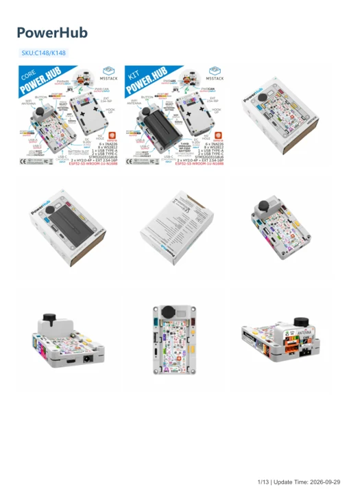
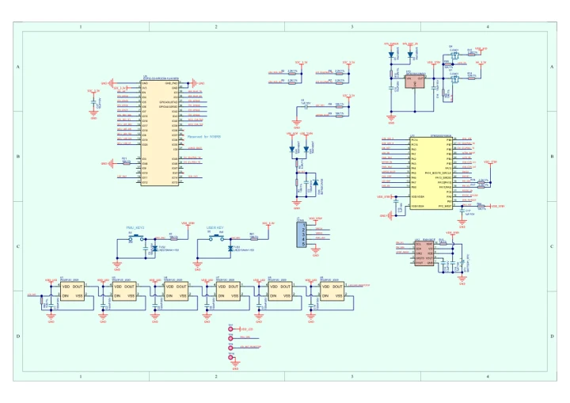
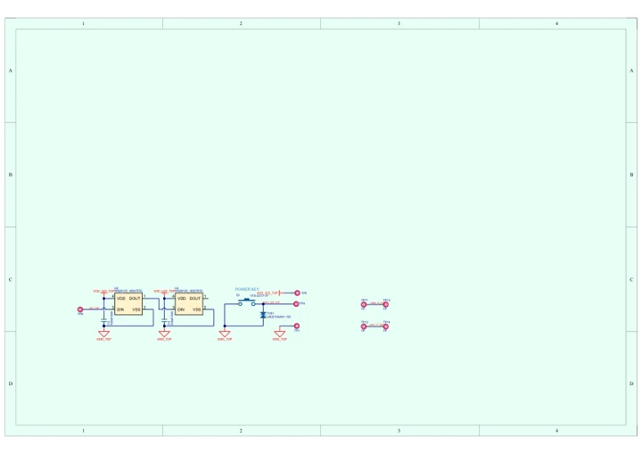

# PowerHub

**M5Stack** · Source collection

Revision: Unverified source identity

Coverage: Manufacturer references available; physical pinout and complete connector review are tracked separately

[Browse all manufacturers](../../../../BROWSE.md) · [Devices & IoT](../../../../DEVICES.md) · [Open in the browser guide](https://valleytech-black-wire-guide.pages.dev/?board=source-board-6185da76f83b0f69dd)

## Datasheets and original documentation

Board datasheet: **not yet recorded**. Visual reference: **available**.

[Manufacturer model documentation](https://docs.m5stack.com/en/core/PowerHub)

- **hardware-guide / board**: [PowerHub — manufacturer hardware guide](https://m5stack.oss-cn-shenzhen.aliyuncs.com/resource/docs/static/pdf/static/en/core/PowerHub.pdf) · [saved document](../../../../library/media/4211cfb6359d832d30ef6ca9556ff4e8b45df392f9cf8b6f2ae61d9ae874947a.pdf)
- **schematic / board**: [PowerHub Mainboard Schematics PDF — schematic](https://m5stack-doc.oss-cn-shenzhen.aliyuncs.com/1183/PowerHub_SCH_Main_b0.3_20250704_Docs_2025_09_09_14_01_58.pdf) · [saved document](../../../../library/media/45f49ece52cecc73bcc4c3d650d3676555f0408a55284f6dff85a8feb4e5d1c3.pdf)
- **schematic / board**: [PowerHub Baseboard Schematics PDF — schematic](https://m5stack-doc.oss-cn-shenzhen.aliyuncs.com/1183/PowerHub_SCH_ext_b03_20250718_Docs_2025_09_09_14_01_53.pdf) · [saved document](../../../../library/media/8a49a5c41bf3ac027cee34e36c6ec90c473cc617c45bc2ed9a64a9bd105282e8.pdf)

A chip datasheet, schematic and board datasheet have different scopes. Match the exact hardware revision.

[Documentation coverage and remaining gaps](../../../../DOCUMENTATION.md)

## Dimensions

**source reference** · Unreviewed source · PNG

[Open original reference](../../../../library/media/bbca08521c9e31e2b73425881e035a88470df4c4dfb702e2d3ae23ce549d7794.png)

**Credit and rights:** Source rights not yet established. Source/manufacturer: M5Stack.

[Source 1](https://m5stack-doc.oss-cn-shenzhen.aliyuncs.com/1183/K148_Model_Size_01_page_01.png) · [Source 2](https://docs.m5stack.com/en/core/PowerHub)

Original source index: Dimensions. This file is searchable but has not been promoted to a reviewed physical board pinout.

Image revision: Not identified

SHA-256: `bbca08521c9e31e2b73425881e035a88470df4c4dfb702e2d3ae23ce549d7794`

## PowerHub — manufacturer hardware guide

**reference PDF** · Source model/link and PDF signature/title checked; individual pin assignments and electrical validation pending · PDF

[Open original reference](../../../../library/media/4211cfb6359d832d30ef6ca9556ff4e8b45df392f9cf8b6f2ae61d9ae874947a.pdf)

**Credit and rights:** Original publisher/manufacturer artwork; redistribution and print rights not established. Attribution is not a license grant.. Source/manufacturer: M5Stack.

[Source 1](https://m5stack.oss-cn-shenzhen.aliyuncs.com/resource/docs/static/pdf/static/en/core/PowerHub.pdf) · [Source 2](https://docs.m5stack.com/en/core/PowerHub)

Original document linked from this model’s manufacturer page. Preserve the document’s exact revision and named subassembly scope; a linked accessory schematic is not a whole-device pinout. This is a hardware manual, not a separately classified board datasheet.

Image revision: Use the revision printed in the original document; do not assume all hardware revisions are interchangeable

SHA-256: `4211cfb6359d832d30ef6ca9556ff4e8b45df392f9cf8b6f2ae61d9ae874947a`

## PowerHub Mainboard Schematics PDF — schematic

**reference PDF** · Source model/link and PDF signature/title checked; individual pin assignments and electrical validation pending · PDF

[Open original reference](../../../../library/media/45f49ece52cecc73bcc4c3d650d3676555f0408a55284f6dff85a8feb4e5d1c3.pdf)

**Credit and rights:** Original publisher/manufacturer artwork; redistribution and print rights not established. Attribution is not a license grant.. Source/manufacturer: M5Stack.

[Source 1](https://m5stack-doc.oss-cn-shenzhen.aliyuncs.com/1183/PowerHub_SCH_Main_b0.3_20250704_Docs_2025_09_09_14_01_58.pdf) · [Source 2](https://docs.m5stack.com/en/core/PowerHub)

Original document linked from this model’s manufacturer page. Preserve the document’s exact revision and named subassembly scope; a linked accessory schematic is not a whole-device pinout. This is a circuit schematic, not a physical board pinout.

Image revision: Use the revision printed in the original document; do not assume all hardware revisions are interchangeable

SHA-256: `45f49ece52cecc73bcc4c3d650d3676555f0408a55284f6dff85a8feb4e5d1c3`

## PowerHub Baseboard Schematics PDF — schematic

**reference PDF** · Source model/link and PDF signature/title checked; individual pin assignments and electrical validation pending · PDF

[Open original reference](../../../../library/media/8a49a5c41bf3ac027cee34e36c6ec90c473cc617c45bc2ed9a64a9bd105282e8.pdf)

**Credit and rights:** Original publisher/manufacturer artwork; redistribution and print rights not established. Attribution is not a license grant.. Source/manufacturer: M5Stack.

[Source 1](https://m5stack-doc.oss-cn-shenzhen.aliyuncs.com/1183/PowerHub_SCH_ext_b03_20250718_Docs_2025_09_09_14_01_53.pdf) · [Source 2](https://docs.m5stack.com/en/core/PowerHub)

Original document linked from this model’s manufacturer page. Preserve the document’s exact revision and named subassembly scope; a linked accessory schematic is not a whole-device pinout. This is a circuit schematic, not a physical board pinout.

Image revision: Use the revision printed in the original document; do not assume all hardware revisions are interchangeable

SHA-256: `8a49a5c41bf3ac027cee34e36c6ec90c473cc617c45bc2ed9a64a9bd105282e8`

Pin assignments have not been independently electrically verified. Check board revision before wiring.
