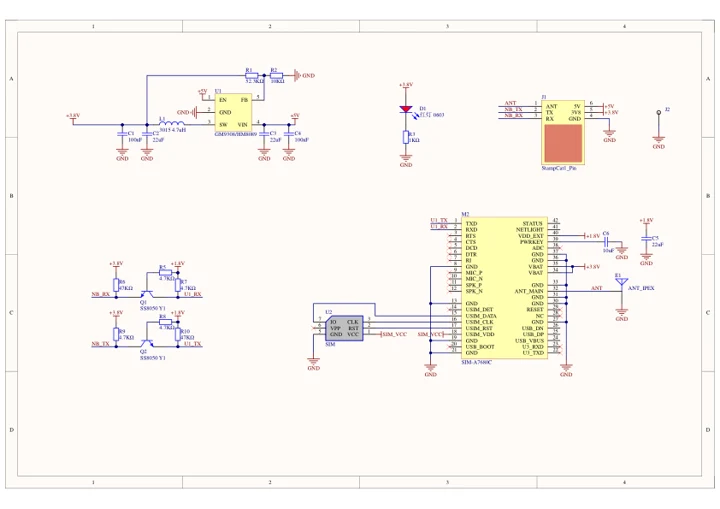
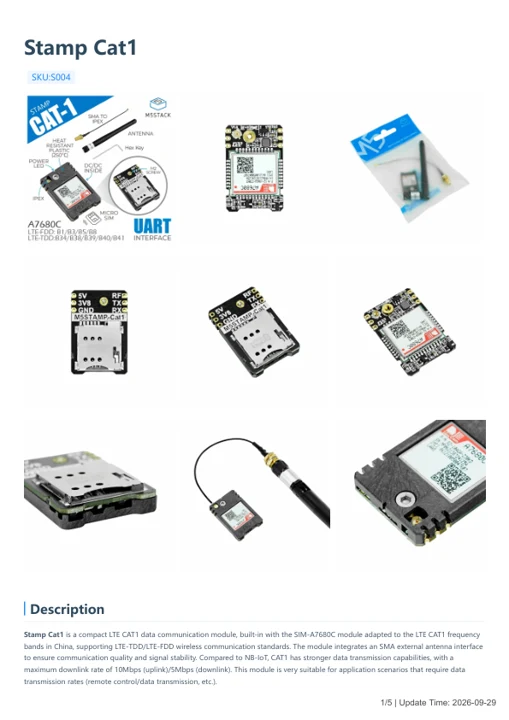

# Stamp Cat1

**M5Stack** · Source collection

Revision: Unverified source identity

Coverage: Manufacturer references available; physical pinout and complete connector review are tracked separately

[Browse all manufacturers](../../../../BROWSE.md) · [Devices & IoT](../../../../DEVICES.md) · [Open in the browser guide](https://valleytech-black-wire-guide.pages.dev/?board=source-board-fce2e6219b7df281a8)

## Datasheets and original documentation

Board datasheet: **not yet recorded**. Visual reference: **available**.

[Manufacturer model documentation](https://docs.m5stack.com/en/stamp/stamp_cat1)

- **schematic / board**: [Stamp Cat1 Schematics PDF — schematic](https://m5stack-doc.oss-cn-shenzhen.aliyuncs.com/570/Sch_StampCat1.pdf) · [saved document](../../../../library/media/080d5469aac5d8fa56459b97ddcedf74ebc118f3e635e1da854152f87038df4f.pdf)
- **hardware-guide / board**: [Stamp Cat1 — manufacturer hardware guide](https://m5stack.oss-cn-shenzhen.aliyuncs.com/resource/docs/static/pdf/static/en/stamp/Stamp_Cat1.pdf) · [saved document](../../../../library/media/1cad84d81d140f39bd0f8ae6a2e8ce2af5053fc1c0293733bb5a8a17b9cf0872.pdf)

A chip datasheet, schematic and board datasheet have different scopes. Match the exact hardware revision.

[Documentation coverage and remaining gaps](../../../../DOCUMENTATION.md)

## Dimensions

**source reference** · Unreviewed source · JPG

[Open original reference](../../../../library/media/b5eae09f63c272e2e917b0e9b3c060069ecc3bab1fd20abfadd68a5f34553a11.jpg)

**Credit and rights:** Source rights not yet established. Source/manufacturer: M5Stack.

[Source 1](https://static-cdn.m5stack.com/resource/docs/products/stamp/stamp_cat1/stamp_com_size_01.webp) · [Source 2](https://docs.m5stack.com/en/stamp/stamp_cat1)

Original source index: Dimensions. This file is searchable but has not been promoted to a reviewed physical board pinout.

Image revision: Not identified

SHA-256: `b5eae09f63c272e2e917b0e9b3c060069ecc3bab1fd20abfadd68a5f34553a11`

## Stamp Cat1 Schematics PDF — schematic

**reference PDF** · Source model/link and PDF signature/title checked; individual pin assignments and electrical validation pending · PDF

[Open original reference](../../../../library/media/080d5469aac5d8fa56459b97ddcedf74ebc118f3e635e1da854152f87038df4f.pdf)

**Credit and rights:** Original publisher/manufacturer artwork; redistribution and print rights not established. Attribution is not a license grant.. Source/manufacturer: M5Stack.

[Source 1](https://m5stack-doc.oss-cn-shenzhen.aliyuncs.com/570/Sch_StampCat1.pdf) · [Source 2](https://docs.m5stack.com/en/stamp/stamp_cat1)

Original document linked from this model’s manufacturer page. Preserve the document’s exact revision and named subassembly scope; a linked accessory schematic is not a whole-device pinout. This is a circuit schematic, not a physical board pinout.

Image revision: Use the revision printed in the original document; do not assume all hardware revisions are interchangeable

SHA-256: `080d5469aac5d8fa56459b97ddcedf74ebc118f3e635e1da854152f87038df4f`

## Stamp Cat1 — manufacturer hardware guide

**reference PDF** · Source model/link and PDF signature/title checked; individual pin assignments and electrical validation pending · PDF

[Open original reference](../../../../library/media/1cad84d81d140f39bd0f8ae6a2e8ce2af5053fc1c0293733bb5a8a17b9cf0872.pdf)

**Credit and rights:** Original publisher/manufacturer artwork; redistribution and print rights not established. Attribution is not a license grant.. Source/manufacturer: M5Stack.

[Source 1](https://m5stack.oss-cn-shenzhen.aliyuncs.com/resource/docs/static/pdf/static/en/stamp/Stamp_Cat1.pdf) · [Source 2](https://docs.m5stack.com/en/stamp/stamp_cat1)

Original document linked from this model’s manufacturer page. Preserve the document’s exact revision and named subassembly scope; a linked accessory schematic is not a whole-device pinout. This is a hardware manual, not a separately classified board datasheet.

Image revision: Use the revision printed in the original document; do not assume all hardware revisions are interchangeable

SHA-256: `1cad84d81d140f39bd0f8ae6a2e8ce2af5053fc1c0293733bb5a8a17b9cf0872`

Pin assignments have not been independently electrically verified. Check board revision before wiring.
