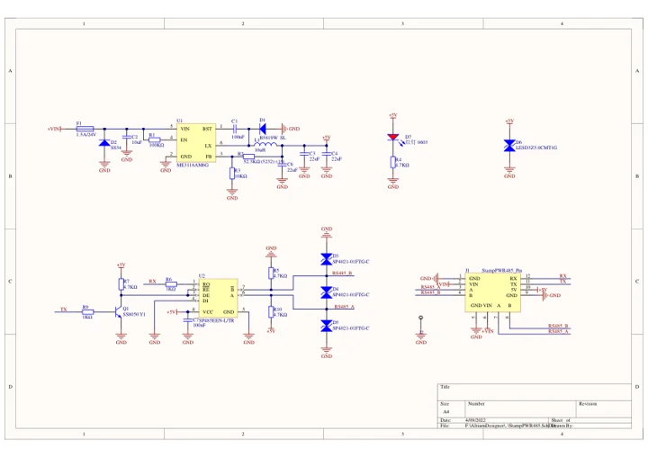

# Stamp PWR485

**M5Stack** · Source collection

Revision: Unverified source identity

Coverage: Manufacturer references available; physical pinout and complete connector review are tracked separately

[Browse all manufacturers](../../../../BROWSE.md) · [Devices & IoT](../../../../DEVICES.md) · [Open in the browser guide](https://valleytech-black-wire-guide.pages.dev/?board=source-board-530769f84cc4ce6441)

## Datasheets and original documentation

Board datasheet: **not yet recorded**. Visual reference: **available**.

[Manufacturer model documentation](https://docs.m5stack.com/en/stamp/stamp_pwr485)

- **schematic / board**: [Stamp PWR485 Schematics PDF — schematic](https://m5stack-doc.oss-cn-shenzhen.aliyuncs.com/567/Sch_StampPWR485.pdf) · [saved document](../../../../library/media/8f6854089bc36de778483c12d1b111fbae11c4b7b73bf6c62c96185ea3a912d6.pdf)

A chip datasheet, schematic and board datasheet have different scopes. Match the exact hardware revision.

[Documentation coverage and remaining gaps](../../../../DOCUMENTATION.md)

## Dimensions

**source reference** · Unreviewed source · PNG

[Open original reference](../../../../library/media/9d1922406a6dcbad0193f0f6f37cbdd84ee75716f023070c5e8563cabf2c48f8.png)

**Credit and rights:** Source rights not yet established. Source/manufacturer: M5Stack.

[Source 1](https://m5stack-doc.oss-cn-shenzhen.aliyuncs.com/1032/S001-model-size-STAMP-485_page_01.png) · [Source 2](https://docs.m5stack.com/en/stamp/stamp_pwr485)

Original source index: Dimensions. This file is searchable but has not been promoted to a reviewed physical board pinout.

Image revision: Not identified

SHA-256: `9d1922406a6dcbad0193f0f6f37cbdd84ee75716f023070c5e8563cabf2c48f8`

## Stamp PWR485 Schematics PDF — schematic

**reference PDF** · Source model/link and PDF signature/title checked; individual pin assignments and electrical validation pending · PDF

[Open original reference](../../../../library/media/8f6854089bc36de778483c12d1b111fbae11c4b7b73bf6c62c96185ea3a912d6.pdf)

**Credit and rights:** Original publisher/manufacturer artwork; redistribution and print rights not established. Attribution is not a license grant.. Source/manufacturer: M5Stack.

[Source 1](https://m5stack-doc.oss-cn-shenzhen.aliyuncs.com/567/Sch_StampPWR485.pdf) · [Source 2](https://docs.m5stack.com/en/stamp/stamp_pwr485)

Original document linked from this model’s manufacturer page. Preserve the document’s exact revision and named subassembly scope; a linked accessory schematic is not a whole-device pinout. This is a circuit schematic, not a physical board pinout.

Image revision: Use the revision printed in the original document; do not assume all hardware revisions are interchangeable

SHA-256: `8f6854089bc36de778483c12d1b111fbae11c4b7b73bf6c62c96185ea3a912d6`

Pin assignments have not been independently electrically verified. Check board revision before wiring.
