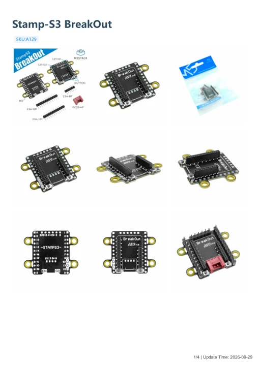

# Stamp-S3 BreakOut

**M5Stack** · Source collection

Revision: Unverified source identity

Coverage: Manufacturer references available; physical pinout and complete connector review are tracked separately

[Browse all manufacturers](../../../../BROWSE.md) · [Devices & IoT](../../../../DEVICES.md) · [Open in the browser guide](https://valleytech-black-wire-guide.pages.dev/?board=source-board-3f9607529b57eb2ff6)

## Datasheets and original documentation

Board datasheet: **not yet recorded**. Visual reference: **available**.

[Manufacturer model documentation](https://docs.m5stack.com/en/stamp/StampS3BreakOut)

- **hardware-guide / board**: [Stamp-S3 BreakOut — manufacturer hardware guide](https://m5stack.oss-cn-shenzhen.aliyuncs.com/resource/docs/static/pdf/static/en/stamp/Stamp-S3_BreakOut.pdf) · [saved document](../../../../library/media/07e2db7e6b9d4619214e9789ab80b57399d45032973f942413faed63fc7ae61f.pdf)

A chip datasheet, schematic and board datasheet have different scopes. Match the exact hardware revision.

[Documentation coverage and remaining gaps](../../../../DOCUMENTATION.md)

## Dimensions

**source reference** · Unreviewed source · PNG

[Open original reference](../../../../library/media/e37955fa9fde10d9c899dedfdc11474d5905de5f223ace3eea6b7e5d16983181.png)

**Credit and rights:** Source rights not yet established. Source/manufacturer: M5Stack.

[Source 1](https://static-cdn.m5stack.com/resource/docs/products/unit/StampS3BreakOut/img-936aff59-912e-4a07-b254-6b248529c427.png) · [Source 2](https://docs.m5stack.com/en/stamp/StampS3BreakOut)

Original source index: Dimensions. This file is searchable but has not been promoted to a reviewed physical board pinout.

Image revision: Not identified

SHA-256: `e37955fa9fde10d9c899dedfdc11474d5905de5f223ace3eea6b7e5d16983181`

## Stamp-S3 BreakOut — manufacturer hardware guide

**reference PDF** · Source model/link and PDF signature/title checked; individual pin assignments and electrical validation pending · PDF

[Open original reference](../../../../library/media/07e2db7e6b9d4619214e9789ab80b57399d45032973f942413faed63fc7ae61f.pdf)

**Credit and rights:** Original publisher/manufacturer artwork; redistribution and print rights not established. Attribution is not a license grant.. Source/manufacturer: M5Stack.

[Source 1](https://m5stack.oss-cn-shenzhen.aliyuncs.com/resource/docs/static/pdf/static/en/stamp/Stamp-S3_BreakOut.pdf) · [Source 2](https://docs.m5stack.com/en/stamp/StampS3BreakOut)

Original document linked from this model’s manufacturer page. Preserve the document’s exact revision and named subassembly scope; a linked accessory schematic is not a whole-device pinout. This is a hardware manual, not a separately classified board datasheet.

Image revision: Use the revision printed in the original document; do not assume all hardware revisions are interchangeable

SHA-256: `07e2db7e6b9d4619214e9789ab80b57399d45032973f942413faed63fc7ae61f`

Pin assignments have not been independently electrically verified. Check board revision before wiring.
