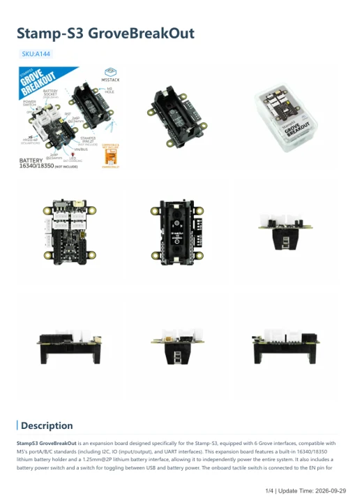
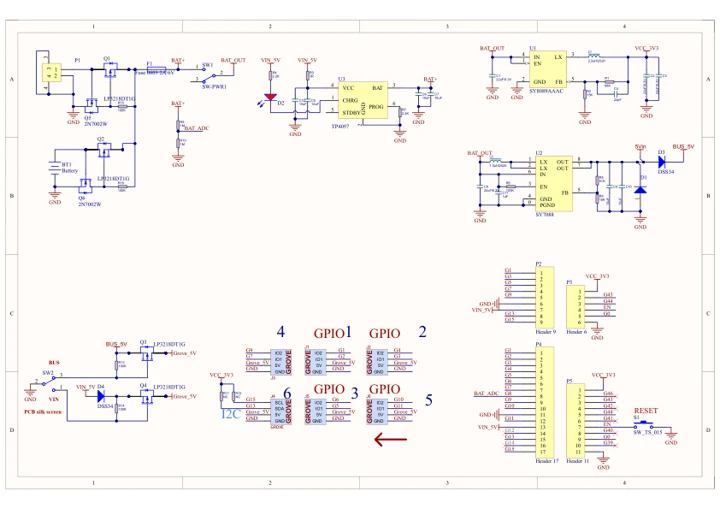

# Stamp-S3 GroveBreakOut

**M5Stack** · Source collection

Revision: Unverified source identity

Coverage: Manufacturer references available; physical pinout and complete connector review are tracked separately

[Browse all manufacturers](../../../../BROWSE.md) · [Devices & IoT](../../../../DEVICES.md) · [Open in the browser guide](https://valleytech-black-wire-guide.pages.dev/?board=source-board-78bad7861e820767c0)

## Datasheets and original documentation

Board datasheet: **not yet recorded**. Visual reference: **available**.

[Manufacturer model documentation](https://docs.m5stack.com/en/accessory/StampS3%20GroveBreakOut)

- **hardware-guide / board**: [Stamp-S3 GroveBreakOut — manufacturer hardware guide](https://m5stack.oss-cn-shenzhen.aliyuncs.com/resource/docs/static/pdf/static/en/accessory/Stamp-S3_GroveBreakOut.pdf) · [saved document](../../../../library/media/f83ba53eca9e88ef410c446adf4deb0f44edf67c0c48467e3515f5a50042d74a.pdf)
- **schematic / board**: [Stamp-S3 GroveBreakOut Schematics PDF — schematic](https://m5stack-doc.oss-cn-shenzhen.aliyuncs.com/538/SCH_StampS3GroveBreakOut_V1.0.pdf) · [saved document](../../../../library/media/6848184cfbdbe96507c27ed4c54a52ad1e5d3ed9f8380fec07b1a913b7ffc595.pdf)

A chip datasheet, schematic and board datasheet have different scopes. Match the exact hardware revision.

[Documentation coverage and remaining gaps](../../../../DOCUMENTATION.md)

## Dimensions

**source reference** · Unreviewed source · JPG

[Open original reference](../../../../library/media/28cb00b216741caf80202efdad32bf6a70b74d60d1cbacf2d6ecbc0a415a4d01.jpg)

**Credit and rights:** Source rights not yet established. Source/manufacturer: M5Stack.

[Source 1](https://static-cdn.m5stack.com/resource/docs/products/accessory/StampS3 GroveBreakOut/img-e8ab287a-1891-4198-b612-2fc70f785838.jpg) · [Source 2](https://docs.m5stack.com/en/accessory/StampS3%20GroveBreakOut)

Original source index: Dimensions. This file is searchable but has not been promoted to a reviewed physical board pinout.

Image revision: Not identified

SHA-256: `28cb00b216741caf80202efdad32bf6a70b74d60d1cbacf2d6ecbc0a415a4d01`

## Stamp-S3 GroveBreakOut — manufacturer hardware guide

**reference PDF** · Source model/link and PDF signature/title checked; individual pin assignments and electrical validation pending · PDF

[Open original reference](../../../../library/media/f83ba53eca9e88ef410c446adf4deb0f44edf67c0c48467e3515f5a50042d74a.pdf)

**Credit and rights:** Original publisher/manufacturer artwork; redistribution and print rights not established. Attribution is not a license grant.. Source/manufacturer: M5Stack.

[Source 1](https://m5stack.oss-cn-shenzhen.aliyuncs.com/resource/docs/static/pdf/static/en/accessory/Stamp-S3_GroveBreakOut.pdf) · [Source 2](https://docs.m5stack.com/en/accessory/StampS3%20GroveBreakOut)

Original document linked from this model’s manufacturer page. Preserve the document’s exact revision and named subassembly scope; a linked accessory schematic is not a whole-device pinout. This is a hardware manual, not a separately classified board datasheet.

Image revision: Use the revision printed in the original document; do not assume all hardware revisions are interchangeable

SHA-256: `f83ba53eca9e88ef410c446adf4deb0f44edf67c0c48467e3515f5a50042d74a`

## Stamp-S3 GroveBreakOut Schematics PDF — schematic

**reference PDF** · Source model/link and PDF signature/title checked; individual pin assignments and electrical validation pending · PDF

[Open original reference](../../../../library/media/6848184cfbdbe96507c27ed4c54a52ad1e5d3ed9f8380fec07b1a913b7ffc595.pdf)

**Credit and rights:** Original publisher/manufacturer artwork; redistribution and print rights not established. Attribution is not a license grant.. Source/manufacturer: M5Stack.

[Source 1](https://m5stack-doc.oss-cn-shenzhen.aliyuncs.com/538/SCH_StampS3GroveBreakOut_V1.0.pdf) · [Source 2](https://docs.m5stack.com/en/accessory/StampS3%20GroveBreakOut)

Original document linked from this model’s manufacturer page. Preserve the document’s exact revision and named subassembly scope; a linked accessory schematic is not a whole-device pinout. This is a circuit schematic, not a physical board pinout.

Image revision: Use the revision printed in the original document; do not assume all hardware revisions are interchangeable

SHA-256: `6848184cfbdbe96507c27ed4c54a52ad1e5d3ed9f8380fec07b1a913b7ffc595`

Pin assignments have not been independently electrically verified. Check board revision before wiring.
