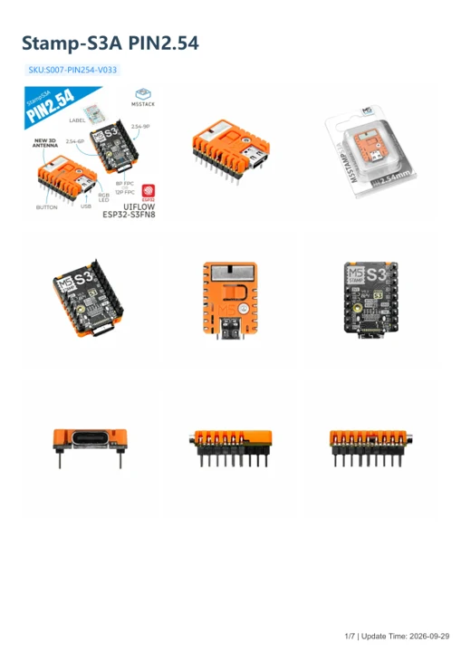

# Stamp-S3A PIN2.54

**M5Stack** · Source collection

Revision: Unverified source identity

Coverage: Manufacturer references available; physical pinout and complete connector review are tracked separately

[Browse all manufacturers](../../../../BROWSE.md) · [Devices & IoT](../../../../DEVICES.md) · [Open in the browser guide](https://valleytech-black-wire-guide.pages.dev/?board=source-board-aacdff2ecaa00a03c9)

## Datasheets and original documentation

Board datasheet: **not yet recorded**. Visual reference: **available**.

[Manufacturer model documentation](https://docs.m5stack.com/en/core/Stamp-S3A_PIN254)

- **schematic / board**: [Stamp-S3A Schematics PDF — schematic](https://m5stack-doc.oss-cn-shenzhen.aliyuncs.com/1150/Sch_StampS3_v0.3.3.pdf) · [saved document](../../../../library/media/2f9610aecc5a5d2ee51b33c75df31cf90c7639d2997e7a2bb147ba8d46b46966.pdf)
- **hardware-guide / board**: [Stamp-S3A PIN2.54 — manufacturer hardware guide](https://m5stack.oss-cn-shenzhen.aliyuncs.com/resource/docs/static/pdf/static/en/core/Stamp-S3A_PIN2.54.pdf) · [saved document](../../../../library/media/d06e3fa42b89fb86fd77fabe916487686acdf207296ccf1292e400cfae62280a.pdf)

A chip datasheet, schematic and board datasheet have different scopes. Match the exact hardware revision.

[Documentation coverage and remaining gaps](../../../../DOCUMENTATION.md)

## Dimensions

**source reference** · Unreviewed source · PNG

[Open original reference](../../../../library/media/5dfa76fd9ff5d578ae378f62b0f5982637982375f799290101aab9f7dc8f5138.png)

**Credit and rights:** Source rights not yet established. Source/manufacturer: M5Stack.

[Source 1](https://m5stack-doc.oss-cn-shenzhen.aliyuncs.com/1181/stamps3a-254_page_01.png) · [Source 2](https://docs.m5stack.com/en/core/Stamp-S3A_PIN254)

Original source index: Dimensions. This file is searchable but has not been promoted to a reviewed physical board pinout.

Image revision: Not identified

SHA-256: `5dfa76fd9ff5d578ae378f62b0f5982637982375f799290101aab9f7dc8f5138`

## Stamp-S3A Schematics PDF — schematic

**reference PDF** · Source model/link and PDF signature/title checked; individual pin assignments and electrical validation pending · PDF

[Open original reference](../../../../library/media/2f9610aecc5a5d2ee51b33c75df31cf90c7639d2997e7a2bb147ba8d46b46966.pdf)

**Credit and rights:** Original publisher/manufacturer artwork; redistribution and print rights not established. Attribution is not a license grant.. Source/manufacturer: M5Stack.

[Source 1](https://m5stack-doc.oss-cn-shenzhen.aliyuncs.com/1150/Sch_StampS3_v0.3.3.pdf) · [Source 2](https://docs.m5stack.com/en/core/Stamp-S3A)

Original document linked from this model’s manufacturer page. Preserve the document’s exact revision and named subassembly scope; a linked accessory schematic is not a whole-device pinout. This is a circuit schematic, not a physical board pinout.

Image revision: Use the revision printed in the original document; do not assume all hardware revisions are interchangeable

SHA-256: `2f9610aecc5a5d2ee51b33c75df31cf90c7639d2997e7a2bb147ba8d46b46966`

## StampS3A physical pad and connector map

**pinout image** · Visually reviewed for identity and reference scope; independent electrical review pending · JPG

[Open original reference](../../../../library/media/979f3572d60fd9ef9017bb28f0953ba59f48072d7c8bcdfa07f916a3060493d3.jpg)

**Credit and rights:** Original publisher/manufacturer artwork; redistribution and print rights not established. Attribution is not a license grant.. Source/manufacturer: M5Stack.

[Source 1](https://m5stack-doc.oss-cn-shenzhen.aliyuncs.com/686/S007-PIN127-V033_PinMap_01.jpg) · [Source 2](https://docs.m5stack.com/en/core/Stamp-S3A_PIN254)

Manufacturer links this common map from StampS3A and PIN254 pages. Header pitch/assembly variants differ; verify the pictured layout and revision.

Image revision: Use the revision printed in the original document; do not assume all hardware revisions are interchangeable

SHA-256: `979f3572d60fd9ef9017bb28f0953ba59f48072d7c8bcdfa07f916a3060493d3`

## Stamp-S3A PIN2.54 — manufacturer hardware guide

**reference PDF** · Source model/link and PDF signature/title checked; individual pin assignments and electrical validation pending · PDF

[Open original reference](../../../../library/media/d06e3fa42b89fb86fd77fabe916487686acdf207296ccf1292e400cfae62280a.pdf)

**Credit and rights:** Original publisher/manufacturer artwork; redistribution and print rights not established. Attribution is not a license grant.. Source/manufacturer: M5Stack.

[Source 1](https://m5stack.oss-cn-shenzhen.aliyuncs.com/resource/docs/static/pdf/static/en/core/Stamp-S3A_PIN2.54.pdf) · [Source 2](https://docs.m5stack.com/en/core/Stamp-S3A_PIN254)

Original document linked from this model’s manufacturer page. Preserve the document’s exact revision and named subassembly scope; a linked accessory schematic is not a whole-device pinout. This is a hardware manual, not a separately classified board datasheet.

Image revision: Use the revision printed in the original document; do not assume all hardware revisions are interchangeable

SHA-256: `d06e3fa42b89fb86fd77fabe916487686acdf207296ccf1292e400cfae62280a`

Pin assignments have not been independently electrically verified. Check board revision before wiring.
