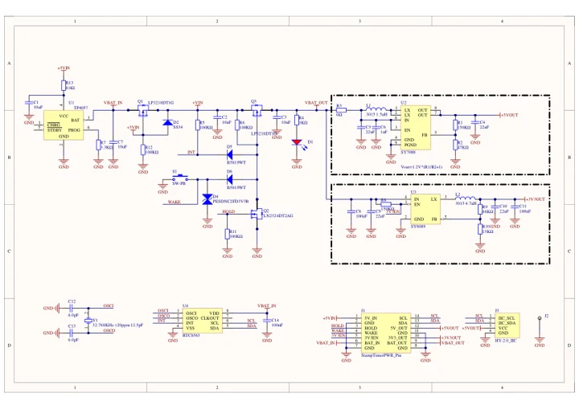
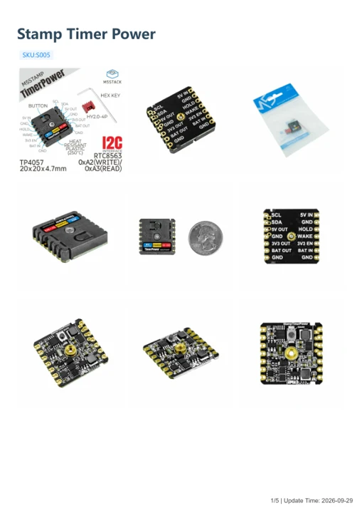

# Stamp Timer Power

**M5Stack** · Source collection

Revision: Unverified source identity

Coverage: Manufacturer references available; physical pinout and complete connector review are tracked separately

[Browse all manufacturers](../../../../BROWSE.md) · [Devices & IoT](../../../../DEVICES.md) · [Open in the browser guide](https://valleytech-black-wire-guide.pages.dev/?board=source-board-60f1879faa5e41dd97)

## Datasheets and original documentation

Board datasheet: **not yet recorded**. Visual reference: **available**.

[Manufacturer model documentation](https://docs.m5stack.com/en/module/StampTimerPower)

- **schematic / board**: [Stamp Timer Power Schematics PDF — schematic](https://m5stack-doc.oss-cn-shenzhen.aliyuncs.com/571/Sch_StampTimerPower_v1.2.pdf) · [saved document](../../../../library/media/c22d5cd5070f41e2726e86822fdc755305103907511c64cbfd6d2df8d655f2be.pdf)
- **hardware-guide / board**: [Stamp Timer Power — manufacturer hardware guide](https://m5stack.oss-cn-shenzhen.aliyuncs.com/resource/docs/static/pdf/static/en/stamp/Stamp_Timer_Power.pdf) · [saved document](../../../../library/media/32cd89a51f4093d5b33b3c9587b73ff6a5d749d263cbcbe64d8ba50af91a907e.pdf)

A chip datasheet, schematic and board datasheet have different scopes. Match the exact hardware revision.

[Documentation coverage and remaining gaps](../../../../DOCUMENTATION.md)

## Dimensions

**source reference** · Unreviewed source · PNG

[Open original reference](../../../../library/media/24718303b12de385ab81e832c970049cfaa081e84e48840a5d9b01666a3a3bf9.png)

**Credit and rights:** Source rights not yet established. Source/manufacturer: M5Stack.

[Source 1](https://m5stack-doc.oss-cn-shenzhen.aliyuncs.com/1036/S005-model-size-STAMP-Timerpower_page_01.png) · [Source 2](https://docs.m5stack.com/en/module/StampTimerPower)

Original source index: Dimensions. This file is searchable but has not been promoted to a reviewed physical board pinout.

Image revision: Not identified

SHA-256: `24718303b12de385ab81e832c970049cfaa081e84e48840a5d9b01666a3a3bf9`

## Stamp Timer Power Schematics PDF — schematic

**reference PDF** · Source model/link and PDF signature/title checked; individual pin assignments and electrical validation pending · PDF

[Open original reference](../../../../library/media/c22d5cd5070f41e2726e86822fdc755305103907511c64cbfd6d2df8d655f2be.pdf)

**Credit and rights:** Original publisher/manufacturer artwork; redistribution and print rights not established. Attribution is not a license grant.. Source/manufacturer: M5Stack.

[Source 1](https://m5stack-doc.oss-cn-shenzhen.aliyuncs.com/571/Sch_StampTimerPower_v1.2.pdf) · [Source 2](https://docs.m5stack.com/en/module/StampTimerPower)

Original document linked from this model’s manufacturer page. Preserve the document’s exact revision and named subassembly scope; a linked accessory schematic is not a whole-device pinout. This is a circuit schematic, not a physical board pinout.

Image revision: Use the revision printed in the original document; do not assume all hardware revisions are interchangeable

SHA-256: `c22d5cd5070f41e2726e86822fdc755305103907511c64cbfd6d2df8d655f2be`

## Stamp Timer Power — manufacturer hardware guide

**reference PDF** · Source model/link and PDF signature/title checked; individual pin assignments and electrical validation pending · PDF

[Open original reference](../../../../library/media/32cd89a51f4093d5b33b3c9587b73ff6a5d749d263cbcbe64d8ba50af91a907e.pdf)

**Credit and rights:** Original publisher/manufacturer artwork; redistribution and print rights not established. Attribution is not a license grant.. Source/manufacturer: M5Stack.

[Source 1](https://m5stack.oss-cn-shenzhen.aliyuncs.com/resource/docs/static/pdf/static/en/stamp/Stamp_Timer_Power.pdf) · [Source 2](https://docs.m5stack.com/en/module/StampTimerPower)

Original document linked from this model’s manufacturer page. Preserve the document’s exact revision and named subassembly scope; a linked accessory schematic is not a whole-device pinout. This is a hardware manual, not a separately classified board datasheet.

Image revision: Use the revision printed in the original document; do not assume all hardware revisions are interchangeable

SHA-256: `32cd89a51f4093d5b33b3c9587b73ff6a5d749d263cbcbe64d8ba50af91a907e`

Pin assignments have not been independently electrically verified. Check board revision before wiring.
