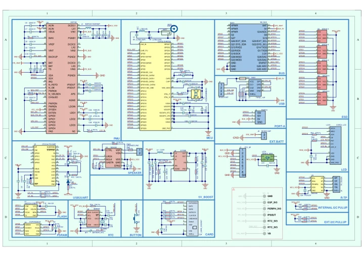

# Tough

**M5Stack** · Source collection

Revision: Unverified source identity

Coverage: Manufacturer references available; physical pinout and complete connector review are tracked separately

[Browse all manufacturers](../../../../BROWSE.md) · [Devices & IoT](../../../../DEVICES.md) · [Open in the browser guide](https://valleytech-black-wire-guide.pages.dev/?board=source-board-16add3f5d8350cb185)

Device category: **Controllers & instruments**

## Datasheets and original documentation

Board datasheet: **not yet recorded**. Visual reference: **available**.

[Manufacturer model documentation](https://docs.m5stack.com/en/core/tough)

- **schematic / board**: [Tough Schematics PDF — schematic](https://m5stack-doc.oss-cn-shenzhen.aliyuncs.com/647/Tough-Schematics-PDF.pdf) · [saved document](../../../../library/media/0ca43ae786abc18a20b3cf9292e444a311a8f8acd661a56bfdcea8e631e2c3ab.pdf)

A chip datasheet, schematic and board datasheet have different scopes. Match the exact hardware revision.

[Documentation coverage and remaining gaps](../../../../DOCUMENTATION.md)

## Dimensions

**source reference** · Unreviewed source · JPG

[Open original reference](../../../../library/media/691df72ad5bcd4ecf994b3a48cc1775277fce0697fd115045622e9fab1644b6e.jpg)

**Credit and rights:** Source rights not yet established. Source/manufacturer: M5Stack.

[Source 1](https://m5stack.oss-cn-shenzhen.aliyuncs.com/resource/docs/products/core/tough/img-212b414b-6980-4460-92a2-9c680620cb58.jpg) · [Source 2](https://docs.m5stack.com/en/core/tough)

Original source index: Dimensions. This file is searchable but has not been promoted to a reviewed physical board pinout.

Image revision: Not identified

SHA-256: `691df72ad5bcd4ecf994b3a48cc1775277fce0697fd115045622e9fab1644b6e`

## Tough Schematics PDF — schematic

**reference PDF** · Source model/link and PDF signature/title checked; individual pin assignments and electrical validation pending · PDF

[Open original reference](../../../../library/media/0ca43ae786abc18a20b3cf9292e444a311a8f8acd661a56bfdcea8e631e2c3ab.pdf)

**Credit and rights:** Original publisher/manufacturer artwork; redistribution and print rights not established. Attribution is not a license grant.. Source/manufacturer: M5Stack.

[Source 1](https://m5stack-doc.oss-cn-shenzhen.aliyuncs.com/647/Tough-Schematics-PDF.pdf) · [Source 2](https://docs.m5stack.com/en/core/tough)

Original document linked from this model’s manufacturer page. Preserve the document’s exact revision and named subassembly scope; a linked accessory schematic is not a whole-device pinout. This is a circuit schematic, not a physical board pinout.

Image revision: Use the revision printed in the original document; do not assume all hardware revisions are interchangeable

SHA-256: `0ca43ae786abc18a20b3cf9292e444a311a8f8acd661a56bfdcea8e631e2c3ab`

Pin assignments have not been independently electrically verified. Check board revision before wiring.
