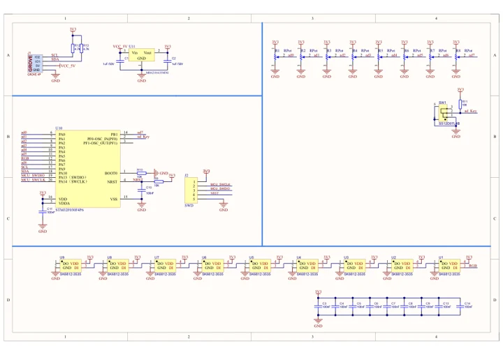
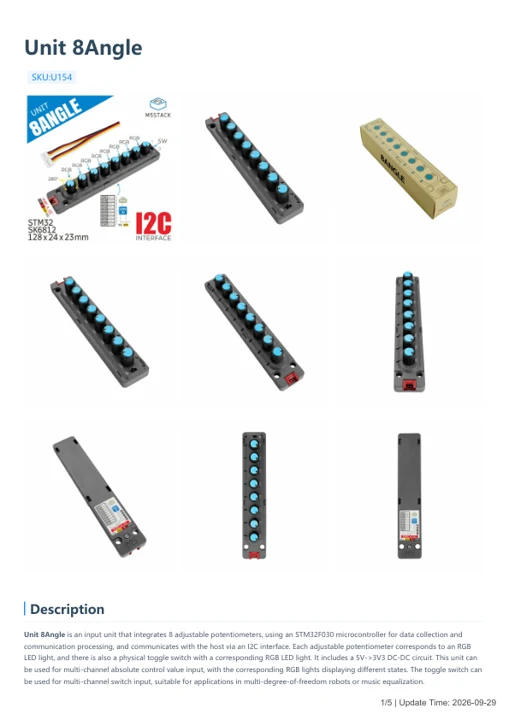

# Unit 8Angle

**M5Stack** · Source collection

Revision: Unverified source identity

Coverage: Manufacturer references available; physical pinout and complete connector review are tracked separately

[Browse all manufacturers](../../../../BROWSE.md) · [Devices & IoT](../../../../DEVICES.md) · [Open in the browser guide](https://valleytech-black-wire-guide.pages.dev/?board=source-board-0711046c6ae397d072)

## Datasheets and original documentation

Board datasheet: **not yet recorded**. Visual reference: **available**.

[Manufacturer model documentation](https://docs.m5stack.com/en/unit/8Angle)

- **schematic / board**: [Unit 8Angle Schematics PDF — schematic](https://m5stack-doc.oss-cn-shenzhen.aliyuncs.com/608/SCH_UNIT_8Angle_V1.01.pdf) · [saved document](../../../../library/media/62a0e48d9f93ef30637b9675162ae5355845cd644da213da7eb1a36f359125a9.pdf)
- **hardware-guide / board**: [Unit 8Angle — manufacturer hardware guide](https://m5stack.oss-cn-shenzhen.aliyuncs.com/resource/docs/static/pdf/static/en/unit/Unit_8Angle.pdf) · [saved document](../../../../library/media/e7a10347687adc87203f35415764b11c24ef71249ecf1a434b13ed4f825ae864.pdf)

A chip datasheet, schematic and board datasheet have different scopes. Match the exact hardware revision.

[Documentation coverage and remaining gaps](../../../../DOCUMENTATION.md)

## Dimensions

**source reference** · Unreviewed source · PNG

[Open original reference](../../../../library/media/71a87e3d887632dc42c7390a37b841afb194f984aa9c7db2b56bbdb3eb671e2d.png)

**Credit and rights:** Source rights not yet established. Source/manufacturer: M5Stack.

[Source 1](https://static-cdn.m5stack.com/resource/docs/products/unit/8Angle/img-4b39398e-5590-43b9-8dfe-84eb4aec5312.png) · [Source 2](https://docs.m5stack.com/en/unit/8Angle)

Original source index: Dimensions. This file is searchable but has not been promoted to a reviewed physical board pinout.

Image revision: Not identified

SHA-256: `71a87e3d887632dc42c7390a37b841afb194f984aa9c7db2b56bbdb3eb671e2d`

## Unit 8Angle Schematics PDF — schematic

**reference PDF** · Source model/link and PDF signature/title checked; individual pin assignments and electrical validation pending · PDF

[Open original reference](../../../../library/media/62a0e48d9f93ef30637b9675162ae5355845cd644da213da7eb1a36f359125a9.pdf)

**Credit and rights:** Original publisher/manufacturer artwork; redistribution and print rights not established. Attribution is not a license grant.. Source/manufacturer: M5Stack.

[Source 1](https://m5stack-doc.oss-cn-shenzhen.aliyuncs.com/608/SCH_UNIT_8Angle_V1.01.pdf) · [Source 2](https://docs.m5stack.com/en/unit/8Angle)

Original document linked from this model’s manufacturer page. Preserve the document’s exact revision and named subassembly scope; a linked accessory schematic is not a whole-device pinout. This is a circuit schematic, not a physical board pinout.

Image revision: Use the revision printed in the original document; do not assume all hardware revisions are interchangeable

SHA-256: `62a0e48d9f93ef30637b9675162ae5355845cd644da213da7eb1a36f359125a9`

## Unit 8Angle — manufacturer hardware guide

**reference PDF** · Source model/link and PDF signature/title checked; individual pin assignments and electrical validation pending · PDF

[Open original reference](../../../../library/media/e7a10347687adc87203f35415764b11c24ef71249ecf1a434b13ed4f825ae864.pdf)

**Credit and rights:** Original publisher/manufacturer artwork; redistribution and print rights not established. Attribution is not a license grant.. Source/manufacturer: M5Stack.

[Source 1](https://m5stack.oss-cn-shenzhen.aliyuncs.com/resource/docs/static/pdf/static/en/unit/Unit_8Angle.pdf) · [Source 2](https://docs.m5stack.com/en/unit/8Angle)

Original document linked from this model’s manufacturer page. Preserve the document’s exact revision and named subassembly scope; a linked accessory schematic is not a whole-device pinout. This is a hardware manual, not a separately classified board datasheet.

Image revision: Use the revision printed in the original document; do not assume all hardware revisions are interchangeable

SHA-256: `e7a10347687adc87203f35415764b11c24ef71249ecf1a434b13ed4f825ae864`

Pin assignments have not been independently electrically verified. Check board revision before wiring.
