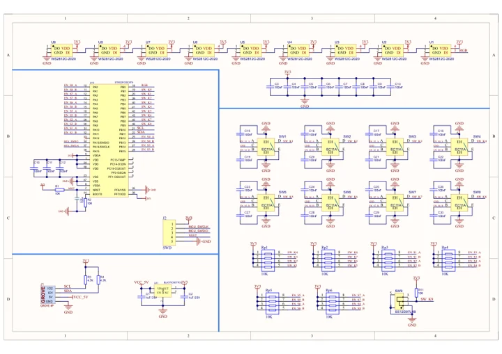
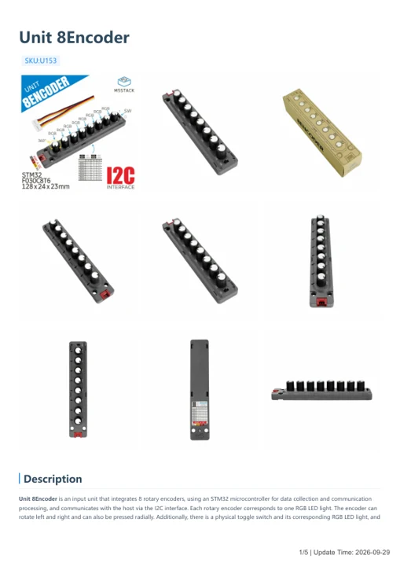

# Unit 8Encoder

**M5Stack** · Source collection

Revision: Unverified source identity

Coverage: Manufacturer references available; physical pinout and complete connector review are tracked separately

[Browse all manufacturers](../../../../BROWSE.md) · [Devices & IoT](../../../../DEVICES.md) · [Open in the browser guide](https://valleytech-black-wire-guide.pages.dev/?board=source-board-834f40b2126ac18fbc)

## Datasheets and original documentation

Board datasheet: **not yet recorded**. Visual reference: **available**.

[Manufacturer model documentation](https://docs.m5stack.com/en/unit/8Encoder)

- **schematic / board**: [Unit 8Encoder Schematics PDF — schematic](https://m5stack-doc.oss-cn-shenzhen.aliyuncs.com/607/SCH_UNIT_8Encoder_V1.01.pdf) · [saved document](../../../../library/media/4abdba0a16c39dccb39a41ef740529364fce89cd0d38397b534a3ef650354be2.pdf)
- **hardware-guide / board**: [Unit 8Encoder — manufacturer hardware guide](https://m5stack.oss-cn-shenzhen.aliyuncs.com/resource/docs/static/pdf/static/en/unit/Unit_8Encoder.pdf) · [saved document](../../../../library/media/d101840440703a7db4f1a940d22ec2a38eff2d2b67a76ad0336d0ad6300cefa5.pdf)

A chip datasheet, schematic and board datasheet have different scopes. Match the exact hardware revision.

[Documentation coverage and remaining gaps](../../../../DOCUMENTATION.md)

## Dimensions

**source reference** · Unreviewed source · PNG

[Open original reference](../../../../library/media/8f63277c68e8ff2d519ebe9f18c706ac5916f9a90e49c640b0b0dda91d5b61b3.png)

**Credit and rights:** Source rights not yet established. Source/manufacturer: M5Stack.

[Source 1](https://static-cdn.m5stack.com/resource/docs/products/unit/8Encoder/img-55ebb676-2b3c-4b9a-a192-b85bf0d1a87c.png) · [Source 2](https://docs.m5stack.com/en/unit/8Encoder)

Original source index: Dimensions. This file is searchable but has not been promoted to a reviewed physical board pinout.

Image revision: Not identified

SHA-256: `8f63277c68e8ff2d519ebe9f18c706ac5916f9a90e49c640b0b0dda91d5b61b3`

## Unit 8Encoder Schematics PDF — schematic

**reference PDF** · Source model/link and PDF signature/title checked; individual pin assignments and electrical validation pending · PDF

[Open original reference](../../../../library/media/4abdba0a16c39dccb39a41ef740529364fce89cd0d38397b534a3ef650354be2.pdf)

**Credit and rights:** Original publisher/manufacturer artwork; redistribution and print rights not established. Attribution is not a license grant.. Source/manufacturer: M5Stack.

[Source 1](https://m5stack-doc.oss-cn-shenzhen.aliyuncs.com/607/SCH_UNIT_8Encoder_V1.01.pdf) · [Source 2](https://docs.m5stack.com/en/unit/8Encoder)

Original document linked from this model’s manufacturer page. Preserve the document’s exact revision and named subassembly scope; a linked accessory schematic is not a whole-device pinout. This is a circuit schematic, not a physical board pinout.

Image revision: Use the revision printed in the original document; do not assume all hardware revisions are interchangeable

SHA-256: `4abdba0a16c39dccb39a41ef740529364fce89cd0d38397b534a3ef650354be2`

## Unit 8Encoder — manufacturer hardware guide

**reference PDF** · Source model/link and PDF signature/title checked; individual pin assignments and electrical validation pending · PDF

[Open original reference](../../../../library/media/d101840440703a7db4f1a940d22ec2a38eff2d2b67a76ad0336d0ad6300cefa5.pdf)

**Credit and rights:** Original publisher/manufacturer artwork; redistribution and print rights not established. Attribution is not a license grant.. Source/manufacturer: M5Stack.

[Source 1](https://m5stack.oss-cn-shenzhen.aliyuncs.com/resource/docs/static/pdf/static/en/unit/Unit_8Encoder.pdf) · [Source 2](https://docs.m5stack.com/en/unit/8Encoder)

Original document linked from this model’s manufacturer page. Preserve the document’s exact revision and named subassembly scope; a linked accessory schematic is not a whole-device pinout. This is a hardware manual, not a separately classified board datasheet.

Image revision: Use the revision printed in the original document; do not assume all hardware revisions are interchangeable

SHA-256: `d101840440703a7db4f1a940d22ec2a38eff2d2b67a76ad0336d0ad6300cefa5`

Pin assignments have not been independently electrically verified. Check board revision before wiring.
