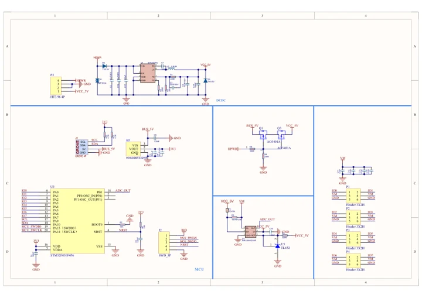
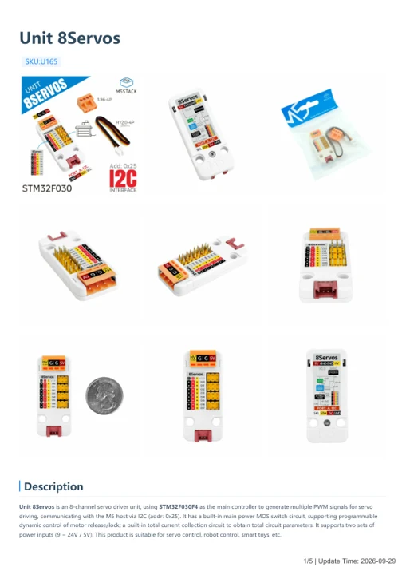

# Unit 8Servos

**M5Stack** · Source collection

Revision: Unverified source identity

Coverage: Manufacturer references available; physical pinout and complete connector review are tracked separately

[Browse all manufacturers](../../../../BROWSE.md) · [Devices & IoT](../../../../DEVICES.md) · [Open in the browser guide](https://valleytech-black-wire-guide.pages.dev/?board=source-board-aac83aba13e5a6ef0c)

## Datasheets and original documentation

Board datasheet: **not yet recorded**. Visual reference: **available**.

[Manufacturer model documentation](https://docs.m5stack.com/en/unit/8Servos%20Unit)

- **schematic / board**: [Unit 8Servos Schematics PDF — schematic](https://m5stack-doc.oss-cn-shenzhen.aliyuncs.com/620/SCH_UNIT_8Servos_V1.01.pdf) · [saved document](../../../../library/media/a756ca90c6695402f412eb1f7024c4338455d39bb3189043d45bf34bc9ce008f.pdf)
- **hardware-guide / board**: [Unit 8Servos — manufacturer hardware guide](https://m5stack.oss-cn-shenzhen.aliyuncs.com/resource/docs/static/pdf/static/en/unit/Unit_8Servos.pdf) · [saved document](../../../../library/media/72f9914a31d269c16a63cb1192c3471932586f474a0a07733e0922c74fd3a594.pdf)

A chip datasheet, schematic and board datasheet have different scopes. Match the exact hardware revision.

[Documentation coverage and remaining gaps](../../../../DOCUMENTATION.md)

## Dimensions

**source reference** · Unreviewed source · JPG

[Open original reference](../../../../library/media/23ba85d8d34eafb9deb7259b7d68ceab34712820c1d47676c671a1c319fd8252.jpg)

**Credit and rights:** Source rights not yet established. Source/manufacturer: M5Stack.

[Source 1](https://static-cdn.m5stack.com/resource/docs/products/unit/8Servos Unit/img-2eae2b86-5d70-4245-9511-36a8efa3098f.jpg) · [Source 2](https://docs.m5stack.com/en/unit/8Servos%20Unit)

Original source index: Dimensions. This file is searchable but has not been promoted to a reviewed physical board pinout.

Image revision: Not identified

SHA-256: `23ba85d8d34eafb9deb7259b7d68ceab34712820c1d47676c671a1c319fd8252`

## Unit 8Servos Schematics PDF — schematic

**reference PDF** · Source model/link and PDF signature/title checked; individual pin assignments and electrical validation pending · PDF

[Open original reference](../../../../library/media/a756ca90c6695402f412eb1f7024c4338455d39bb3189043d45bf34bc9ce008f.pdf)

**Credit and rights:** Original publisher/manufacturer artwork; redistribution and print rights not established. Attribution is not a license grant.. Source/manufacturer: M5Stack.

[Source 1](https://m5stack-doc.oss-cn-shenzhen.aliyuncs.com/620/SCH_UNIT_8Servos_V1.01.pdf) · [Source 2](https://docs.m5stack.com/en/unit/8Servos%20Unit)

Original document linked from this model’s manufacturer page. Preserve the document’s exact revision and named subassembly scope; a linked accessory schematic is not a whole-device pinout. This is a circuit schematic, not a physical board pinout.

Image revision: Use the revision printed in the original document; do not assume all hardware revisions are interchangeable

SHA-256: `a756ca90c6695402f412eb1f7024c4338455d39bb3189043d45bf34bc9ce008f`

## Unit 8Servos — manufacturer hardware guide

**reference PDF** · Source model/link and PDF signature/title checked; individual pin assignments and electrical validation pending · PDF

[Open original reference](../../../../library/media/72f9914a31d269c16a63cb1192c3471932586f474a0a07733e0922c74fd3a594.pdf)

**Credit and rights:** Original publisher/manufacturer artwork; redistribution and print rights not established. Attribution is not a license grant.. Source/manufacturer: M5Stack.

[Source 1](https://m5stack.oss-cn-shenzhen.aliyuncs.com/resource/docs/static/pdf/static/en/unit/Unit_8Servos.pdf) · [Source 2](https://docs.m5stack.com/en/unit/8Servos%20Unit)

Original document linked from this model’s manufacturer page. Preserve the document’s exact revision and named subassembly scope; a linked accessory schematic is not a whole-device pinout. This is a hardware manual, not a separately classified board datasheet.

Image revision: Use the revision printed in the original document; do not assume all hardware revisions are interchangeable

SHA-256: `72f9914a31d269c16a63cb1192c3471932586f474a0a07733e0922c74fd3a594`

Pin assignments have not been independently electrically verified. Check board revision before wiring.
