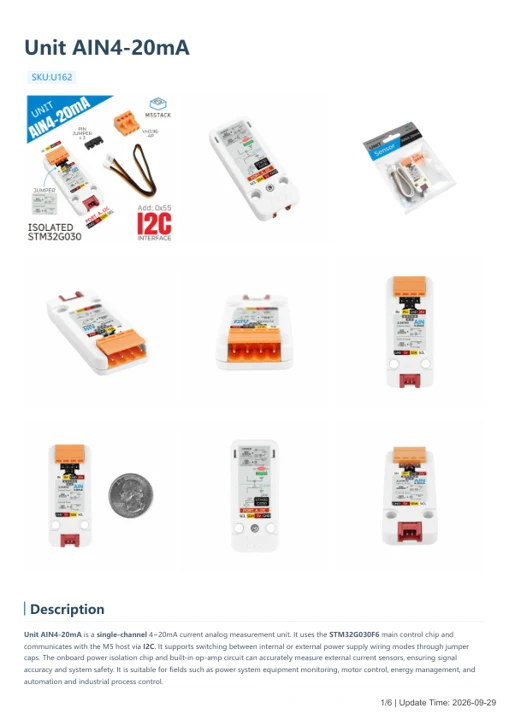
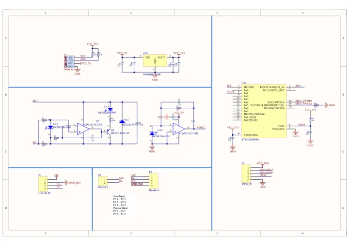

# Unit AIN4-20mA

**M5Stack** · Source collection

Revision: Unverified source identity

Coverage: Manufacturer references available; physical pinout and complete connector review are tracked separately

[Browse all manufacturers](../../../../BROWSE.md) · [Devices & IoT](../../../../DEVICES.md) · [Open in the browser guide](https://valleytech-black-wire-guide.pages.dev/?board=source-board-6f842c1018055cc899)

## Datasheets and original documentation

Board datasheet: **not yet recorded**. Visual reference: **available**.

[Manufacturer model documentation](https://docs.m5stack.com/en/unit/AIN4-20mA%20Unit)

- **hardware-guide / board**: [Unit AIN4-20mA — manufacturer hardware guide](https://m5stack.oss-cn-shenzhen.aliyuncs.com/resource/docs/static/pdf/static/en/unit/Unit_AIN4-20mA.pdf) · [saved document](../../../../library/media/2165a24c58f84b29d2b41614e2a60369591da4b6321a5423e63e15adeae8f1ee.pdf)
- **schematic / board**: [Unit AIN4-20mA Schematics PDF — schematic](https://m5stack-doc.oss-cn-shenzhen.aliyuncs.com/617/SCH_UNIT_AIN4-20mA_V1.01.pdf) · [saved document](../../../../library/media/7a3bdca9887caf0450ffbc80fa37a6630b9609065f041f1647066092d73b152e.pdf)

A chip datasheet, schematic and board datasheet have different scopes. Match the exact hardware revision.

[Documentation coverage and remaining gaps](../../../../DOCUMENTATION.md)

## Dimensions

**source reference** · Unreviewed source · PNG

[Open original reference](../../../../library/media/aef65710d24e865c916ae7abfcc11c36c4d8178e6bdac043a1e46fc6098ef592.png)

**Credit and rights:** Source rights not yet established. Source/manufacturer: M5Stack.

[Source 1](https://m5stack.oss-cn-shenzhen.aliyuncs.com/resource/docs/products/unit/AIN4-20mA%20Unit/%E5%B0%BA%E5%AF%B8%E5%9B%BE.png) · [Source 2](https://docs.m5stack.com/en/unit/AIN4-20mA%20Unit)

Original source index: Dimensions. This file is searchable but has not been promoted to a reviewed physical board pinout.

Image revision: Not identified

SHA-256: `aef65710d24e865c916ae7abfcc11c36c4d8178e6bdac043a1e46fc6098ef592`

## Unit AIN4-20mA — manufacturer hardware guide

**reference PDF** · Source model/link and PDF signature/title checked; individual pin assignments and electrical validation pending · PDF

[Open original reference](../../../../library/media/2165a24c58f84b29d2b41614e2a60369591da4b6321a5423e63e15adeae8f1ee.pdf)

**Credit and rights:** Original publisher/manufacturer artwork; redistribution and print rights not established. Attribution is not a license grant.. Source/manufacturer: M5Stack.

[Source 1](https://m5stack.oss-cn-shenzhen.aliyuncs.com/resource/docs/static/pdf/static/en/unit/Unit_AIN4-20mA.pdf) · [Source 2](https://docs.m5stack.com/en/unit/AIN4-20mA%20Unit)

Original document linked from this model’s manufacturer page. Preserve the document’s exact revision and named subassembly scope; a linked accessory schematic is not a whole-device pinout. This is a hardware manual, not a separately classified board datasheet.

Image revision: Use the revision printed in the original document; do not assume all hardware revisions are interchangeable

SHA-256: `2165a24c58f84b29d2b41614e2a60369591da4b6321a5423e63e15adeae8f1ee`

## Unit AIN4-20mA Schematics PDF — schematic

**reference PDF** · Source model/link and PDF signature/title checked; individual pin assignments and electrical validation pending · PDF

[Open original reference](../../../../library/media/7a3bdca9887caf0450ffbc80fa37a6630b9609065f041f1647066092d73b152e.pdf)

**Credit and rights:** Original publisher/manufacturer artwork; redistribution and print rights not established. Attribution is not a license grant.. Source/manufacturer: M5Stack.

[Source 1](https://m5stack-doc.oss-cn-shenzhen.aliyuncs.com/617/SCH_UNIT_AIN4-20mA_V1.01.pdf) · [Source 2](https://docs.m5stack.com/en/unit/AIN4-20mA%20Unit)

Original document linked from this model’s manufacturer page. Preserve the document’s exact revision and named subassembly scope; a linked accessory schematic is not a whole-device pinout. This is a circuit schematic, not a physical board pinout.

Image revision: Use the revision printed in the original document; do not assume all hardware revisions are interchangeable

SHA-256: `7a3bdca9887caf0450ffbc80fa37a6630b9609065f041f1647066092d73b152e`

Pin assignments have not been independently electrically verified. Check board revision before wiring.
