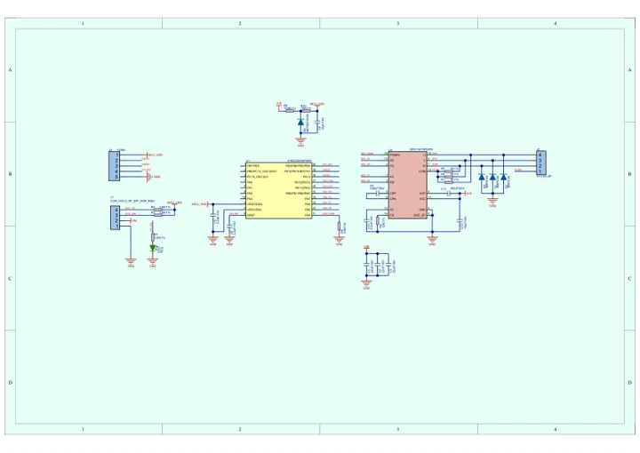
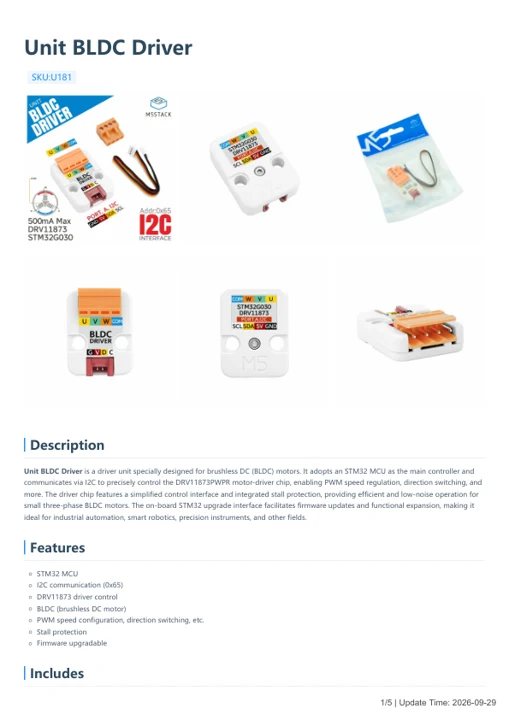

# Unit BLDC Driver

**M5Stack** · Source collection

Revision: Unverified source identity

Coverage: Manufacturer references available; physical pinout and complete connector review are tracked separately

[Browse all manufacturers](../../../../BROWSE.md) · [Devices & IoT](../../../../DEVICES.md) · [Open in the browser guide](https://valleytech-black-wire-guide.pages.dev/?board=source-board-a428555279fa49793a)

## Datasheets and original documentation

Board datasheet: **not yet recorded**. Visual reference: **available**.

[Manufacturer model documentation](https://docs.m5stack.com/en/unit/Unit-BLDC%20Driver)

- **schematic / board**: [Unit BLDC Driver Schematics PDF — schematic](https://m5stack-doc.oss-cn-shenzhen.aliyuncs.com/633/Sch_bldc_driver_V1.3.pdf) · [saved document](../../../../library/media/6228f10e071306e0119a1f1e7916922a81c5792c2fc6b08ce94c1d530d4c4983.pdf)
- **hardware-guide / board**: [Unit BLDC Driver — manufacturer hardware guide](https://m5stack.oss-cn-shenzhen.aliyuncs.com/resource/docs/static/pdf/static/en/unit/Unit_BLDC_Driver.pdf) · [saved document](../../../../library/media/f6265d18b5b934c805bc947db3378afda3fb029608b0787b2c3680eb3220565f.pdf)

A chip datasheet, schematic and board datasheet have different scopes. Match the exact hardware revision.

[Documentation coverage and remaining gaps](../../../../DOCUMENTATION.md)

## Dimensions

**source reference** · Unreviewed source · JPG

[Open original reference](../../../../library/media/7b1dbdac1fa4595940594466f5632e57e567b577b0a05100d5b4be5e8d945296.jpg)

**Credit and rights:** Source rights not yet established. Source/manufacturer: M5Stack.

[Source 1](https://static-cdn.m5stack.com/resource/docs/products/unit/Unit-BLDC Driver/img-d749b649-9eec-4d72-9cf0-c80a878d4d55.jpg) · [Source 2](https://docs.m5stack.com/en/unit/Unit-BLDC%20Driver)

Original source index: Dimensions. This file is searchable but has not been promoted to a reviewed physical board pinout.

Image revision: Not identified

SHA-256: `7b1dbdac1fa4595940594466f5632e57e567b577b0a05100d5b4be5e8d945296`

## Unit BLDC Driver Schematics PDF — schematic

**reference PDF** · Source model/link and PDF signature/title checked; individual pin assignments and electrical validation pending · PDF

[Open original reference](../../../../library/media/6228f10e071306e0119a1f1e7916922a81c5792c2fc6b08ce94c1d530d4c4983.pdf)

**Credit and rights:** Original publisher/manufacturer artwork; redistribution and print rights not established. Attribution is not a license grant.. Source/manufacturer: M5Stack.

[Source 1](https://m5stack-doc.oss-cn-shenzhen.aliyuncs.com/633/Sch_bldc_driver_V1.3.pdf) · [Source 2](https://docs.m5stack.com/en/unit/Unit-BLDC%20Driver)

Original document linked from this model’s manufacturer page. Preserve the document’s exact revision and named subassembly scope; a linked accessory schematic is not a whole-device pinout. This is a circuit schematic, not a physical board pinout.

Image revision: Use the revision printed in the original document; do not assume all hardware revisions are interchangeable

SHA-256: `6228f10e071306e0119a1f1e7916922a81c5792c2fc6b08ce94c1d530d4c4983`

## Unit BLDC Driver — manufacturer hardware guide

**reference PDF** · Source model/link and PDF signature/title checked; individual pin assignments and electrical validation pending · PDF

[Open original reference](../../../../library/media/f6265d18b5b934c805bc947db3378afda3fb029608b0787b2c3680eb3220565f.pdf)

**Credit and rights:** Original publisher/manufacturer artwork; redistribution and print rights not established. Attribution is not a license grant.. Source/manufacturer: M5Stack.

[Source 1](https://m5stack.oss-cn-shenzhen.aliyuncs.com/resource/docs/static/pdf/static/en/unit/Unit_BLDC_Driver.pdf) · [Source 2](https://docs.m5stack.com/en/unit/Unit-BLDC%20Driver)

Original document linked from this model’s manufacturer page. Preserve the document’s exact revision and named subassembly scope; a linked accessory schematic is not a whole-device pinout. This is a hardware manual, not a separately classified board datasheet.

Image revision: Use the revision printed in the original document; do not assume all hardware revisions are interchangeable

SHA-256: `f6265d18b5b934c805bc947db3378afda3fb029608b0787b2c3680eb3220565f`

Pin assignments have not been independently electrically verified. Check board revision before wiring.
