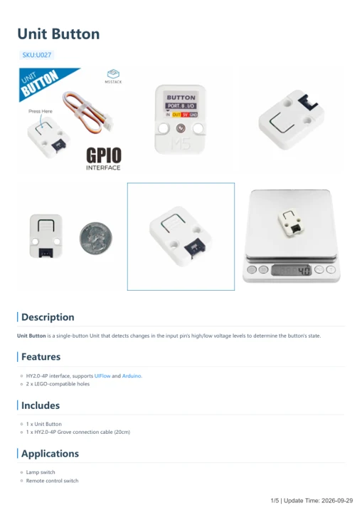
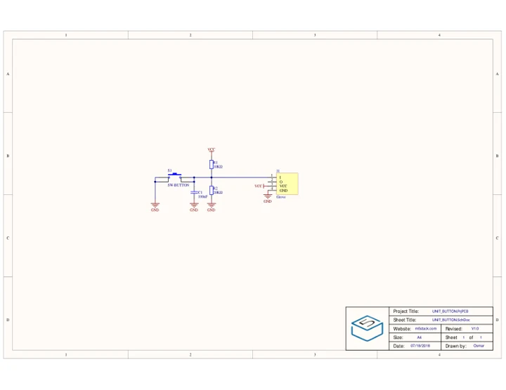

# Unit Button

**M5Stack** · Source collection

Revision: Unverified source identity

Coverage: Manufacturer references available; physical pinout and complete connector review are tracked separately

[Browse all manufacturers](../../../../BROWSE.md) · [Devices & IoT](../../../../DEVICES.md) · [Open in the browser guide](https://valleytech-black-wire-guide.pages.dev/?board=source-board-93f8f5b86b82e353c4)

## Datasheets and original documentation

Board datasheet: **not yet recorded**. Visual reference: **available**.

[Manufacturer model documentation](https://docs.m5stack.com/en/unit/button)

- **hardware-guide / board**: [Unit Button — manufacturer hardware guide](https://m5stack.oss-cn-shenzhen.aliyuncs.com/resource/docs/static/pdf/static/en/unit/Unit_Button.pdf) · [saved document](../../../../library/media/743d034f8944c42609e4de3ecbee6d92177a30dadbcec1db7588ee1e881c7aa8.pdf)
- **schematic / board**: [Unit Button Schematics PDF — schematic](https://m5stack-doc.oss-cn-shenzhen.aliyuncs.com/804/U027_UNIT_BUTTON_SCHE.pdf) · [saved document](../../../../library/media/36ca23cb05aca9250c308fc3a8540e7aa7e8f74b160c6c055ddb126d82f76c7f.pdf)

A chip datasheet, schematic and board datasheet have different scopes. Match the exact hardware revision.

[Documentation coverage and remaining gaps](../../../../DOCUMENTATION.md)

## Dimensions

**source reference** · Unreviewed source · PNG

[Open original reference](../../../../library/media/b88d91527a3aba43016d3cf21ee1e37485cce260fbfc5bd67376519530f4a3ad.png)

**Credit and rights:** Source rights not yet established. Source/manufacturer: M5Stack.

[Source 1](https://m5stack-doc.oss-cn-shenzhen.aliyuncs.com/804/U027_Model_Size_page_01.png) · [Source 2](https://docs.m5stack.com/en/unit/button)

Original source index: Dimensions. This file is searchable but has not been promoted to a reviewed physical board pinout.

Image revision: Not identified

SHA-256: `b88d91527a3aba43016d3cf21ee1e37485cce260fbfc5bd67376519530f4a3ad`

## Unit Button — manufacturer hardware guide

**reference PDF** · Source model/link and PDF signature/title checked; individual pin assignments and electrical validation pending · PDF

[Open original reference](../../../../library/media/743d034f8944c42609e4de3ecbee6d92177a30dadbcec1db7588ee1e881c7aa8.pdf)

**Credit and rights:** Original publisher/manufacturer artwork; redistribution and print rights not established. Attribution is not a license grant.. Source/manufacturer: M5Stack.

[Source 1](https://m5stack.oss-cn-shenzhen.aliyuncs.com/resource/docs/static/pdf/static/en/unit/Unit_Button.pdf) · [Source 2](https://docs.m5stack.com/en/unit/button)

Original document linked from this model’s manufacturer page. Preserve the document’s exact revision and named subassembly scope; a linked accessory schematic is not a whole-device pinout. This is a hardware manual, not a separately classified board datasheet.

Image revision: Use the revision printed in the original document; do not assume all hardware revisions are interchangeable

SHA-256: `743d034f8944c42609e4de3ecbee6d92177a30dadbcec1db7588ee1e881c7aa8`

## Unit Button Schematics PDF — schematic

**reference PDF** · Source model/link and PDF signature/title checked; individual pin assignments and electrical validation pending · PDF

[Open original reference](../../../../library/media/36ca23cb05aca9250c308fc3a8540e7aa7e8f74b160c6c055ddb126d82f76c7f.pdf)

**Credit and rights:** Original publisher/manufacturer artwork; redistribution and print rights not established. Attribution is not a license grant.. Source/manufacturer: M5Stack.

[Source 1](https://m5stack-doc.oss-cn-shenzhen.aliyuncs.com/804/U027_UNIT_BUTTON_SCHE.pdf) · [Source 2](https://docs.m5stack.com/en/unit/button)

Original document linked from this model’s manufacturer page. Preserve the document’s exact revision and named subassembly scope; a linked accessory schematic is not a whole-device pinout. This is a circuit schematic, not a physical board pinout.

Image revision: Use the revision printed in the original document; do not assume all hardware revisions are interchangeable

SHA-256: `36ca23cb05aca9250c308fc3a8540e7aa7e8f74b160c6c055ddb126d82f76c7f`

Pin assignments have not been independently electrically verified. Check board revision before wiring.
