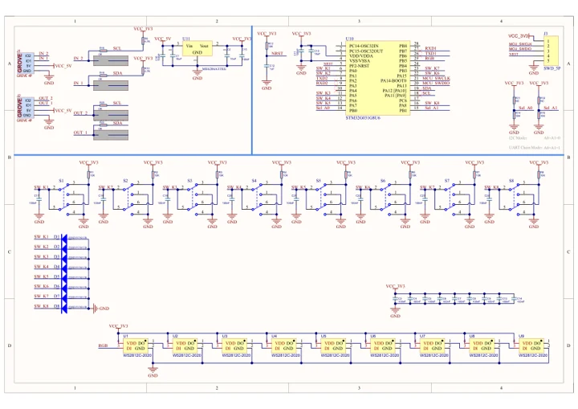
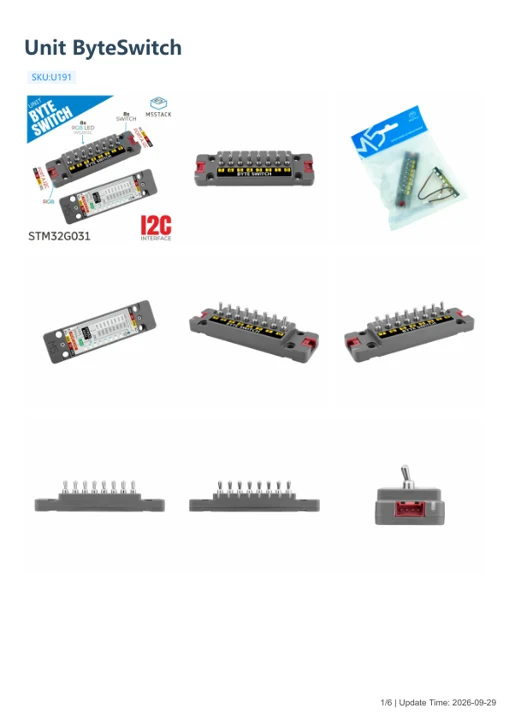

# Unit ByteSwitch

**M5Stack** · Source collection

Revision: Unverified source identity

Coverage: Manufacturer references available; physical pinout and complete connector review are tracked separately

[Browse all manufacturers](../../../../BROWSE.md) · [Devices & IoT](../../../../DEVICES.md) · [Open in the browser guide](https://valleytech-black-wire-guide.pages.dev/?board=source-board-49a7e629a0418a8886)

## Datasheets and original documentation

Board datasheet: **not yet recorded**. Visual reference: **available**.

[Manufacturer model documentation](https://docs.m5stack.com/en/unit/Unit%20ByteSwitch)

- **schematic / board**: [Unit ByteSwitch Schematics PDF — schematic](https://m5stack-doc.oss-cn-shenzhen.aliyuncs.com/820/SCH_Unit-ByteSwitch_V1.0.pdf) · [saved document](../../../../library/media/9ebf269e73617b99e7537e96627617d7632e8765d1b121911332e5df559e8fb4.pdf)
- **hardware-guide / board**: [Unit ByteSwitch — manufacturer hardware guide](https://m5stack.oss-cn-shenzhen.aliyuncs.com/resource/docs/static/pdf/static/en/unit/Unit_ByteSwitch.pdf) · [saved document](../../../../library/media/3a8241952c207fff729213b6cc1fd7b6b67b2dd4d3cdd8ad39c653a19ac8a9fb.pdf)

A chip datasheet, schematic and board datasheet have different scopes. Match the exact hardware revision.

[Documentation coverage and remaining gaps](../../../../DOCUMENTATION.md)

## Dimensions

**source reference** · Unreviewed source · PNG

[Open original reference](../../../../library/media/ee3e2cc03f7a9dd7c0600f4725e5214f14897f266e8f892b8bd42ee765e7c07d.png)

**Credit and rights:** Source rights not yet established. Source/manufacturer: M5Stack.

[Source 1](https://m5stack.oss-cn-shenzhen.aliyuncs.com/resource/docs/products/unit/Unit%20ByteSwitch/model%20size.png) · [Source 2](https://docs.m5stack.com/en/unit/Unit%20ByteSwitch)

Original source index: Dimensions. This file is searchable but has not been promoted to a reviewed physical board pinout.

Image revision: Not identified

SHA-256: `ee3e2cc03f7a9dd7c0600f4725e5214f14897f266e8f892b8bd42ee765e7c07d`

## Unit ByteSwitch Schematics PDF — schematic

**reference PDF** · Source model/link and PDF signature/title checked; individual pin assignments and electrical validation pending · PDF

[Open original reference](../../../../library/media/9ebf269e73617b99e7537e96627617d7632e8765d1b121911332e5df559e8fb4.pdf)

**Credit and rights:** Original publisher/manufacturer artwork; redistribution and print rights not established. Attribution is not a license grant.. Source/manufacturer: M5Stack.

[Source 1](https://m5stack-doc.oss-cn-shenzhen.aliyuncs.com/820/SCH_Unit-ByteSwitch_V1.0.pdf) · [Source 2](https://docs.m5stack.com/en/unit/Unit%20ByteSwitch)

Original document linked from this model’s manufacturer page. Preserve the document’s exact revision and named subassembly scope; a linked accessory schematic is not a whole-device pinout. This is a circuit schematic, not a physical board pinout.

Image revision: Use the revision printed in the original document; do not assume all hardware revisions are interchangeable

SHA-256: `9ebf269e73617b99e7537e96627617d7632e8765d1b121911332e5df559e8fb4`

## Unit ByteSwitch — manufacturer hardware guide

**reference PDF** · Source model/link and PDF signature/title checked; individual pin assignments and electrical validation pending · PDF

[Open original reference](../../../../library/media/3a8241952c207fff729213b6cc1fd7b6b67b2dd4d3cdd8ad39c653a19ac8a9fb.pdf)

**Credit and rights:** Original publisher/manufacturer artwork; redistribution and print rights not established. Attribution is not a license grant.. Source/manufacturer: M5Stack.

[Source 1](https://m5stack.oss-cn-shenzhen.aliyuncs.com/resource/docs/static/pdf/static/en/unit/Unit_ByteSwitch.pdf) · [Source 2](https://docs.m5stack.com/en/unit/Unit%20ByteSwitch)

Original document linked from this model’s manufacturer page. Preserve the document’s exact revision and named subassembly scope; a linked accessory schematic is not a whole-device pinout. This is a hardware manual, not a separately classified board datasheet.

Image revision: Use the revision printed in the original document; do not assume all hardware revisions are interchangeable

SHA-256: `3a8241952c207fff729213b6cc1fd7b6b67b2dd4d3cdd8ad39c653a19ac8a9fb`

Pin assignments have not been independently electrically verified. Check board revision before wiring.
