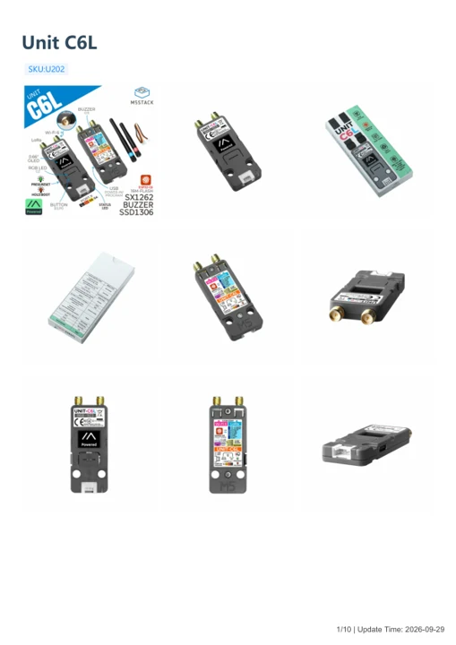

# Unit C6L

**M5Stack** · Source collection

Revision: Unverified source identity

Coverage: Manufacturer references available; physical pinout and complete connector review are tracked separately

[Browse all manufacturers](../../../../BROWSE.md) · [Devices & IoT](../../../../DEVICES.md) · [Open in the browser guide](https://valleytech-black-wire-guide.pages.dev/?board=source-board-4cbd9ff0b6a21ef607)

## Datasheets and original documentation

Board datasheet: **not yet recorded**. Visual reference: **available**.

[Manufacturer model documentation](https://docs.m5stack.com/en/unit/Unit_C6L)

- **schematic / board**: [Stamp C6LoRa Schematics PDF — schematic](https://m5stack-doc.oss-cn-shenzhen.aliyuncs.com/1223/S012-SCH_Sch_M5_C6_Lora_v0.2.3_2025_12_02_19_14_35.pdf) · [saved document](../../../../library/media/2dafe92c5090a01aa948c1ce88b17d1237421d09701c1e0a15a122bd9d844d35.pdf)
- **hardware-guide / board**: [Unit C6L — manufacturer hardware guide](https://m5stack.oss-cn-shenzhen.aliyuncs.com/resource/docs/static/pdf/static/en/unit/Unit_C6L.pdf) · [saved document](../../../../library/media/70de6112d34a9e1b15d99de528562c07399482315c921a21907a884db62dc9a5.pdf)

A chip datasheet, schematic and board datasheet have different scopes. Match the exact hardware revision.

[Documentation coverage and remaining gaps](../../../../DOCUMENTATION.md)

## Dimensions

**source reference** · Unreviewed source · PNG

[Open original reference](../../../../library/media/ff6c76245b8a6290bf18b5e76b23eae2f9314f1c7865c3067a3b296ee1f1d9ca.png)

**Credit and rights:** Source rights not yet established. Source/manufacturer: M5Stack.

[Source 1](https://m5stack-doc.oss-cn-shenzhen.aliyuncs.com/1185/U202-MODEL-SIZE-unit-2sma_page_01.png) · [Source 2](https://docs.m5stack.com/en/unit/Unit_C6L)

Original source index: Dimensions. This file is searchable but has not been promoted to a reviewed physical board pinout.

Image revision: Not identified

SHA-256: `ff6c76245b8a6290bf18b5e76b23eae2f9314f1c7865c3067a3b296ee1f1d9ca`

## Stamp C6LoRa Schematics PDF — schematic

**reference PDF** · Source model/link and PDF signature/title checked; individual pin assignments and electrical validation pending · PDF

[Open original reference](../../../../library/media/2dafe92c5090a01aa948c1ce88b17d1237421d09701c1e0a15a122bd9d844d35.pdf)

**Credit and rights:** Original publisher/manufacturer artwork; redistribution and print rights not established. Attribution is not a license grant.. Source/manufacturer: M5Stack.

[Source 1](https://m5stack-doc.oss-cn-shenzhen.aliyuncs.com/1223/S012-SCH_Sch_M5_C6_Lora_v0.2.3_2025_12_02_19_14_35.pdf) · [Source 2](https://docs.m5stack.com/en/unit/Unit_C6L)

Original document linked from this model’s manufacturer page. Preserve the document’s exact revision and named subassembly scope; a linked accessory schematic is not a whole-device pinout. This is a circuit schematic, not a physical board pinout.

Image revision: Use the revision printed in the original document; do not assume all hardware revisions are interchangeable

SHA-256: `2dafe92c5090a01aa948c1ce88b17d1237421d09701c1e0a15a122bd9d844d35`

## Unit C6L — manufacturer hardware guide

**reference PDF** · Source model/link and PDF signature/title checked; individual pin assignments and electrical validation pending · PDF

[Open original reference](../../../../library/media/70de6112d34a9e1b15d99de528562c07399482315c921a21907a884db62dc9a5.pdf)

**Credit and rights:** Original publisher/manufacturer artwork; redistribution and print rights not established. Attribution is not a license grant.. Source/manufacturer: M5Stack.

[Source 1](https://m5stack.oss-cn-shenzhen.aliyuncs.com/resource/docs/static/pdf/static/en/unit/Unit_C6L.pdf) · [Source 2](https://docs.m5stack.com/en/unit/Unit_C6L)

Original document linked from this model’s manufacturer page. Preserve the document’s exact revision and named subassembly scope; a linked accessory schematic is not a whole-device pinout. This is a hardware manual, not a separately classified board datasheet.

Image revision: Use the revision printed in the original document; do not assume all hardware revisions are interchangeable

SHA-256: `70de6112d34a9e1b15d99de528562c07399482315c921a21907a884db62dc9a5`

Pin assignments have not been independently electrically verified. Check board revision before wiring.
