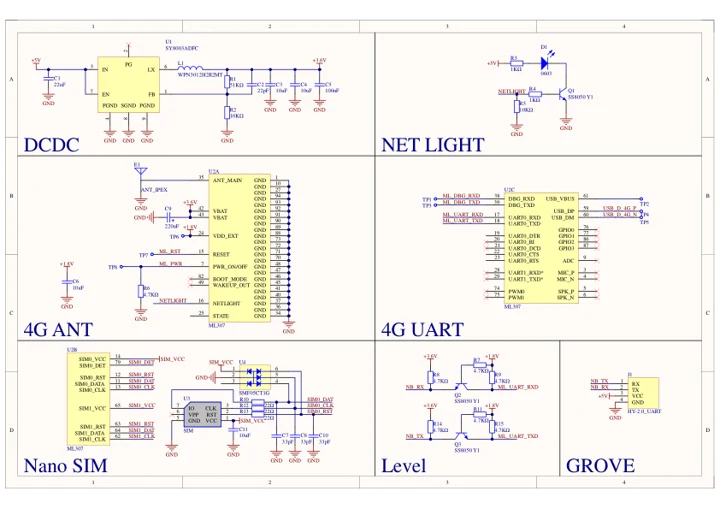
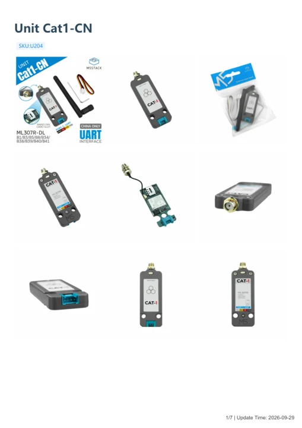

# Unit Cat1-CN

**M5Stack** · Source collection

Revision: Unverified source identity

Coverage: Manufacturer references available; physical pinout and complete connector review are tracked separately

[Browse all manufacturers](../../../../BROWSE.md) · [Devices & IoT](../../../../DEVICES.md) · [Open in the browser guide](https://valleytech-black-wire-guide.pages.dev/?board=source-board-d282e51761a64c9876)

## Datasheets and original documentation

Board datasheet: **not yet recorded**. Visual reference: **available**.

[Manufacturer model documentation](https://docs.m5stack.com/en/unit/Unit_Cat1-CN)

- **schematic / board**: [Unit Cat1-CN Schematics PDF — schematic](https://m5stack-doc.oss-cn-shenzhen.aliyuncs.com/1189/SCH_Unit_Cat.1_SCH_V0.2_20250909_2025_09_09_14_17_11.pdf) · [saved document](../../../../library/media/1e4b6b41d22e8a39b4b72302ebe9b84476d22ac1f3fa2067c1d0970b86c91b62.pdf)
- **hardware-guide / board**: [Unit Cat1-CN — manufacturer hardware guide](https://m5stack.oss-cn-shenzhen.aliyuncs.com/resource/docs/static/pdf/static/en/unit/Unit_Cat1-CN.pdf) · [saved document](../../../../library/media/1b57b428750669748d03a845c8ee61cb80c4ee72a5e3bdd6bd3210dbf34442d9.pdf)

A chip datasheet, schematic and board datasheet have different scopes. Match the exact hardware revision.

[Documentation coverage and remaining gaps](../../../../DOCUMENTATION.md)

## Dimensions

**source reference** · Unreviewed source · PNG

[Open original reference](../../../../library/media/d2f0189f2fe32c3d4e56ce2637784661887ebc161e7b6d0293c36e39e3caebed.png)

**Credit and rights:** Source rights not yet established. Source/manufacturer: M5Stack.

[Source 1](https://m5stack-doc.oss-cn-shenzhen.aliyuncs.com/1189/U204_model_Unit_Cat1-CN_page_01.png) · [Source 2](https://docs.m5stack.com/en/unit/Unit_Cat1-CN)

Original source index: Dimensions. This file is searchable but has not been promoted to a reviewed physical board pinout.

Image revision: Not identified

SHA-256: `d2f0189f2fe32c3d4e56ce2637784661887ebc161e7b6d0293c36e39e3caebed`

## Unit Cat1-CN Schematics PDF — schematic

**reference PDF** · Source model/link and PDF signature/title checked; individual pin assignments and electrical validation pending · PDF

[Open original reference](../../../../library/media/1e4b6b41d22e8a39b4b72302ebe9b84476d22ac1f3fa2067c1d0970b86c91b62.pdf)

**Credit and rights:** Original publisher/manufacturer artwork; redistribution and print rights not established. Attribution is not a license grant.. Source/manufacturer: M5Stack.

[Source 1](https://m5stack-doc.oss-cn-shenzhen.aliyuncs.com/1189/SCH_Unit_Cat.1_SCH_V0.2_20250909_2025_09_09_14_17_11.pdf) · [Source 2](https://docs.m5stack.com/en/unit/Unit_Cat1-CN)

Original document linked from this model’s manufacturer page. Preserve the document’s exact revision and named subassembly scope; a linked accessory schematic is not a whole-device pinout. This is a circuit schematic, not a physical board pinout.

Image revision: Use the revision printed in the original document; do not assume all hardware revisions are interchangeable

SHA-256: `1e4b6b41d22e8a39b4b72302ebe9b84476d22ac1f3fa2067c1d0970b86c91b62`

## Unit Cat1-CN — manufacturer hardware guide

**reference PDF** · Source model/link and PDF signature/title checked; individual pin assignments and electrical validation pending · PDF

[Open original reference](../../../../library/media/1b57b428750669748d03a845c8ee61cb80c4ee72a5e3bdd6bd3210dbf34442d9.pdf)

**Credit and rights:** Original publisher/manufacturer artwork; redistribution and print rights not established. Attribution is not a license grant.. Source/manufacturer: M5Stack.

[Source 1](https://m5stack.oss-cn-shenzhen.aliyuncs.com/resource/docs/static/pdf/static/en/unit/Unit_Cat1-CN.pdf) · [Source 2](https://docs.m5stack.com/en/unit/Unit_Cat1-CN)

Original document linked from this model’s manufacturer page. Preserve the document’s exact revision and named subassembly scope; a linked accessory schematic is not a whole-device pinout. This is a hardware manual, not a separately classified board datasheet.

Image revision: Use the revision printed in the original document; do not assume all hardware revisions are interchangeable

SHA-256: `1b57b428750669748d03a845c8ee61cb80c4ee72a5e3bdd6bd3210dbf34442d9`

Pin assignments have not been independently electrically verified. Check board revision before wiring.
