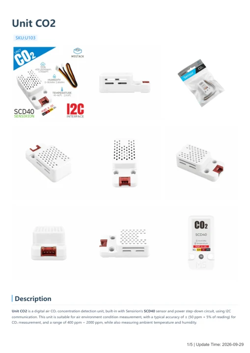
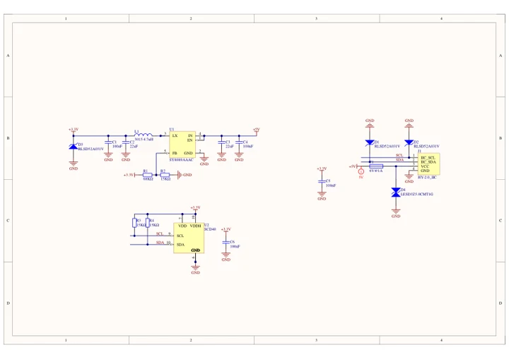

# Unit CO2

**M5Stack** · Source collection

Revision: Unverified source identity

Coverage: Manufacturer references available; physical pinout and complete connector review are tracked separately

[Browse all manufacturers](../../../../BROWSE.md) · [Devices & IoT](../../../../DEVICES.md) · [Open in the browser guide](https://valleytech-black-wire-guide.pages.dev/?board=source-board-f2b5b135d118cd8838)

## Datasheets and original documentation

Board datasheet: **not yet recorded**. Visual reference: **available**.

[Manufacturer model documentation](https://docs.m5stack.com/en/unit/co2)

- **hardware-guide / board**: [Unit CO2 — manufacturer hardware guide](https://m5stack.oss-cn-shenzhen.aliyuncs.com/resource/docs/static/pdf/static/en/unit/Unit_CO2.pdf) · [saved document](../../../../library/media/05f9089dcca44899edc86e7920eea7307f0f97067a03ea5b75247633eb664ee5.pdf)
- **schematic / board**: [Unit CO2 Schematics PDF — schematic](https://m5stack-doc.oss-cn-shenzhen.aliyuncs.com/590/SCH_UNIT_CO2.pdf) · [saved document](../../../../library/media/e18dfc6f4260cbd42bbf67e893a8557f08350f264c9879039becdd201ff6386c.pdf)

A chip datasheet, schematic and board datasheet have different scopes. Match the exact hardware revision.

[Documentation coverage and remaining gaps](../../../../DOCUMENTATION.md)

## Dimensions

**source reference** · Unreviewed source · JPG

[Open original reference](../../../../library/media/63652c3d0252415cfe2dfef7e8c5c957bde89302b44897239266858596199cef.jpg)

**Credit and rights:** Source rights not yet established. Source/manufacturer: M5Stack.

[Source 1](https://m5stack.oss-cn-shenzhen.aliyuncs.com/resource/docs/products/unit/co2/%E5%B0%BA%E5%AF%B8%E5%9B%BE.jpg) · [Source 2](https://docs.m5stack.com/en/unit/co2)

Original source index: Dimensions. This file is searchable but has not been promoted to a reviewed physical board pinout.

Image revision: Not identified

SHA-256: `63652c3d0252415cfe2dfef7e8c5c957bde89302b44897239266858596199cef`

## Unit CO2 — manufacturer hardware guide

**reference PDF** · Source model/link and PDF signature/title checked; individual pin assignments and electrical validation pending · PDF

[Open original reference](../../../../library/media/05f9089dcca44899edc86e7920eea7307f0f97067a03ea5b75247633eb664ee5.pdf)

**Credit and rights:** Original publisher/manufacturer artwork; redistribution and print rights not established. Attribution is not a license grant.. Source/manufacturer: M5Stack.

[Source 1](https://m5stack.oss-cn-shenzhen.aliyuncs.com/resource/docs/static/pdf/static/en/unit/Unit_CO2.pdf) · [Source 2](https://docs.m5stack.com/en/unit/co2)

Original document linked from this model’s manufacturer page. Preserve the document’s exact revision and named subassembly scope; a linked accessory schematic is not a whole-device pinout. This is a hardware manual, not a separately classified board datasheet.

Image revision: Use the revision printed in the original document; do not assume all hardware revisions are interchangeable

SHA-256: `05f9089dcca44899edc86e7920eea7307f0f97067a03ea5b75247633eb664ee5`

## Unit CO2 Schematics PDF — schematic

**reference PDF** · Source model/link and PDF signature/title checked; individual pin assignments and electrical validation pending · PDF

[Open original reference](../../../../library/media/e18dfc6f4260cbd42bbf67e893a8557f08350f264c9879039becdd201ff6386c.pdf)

**Credit and rights:** Original publisher/manufacturer artwork; redistribution and print rights not established. Attribution is not a license grant.. Source/manufacturer: M5Stack.

[Source 1](https://m5stack-doc.oss-cn-shenzhen.aliyuncs.com/590/SCH_UNIT_CO2.pdf) · [Source 2](https://docs.m5stack.com/en/unit/co2)

Original document linked from this model’s manufacturer page. Preserve the document’s exact revision and named subassembly scope; a linked accessory schematic is not a whole-device pinout. This is a circuit schematic, not a physical board pinout.

Image revision: Use the revision printed in the original document; do not assume all hardware revisions are interchangeable

SHA-256: `e18dfc6f4260cbd42bbf67e893a8557f08350f264c9879039becdd201ff6386c`

Pin assignments have not been independently electrically verified. Check board revision before wiring.
