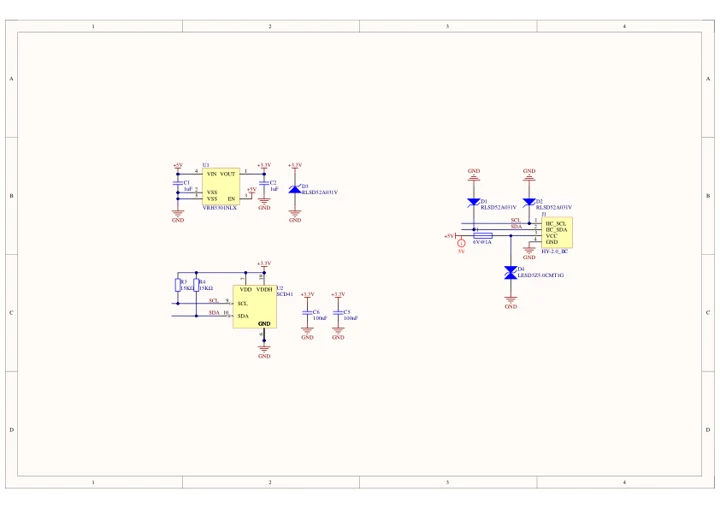

# Unit CO2L

**M5Stack** · Source collection

Revision: Unverified source identity

Coverage: Manufacturer references available; physical pinout and complete connector review are tracked separately

[Browse all manufacturers](../../../../BROWSE.md) · [Devices & IoT](../../../../DEVICES.md) · [Open in the browser guide](https://valleytech-black-wire-guide.pages.dev/?board=source-board-db86e14f80111eba4c)

## Datasheets and original documentation

Board datasheet: **not yet recorded**. Visual reference: **available**.

[Manufacturer model documentation](https://docs.m5stack.com/en/unit/CO2L)

- **schematic / board**: [Unit CO2L Schematics PDF — schematic](https://m5stack-doc.oss-cn-shenzhen.aliyuncs.com/591/SCH_UNIT_CO2L.pdf) · [saved document](../../../../library/media/9d4003297d964e0e2b9be58475f35ffdfde18a4597f3cdf5dd4a819f810f1348.pdf)

A chip datasheet, schematic and board datasheet have different scopes. Match the exact hardware revision.

[Documentation coverage and remaining gaps](../../../../DOCUMENTATION.md)

## Dimensions

**source reference** · Unreviewed source · PNG

[Open original reference](../../../../library/media/0275b1562b6c9b59f4c2305d628e3bffdfdc509b60bfdef1063dacd7b637500a.png)

**Credit and rights:** Source rights not yet established. Source/manufacturer: M5Stack.

[Source 1](https://static-cdn.m5stack.com/resource/docs/products/unit/CO2L/img-6c5b69c0-95f2-45c8-8c6e-468135afb953.png) · [Source 2](https://docs.m5stack.com/en/unit/CO2L)

Original source index: Dimensions. This file is searchable but has not been promoted to a reviewed physical board pinout.

Image revision: Not identified

SHA-256: `0275b1562b6c9b59f4c2305d628e3bffdfdc509b60bfdef1063dacd7b637500a`

## Unit CO2L Schematics PDF — schematic

**reference PDF** · Source model/link and PDF signature/title checked; individual pin assignments and electrical validation pending · PDF

[Open original reference](../../../../library/media/9d4003297d964e0e2b9be58475f35ffdfde18a4597f3cdf5dd4a819f810f1348.pdf)

**Credit and rights:** Original publisher/manufacturer artwork; redistribution and print rights not established. Attribution is not a license grant.. Source/manufacturer: M5Stack.

[Source 1](https://m5stack-doc.oss-cn-shenzhen.aliyuncs.com/591/SCH_UNIT_CO2L.pdf) · [Source 2](https://docs.m5stack.com/en/unit/CO2L)

Original document linked from this model’s manufacturer page. Preserve the document’s exact revision and named subassembly scope; a linked accessory schematic is not a whole-device pinout. This is a circuit schematic, not a physical board pinout.

Image revision: Use the revision printed in the original document; do not assume all hardware revisions are interchangeable

SHA-256: `9d4003297d964e0e2b9be58475f35ffdfde18a4597f3cdf5dd4a819f810f1348`

Pin assignments have not been independently electrically verified. Check board revision before wiring.
