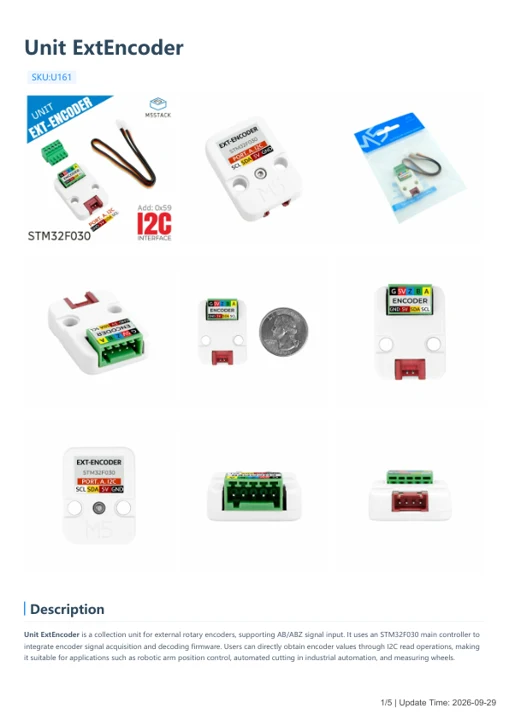
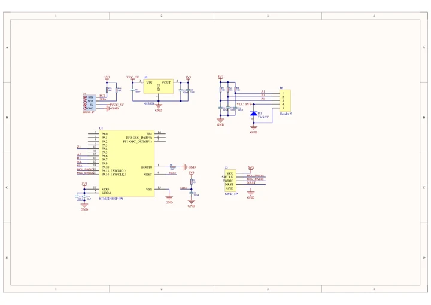

# Unit ExtEncoder

**M5Stack** · Source collection

Revision: Unverified source identity

Coverage: Manufacturer references available; physical pinout and complete connector review are tracked separately

[Browse all manufacturers](../../../../BROWSE.md) · [Devices & IoT](../../../../DEVICES.md) · [Open in the browser guide](https://valleytech-black-wire-guide.pages.dev/?board=source-board-57db784a8a3386d537)

## Datasheets and original documentation

Board datasheet: **not yet recorded**. Visual reference: **available**.

[Manufacturer model documentation](https://docs.m5stack.com/en/unit/ExtEncoder%20Unit)

- **hardware-guide / board**: [Unit ExtEncoder — manufacturer hardware guide](https://m5stack.oss-cn-shenzhen.aliyuncs.com/resource/docs/static/pdf/static/en/unit/Unit_ExtEncoder.pdf) · [saved document](../../../../library/media/db33345b8efe4ee5f2f350b0dfa2acde1c10873add1c842e38be82c8f9b40e92.pdf)
- **schematic / board**: [Unit ExtEncoder Schematics PDF — schematic](https://m5stack-doc.oss-cn-shenzhen.aliyuncs.com/616/SCH_UNIT_EXTEncoder.pdf) · [saved document](../../../../library/media/19fcf6ce7d85d11f5aa1f118ca911d842c11bc36d15777020a0d02b761b64cd1.pdf)

A chip datasheet, schematic and board datasheet have different scopes. Match the exact hardware revision.

[Documentation coverage and remaining gaps](../../../../DOCUMENTATION.md)

## Dimensions

**source reference** · Unreviewed source · JPG

[Open original reference](../../../../library/media/2ade64d0bda52f52453522b34884a9405b2db1f73e8057f381d7f1d1c37ffef4.jpg)

**Credit and rights:** Source rights not yet established. Source/manufacturer: M5Stack.

[Source 1](https://m5stack.oss-cn-shenzhen.aliyuncs.com/resource/docs/products/unit/ExtEncoder%20Unit/model%20size.jpg) · [Source 2](https://docs.m5stack.com/en/unit/ExtEncoder%20Unit)

Original source index: Dimensions. This file is searchable but has not been promoted to a reviewed physical board pinout.

Image revision: Not identified

SHA-256: `2ade64d0bda52f52453522b34884a9405b2db1f73e8057f381d7f1d1c37ffef4`

## Pinout

**source reference** · Unreviewed source · PNG

[Open original reference](../../../../library/media/dec98d2902c4697cce424d2e979db23511a23ff0ee6f60113b3245cb1d6cc700.png)

**Credit and rights:** Source rights not yet established. Source/manufacturer: M5Stack.

[Source 1](https://static-cdn.m5stack.com/resource/docs/products/unit/ExtEncoder Unit/arduinoCase-1683862277316pinmap.png) · [Source 2](https://docs.m5stack.com/en/unit/ExtEncoder%20Unit)

Original source index: Pinout. This file is searchable but has not been promoted to a reviewed physical board pinout.

Image revision: Not identified

SHA-256: `dec98d2902c4697cce424d2e979db23511a23ff0ee6f60113b3245cb1d6cc700`

## Unit ExtEncoder — manufacturer hardware guide

**reference PDF** · Source model/link and PDF signature/title checked; individual pin assignments and electrical validation pending · PDF

[Open original reference](../../../../library/media/db33345b8efe4ee5f2f350b0dfa2acde1c10873add1c842e38be82c8f9b40e92.pdf)

**Credit and rights:** Original publisher/manufacturer artwork; redistribution and print rights not established. Attribution is not a license grant.. Source/manufacturer: M5Stack.

[Source 1](https://m5stack.oss-cn-shenzhen.aliyuncs.com/resource/docs/static/pdf/static/en/unit/Unit_ExtEncoder.pdf) · [Source 2](https://docs.m5stack.com/en/unit/ExtEncoder%20Unit)

Original document linked from this model’s manufacturer page. Preserve the document’s exact revision and named subassembly scope; a linked accessory schematic is not a whole-device pinout. This is a hardware manual, not a separately classified board datasheet.

Image revision: Use the revision printed in the original document; do not assume all hardware revisions are interchangeable

SHA-256: `db33345b8efe4ee5f2f350b0dfa2acde1c10873add1c842e38be82c8f9b40e92`

## Unit ExtEncoder Schematics PDF — schematic

**reference PDF** · Source model/link and PDF signature/title checked; individual pin assignments and electrical validation pending · PDF

[Open original reference](../../../../library/media/19fcf6ce7d85d11f5aa1f118ca911d842c11bc36d15777020a0d02b761b64cd1.pdf)

**Credit and rights:** Original publisher/manufacturer artwork; redistribution and print rights not established. Attribution is not a license grant.. Source/manufacturer: M5Stack.

[Source 1](https://m5stack-doc.oss-cn-shenzhen.aliyuncs.com/616/SCH_UNIT_EXTEncoder.pdf) · [Source 2](https://docs.m5stack.com/en/unit/ExtEncoder%20Unit)

Original document linked from this model’s manufacturer page. Preserve the document’s exact revision and named subassembly scope; a linked accessory schematic is not a whole-device pinout. This is a circuit schematic, not a physical board pinout.

Image revision: Use the revision printed in the original document; do not assume all hardware revisions are interchangeable

SHA-256: `19fcf6ce7d85d11f5aa1f118ca911d842c11bc36d15777020a0d02b761b64cd1`

Pin assignments have not been independently electrically verified. Check board revision before wiring.
